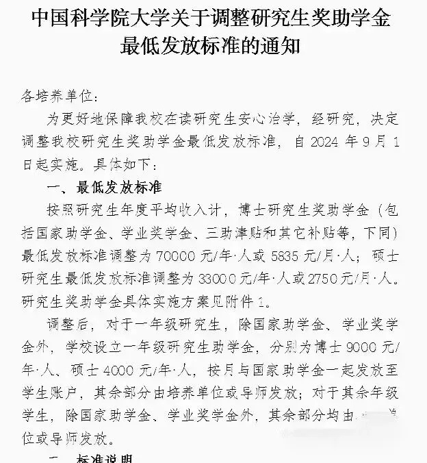

请相关部门及时关注并跟进问题。

## 1 奖助补费

## “有中科大的一半补助也好啊”

## 2 科研成果

## “投稿：今年的科研成果奖励什么时候发啊？学期都要结束了，证书也没见一张”

## “投稿:今年的科研成果奖励啥时候能发啊，焦急等待！都等待一个半月了”

## 3 宿舍

> “回复宿舍男女生混住：四号楼混宿，不止是混楼，还有混层。虽然规划是一二层是男生，其他层是女生，但是其他层也有部分男生。试想，在晚上同层看到异性，心里是怎么想法。而且向宿管反应过，答曰，你们是成年人。这个混住讨论的是学校制度问题，不是性别问题。学校要是想解决完全可以先解决同层混住的问题，不同层混住，混楼的可以等到毕业再调整。要的是学校的一个解决问题的态度和可行的方法。”

## “针对6.2最后一条留言：

1男女同楼的不合理安排是后勤造成的，如果搬家，应当由学校后勤负责搬运行李，而不应该是由这位女同学负责。这个道理，非常清楚。

2即使之前留言的女同学语气确实比较激动，但事实是，这种居住现状确实给女同学带来了不便。如果连这种“没有安全感”都丝毫不能理解，那也没什么好说的。非常典。

3各个高校由于资源有限，都保不齐会出站各别宿舍楼男女同楼的情况。怎么让所有同学都感到方便安全（特别是浴室不在宿舍的情况），本就是需要特殊考虑的情况，而不是简单让女同学“注意仪表”的问题吧。”

“学校就是正常换物业，昨天的同学哪来那么大戾气，换个物业还要经你同意呢？你是谁呀，笑死。

在此表扬新物业的无缝衔接，问了保洁阿姨，新物业公司给他们换了行头，工作时间和待遇上也没有因公司变更导致他们的不安，一切照常。

我就喜欢这种提前做好准备工作的无缝衔接，这在一定程度上体现了新物业公司一流的管理水平。希望看到你们高水平的管理成效，祝贵公司及员工在我校工作顺利！”

（见《[【读者投稿】基建生活问题不断 奖助补费呼声渐强](https://mp.weixin.qq.com/s?__biz=Mzg2MjcwNzQ1Mw==&mid=2247488505&idx=1&sn=5cbe6250d2293f9337d09683dc42984a&chksm=ce02986bf975117dd9e4c88f33bb58aa8000882649ab105d535da5e9b48b1c4b6743c2be5ec1&scene=21#wechat_redirect)》第4条）
