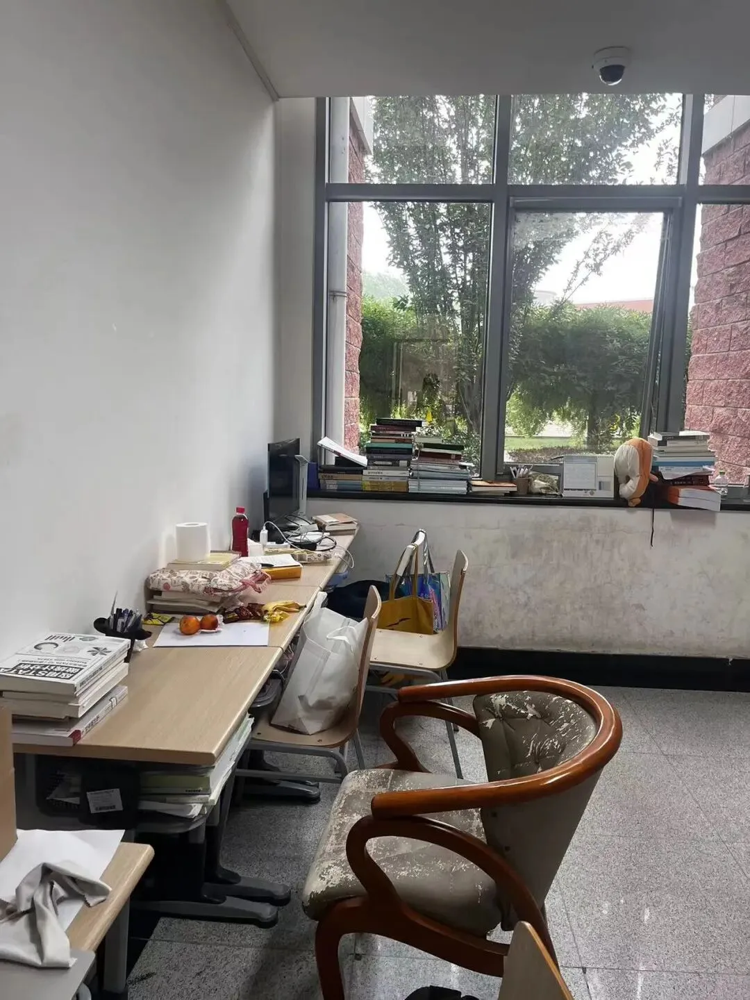

请相关部门及时关注并跟进问题。

## 1 校园网问题

“投稿，良乡的校园网太差了，听讲座都断断续续，钱没少充，奖助金不见涨，反馈这么多年，充耳不闻！”

## 2 教务问题

## “投稿：

说是下周选课，为什么这周到周三了还没看到课程信息的更新，仍然只有本学期的课程信息，没有下学期的。在前面不改革的时候，还能提前一两周出课程大纲，怎么越改越没有，越改越看不见？如果下周选课，是不是可以端午节前把已经修订好的课程教学计划上传到系统里，让我们先看看。而不是第十五周眉毛胡子一把抓。就这一个小事，提的同学、次数都不少了，怎么就还没做好呢？怎么就要拖拖拉拉呢？有的高校都选完课了，社科大仍然连课程信息都没有，这一天天的在干啥呢？”

## “投稿：本科课程管理问题

看到教务处发的新闻通稿，大致意思是又要修改培养方案了。我们记着教务处曾经有一个规定，大致意思是选修课如果多次开不起来就要进行整改甚至于调出开课计划。但是我们能够发现这项规定的执行并不很好，仍有不少学院的不少课程每学期（年）都开不起来，完了下学期还能继续排入课程页面。那么这个规定是形同虚设吗？

有的课经过多次检验确实是质量不行而且也非语言类等具有特殊性质的课，那么为什么还要不停的排这样的课？事实上，它增加了排课的工作量、挤占了教室，也妨碍了其他高质量课程的开设。本质是监管有问题。既然是教学质量提升年、既然面临本科合格评估，那么理应对开设的课程进行核查。除了特殊性质的课程外，如果多次无法开设，就应勒令暂停开设、以儆效尤，而不是听之任之。既然要修订培养方案，那就应该看一看什么样的课几乎从来就无法开设、什么样的课评教屡屡不佳。如有这种情况，这门课就应该暂时挪出培养方案（除非特殊课程，比如语言类），不能为了数量、丢了质量。

还有一点，我们不管怎么样改革，不谈提升问题，最基本的是把已有的东西落实好。上文谈到的是质量不高的问题，与之相对的是空有名头、不见落实的问题。一门课列到培养方案里来了，但不能按时开设、甚至于不开设，那么这样的东西只能是自欺欺人，没有意思。所谓的本科教学规范，第一步就是把该做的做好，是第几学期上什么课就排什么课（当然可以根据要求添加）。即使有极特殊的情况不能按时排课，那是否也应该最迟下个学期及时补救，而不是一拖再拖，最终不了了之了。教务部门应当有这个相关的规定，要求各个系、学院按时开课，即便有极为特殊的情况，那也应该面向学生做出说明以及在适当的时候进行补救。所谓规范，不是要开多少会、站着上课还是坐着上课，而是从关乎根本的细节处做起。

前一阵社科院开大会要治理“散”的问题，上述说到的水课问题、培养方案落实不到位的问题何尝不是教学领域中“散”的表现呢？管理部门应有治“散”的勇气、方略来维护好来之不易的科教融合成果，这才能更好的面对所谓的各种评选评估。”

## “社论君你好，我想投稿:

请问教务处为什么期末考试有的学院两门课之间隔5-7天，这真的合理吗？以及为什么非要在晚上考试？？课程安排在晚上是因为老师只有在晚上才有时间上课，但是考试又不需要任课老师出席，为什么还要安排在晚上呢？

请教务处的老师仔细考虑一下考表中间为什么隔这么长时间以及为什么在晚上考试。同一年级有的学院竟然比我们学院早考完一周，请问为什么非要在哪一天上课就在哪一天考试呢？

恳请老师重新考虑考表安排，不要每学期反应了都不听，把时间拖得很长，这样同学们很疲惫，很烦。

请立刻解决！不要踢皮球！谢谢！”

> “教务处不应该在发布考表前就充分了解教师学生的意见建议吗？本来发布考表时间就很晚了，却还因为部分意见建议撤回考表，为什么政策是可以撤回的？属实不理解这种办事流程”

## “社科大教务改考表算怎么回事呢？事前干什么的 排出来之后再改真的双倍ex”

## “好一个目前确定啊”

## 3 自习空间

## “研究生教学楼的走廊位置是专门设来做固定位置的吗？怎么哪里都有安家的人啊”

## 4 班车管理

## “投稿:

五棵松到学校的班车，好几回出现没有整点到达的情况，甚至有些时候不会来，今天的情况更是让人生气，到五棵松的时候连停都没停一下就直接开走了，社科大没有直通社科院的班车就已经让人觉得不可思议了，大家迫不得已去五棵松那一站坐车回学校，现在连这个都不能保障！我的建议是如果办不好就不要办了！

还有，通勤车值班室的电话，永远都打不通！”

> “您好，想反映一件事，2024年6月5日五棵松的摆渡车没有按规定停靠，我们四个人在公交车站牌等车，就在摆渡车旁边，司机连等一下都没有就走了，导致我们只能走回去，请问现在班车不管学生的死活吗？打电话态度也不好，经常遇到这种事情。希望能有进一步的处理措施。”

## 5 宿舍

“就宿舍问题。前两天在社论上义愤填膺的某女生，我想和你说明一下，你只能代表你自己，不能代表所有女生。别左一个女同学，右一个女生的，你做了调查吗？了解了大家的想法吗？大家都是博士，都有脑子的，你有什么资格替所有女同学说话呢？你的建议值得被采纳吗？这都是需要被思考的问题。”（见《[【读者投稿】生活问题多有讨论](https://mp.weixin.qq.com/s?__biz=Mzg2MjcwNzQ1Mw==&mid=2247488518&idx=1&sn=d40c88086077bb31d76375f60dafb310&scene=21#wechat_redirect)》第2条）

## 6 补助问题

“投稿:关于提高奖助学金数额的事，能否大家共同编写一份关于提高博士生奖助学金的建议书，包含诉求、理由、可行性分析。然后请学校召开专题校情会议，或者官方部门公开回应，是否可以在国家基本补助1250元的基础上，由校方出资，增加补助金，以及能否将博士生最低奖学金提高到10000元，用以覆盖学费。

如果可行，能否请学校结合学生的意见，出具更详细的报告给院部，请求增加部门预算，或者由学校自行整理现有经费，提高奖助学金金额。”

（见《[【读者投稿】生活问题多有讨论](https://mp.weixin.qq.com/s?__biz=Mzg2MjcwNzQ1Mw==&mid=2247488518&idx=1&sn=d40c88086077bb31d76375f60dafb310&scene=21#wechat_redirect)》第1条）
