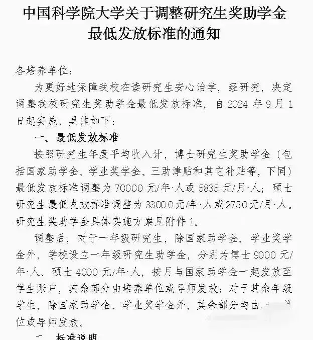

请相关部门及时关注并跟进问题。

## 1 补助问题

> “不比不知道，一比吓一跳！读到博士大家也都老大不小了，各有各的经济压力。请问学校博士生一个月1250是不是有点太少了？能不能像号称兄弟院所的中科院看齐啊？咱们的博士生补贴不能还不如人家的硕士生吧？？！”

“欲强一校之学术，不可不强一校之学生。欲强期刊，必强学生；欲强学生，必强补助。重赏之下，必有勇夫。无薪无奉，核刊不出。

是不是有的同学，为了自己的理想与信念，甘受贫穷，主动选择读博的道路？他们不敢找家里要钱，因为家里人会反问他：“你考博不是你自己选的吗？别人硕士毕业出去挣钱了，你呢？”他们只好默默忍受，继续在一食堂吃糠咽菜，含泪骂道：“他奶奶的，凭什么人家就比我们钱多呢？”

是啊，凭什么？我们的学生就比别的学生差？是我们的学校不好，还是我们学生不好？请校领导们去图书馆看一看吧，吾校之莘莘学子是否对得起各位老师的栽培，是否对得起学校的栽培？肯每天去图书馆的，哪个不努力，哪个不用功？那些个座位近乎变成了他们的专属，不是因为他们霸道，而是因为他们肯吃苦！这样的学生，难道不配你们想想办法多拨点款给他们？

常有高校老师、这个委员那个委员呐喊，在不同的平台、场合、空间呐喊。不说为民请命，最起码真诚地发出了对学生们的同情。我们也需要这样的声音，同学们，不要放弃斗争，只要在这个学校里一天还有“社科大跟国科大不能比”的搪塞，就一天不可能实现补助的提高。

坚持呐喊，总有一天，社论会推向更大的范围去。东风第一枝，莫待风来花枝颤，始信人怨变寒冬。”

（见《[【读者投稿】目前确定的管理问题](https://mp.weixin.qq.com/s?__biz=Mzg2MjcwNzQ1Mw==&mid=2247488526&idx=1&sn=205a8ced4e0c383031805b926e60b759&scene=21#wechat_redirect)》第6条）

## 2 教务问题

“请教务处把考试时间往后分散一点，课程本来就多，再安排这么紧凑，怎么复习的完？学生学不好，那考试又有什么意义？”

> “建议教务处安排一次投票，决定要不要安排复习周。有些同学课程量大，考试多，时间太紧了；有些同学一心只想着早点放假，大概是不重视绩点。所以建议教务处发个投票看要不要安排一个复习周，不要听信一家之言。”

（见《[【读者投稿】目前确定的管理问题](https://mp.weixin.qq.com/s?__biz=Mzg2MjcwNzQ1Mw==&mid=2247488526&idx=1&sn=205a8ced4e0c383031805b926e60b759&scene=21#wechat_redirect)》第2条）

## 3 学术氛围

“点赞应用经济学院公众号运营，学术氛围肉眼可见越来越好了，学院内科研成果也更新及时”

## 4 校园基建

## “学校穷成这样了吗？黑乎乎的”

## 5 宿舍

> “学校的吹风机房不知道是哪个天才想出来的，一点都不透气，每次进去都有一种让人窒息的感觉。像蒸桑拿一样。一点缝隙都不留。如果前一个同学用的是热风。进去里面更热的难受。建议相关人员进去感受一下。”

“之前被人吐槽说周周查宿舍像高中，现在好了，连高中都不如，高频率、有规律的检查也做不到，开始搞突然袭击那一套了，想起来哪天查就哪天来咣咣敲学生的门！干什么！当自己家厕所呢想什么时候进就什么时候进！学生在学校住宿是欠谁钱了？怎么就这么看不顺眼呢？

别老让学生“体谅一下”、“理解一下”，后勤部门安保部门能不能偶尔体谅一下、理解一下学生！你们就是这么做工作的？都脱离群众到什么地步了，对得起自己的党员身份吗？

每周突击入户检查又是哪个大聪明想到的新主意？祝您家庭和睦，幸福美满”

## 6 图书馆

> “投稿！良乡校区图书馆，可能因系统升级等原因导致座位预约时间的变动，这大家都理解！但能不做事情认真点儿?说好的中午十二点准时开放呢？最近几乎没有准点过，你们准时12点是几点啊?12:08也算的话，那12:58也是不是算12点?原先都能做到准时12:00现在为何不行了了呢？学生们的时间不是时间吗？因为你们的不确定导致了学生们的等待时间太长，这样消耗学生时间，你们觉得合适吗？还望相关老师能认真处理一下这个问题！”
