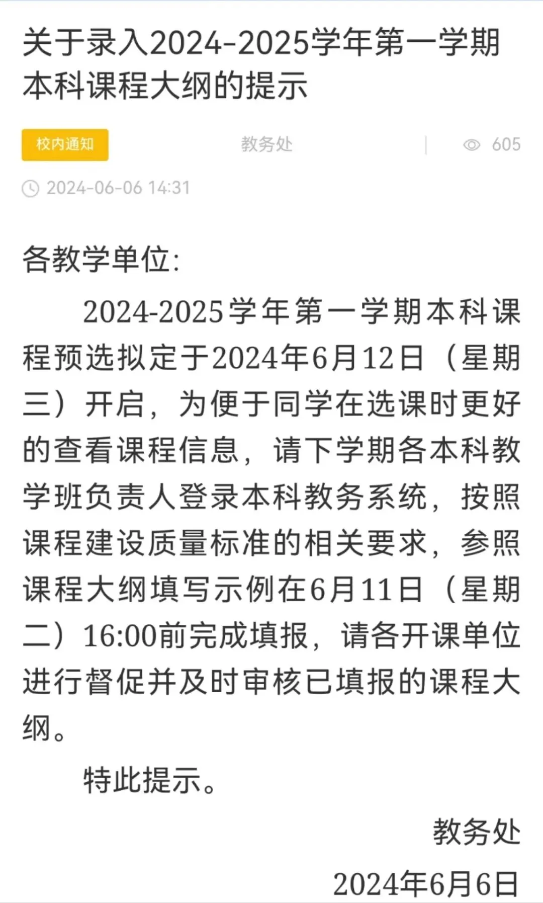

请相关部门及时关注并跟进问题。

## 1 图书馆

“附议空调那条，有些同学真的很奇怪啊，中了26°魔咒吗？因为空调老化等原因，26°一点不凉快也就算了（有新空调的教室除外），这晚上外面温度都24°左右，这空调还非要调到26°，室内比室外还热，合理吗？

当然了，人的体质各有不同，温度不能太低，但也不能完全不制冷，甚至有保暖效果吧？如果连正常的制冷都受不了，大可以多带一件外套，或者开一会关一会，稍微调节一下，而不是让整个屋子的人陪着你“暖洋洋”。”

（见《[【读者投稿】生活问题多有讨论](https://mp.weixin.qq.com/s?__biz=Mzg2MjcwNzQ1Mw==&mid=2247488518&idx=1&sn=d40c88086077bb31d76375f60dafb310&chksm=ce029f94f9751682ca01017728d20c6f043d07391868bb7f4310603bb49b05ff2c9480a42dd1&scene=21#wechat_redirect)》第5条）

## 2 宿舍

## “投稿！赶紧取消宿管突击检查吧！真不懂突击检查意义何在？”

“良乡校区八号楼以后给本科生住，硕士就注定去抢那个上床下桌和上下铺了是吗？老师是一点感受不到上下铺多影响休息是吗，设施都没准备好忙着扩招这么缺钱吗学校？”

（见《[【读者投稿】无薪无奉 核刊不出](https://mp.weixin.qq.com/s?__biz=Mzg2MjcwNzQ1Mw==&mid=2247488540&idx=1&sn=ab15e95e8a378911ff048fccd3905600&chksm=ce029f8ef97516987c7643462802abf5a28e27cf7915e804058a4f02587d954995b80594e92a&scene=21#wechat_redirect)》第5条）

## 3 教务问题

> “教务处这通知也挺有意思的，又把填课程大纲的通知发了一遍，问题是我们希望的是能够先把所有课程公布出来然后再填大纲。比较好的方式是老师填报、审核一门课的那我们就能在系统上看到一门课。不必要非得等到所有课都交了大纲我们才能看到是吧？这就好比原来的教务处官网页面，所有课程大纲都列在那，没交的会显示“待提交”。这多好的，没必要非等到周二或者周三。”

（见《[【读者投稿】无薪无奉 核刊不出](https://mp.weixin.qq.com/s?__biz=Mzg2MjcwNzQ1Mw==&mid=2247488540&idx=1&sn=ab15e95e8a378911ff048fccd3905600&chksm=ce029f8ef97516987c7643462802abf5a28e27cf7915e804058a4f02587d954995b80594e92a&scene=21#wechat_redirect)》第2条）

## 4 奖助补费

## “兖兖诸公,夜哭到明,明哭到夜,能让补贴涨一分否？”

## “好消息：研究生补助涨了！

坏消息：不是社科大…”

“最近补助一事讨论非常热烈，问题发酵至今，校方应该充分认识到补助问题不再是是否需要涨的问题、而是需要涨多少的问题，尽早就此事展开调研与讨论，才是更符合各方利益的明智抉择。

社科大补助过少需要上调，早已不是一个有待讨论的问题，而是板上钉钉的事实；针对这个事实，也不会有人有其他想法。这类问题是每个人最切身最基本的问题，很多问题也许有不同视角，这个问题却只会一眼直观。这也是为何为了呼应这个问题的解决，大家将会乐意自己调动自己。

那么，较之于漠视这个问题，选择尽早通过各类方式达成各方都可以接受的补助上调合理份额才是合理的选择。除非社科大停止硕博招生，否则这个问题就不可能被搪塞过去，反而问题拖的越久，最后的结果就会越发难以预料、难以接受。相信校方也并不是想给人以一种吃定了大家就这个问题没有进一步行动的猥琐之感。必须要提醒的是，大家之所以还在反映这个问题，是因为大家还乐意反映这个问题。如果拖到大家觉得这个问题没有必要再去以现行方式进行呼吁的时候，会发生什么？可能失去的就只有锁链了吧。从这个角度来看，现在算是一个“窗口期”，现在各方高高兴兴地展开讨论、高高兴兴地达成共识，并不算晚，大家都比较体面，校方也可以落得一个接纳合理诉求的雅名。

有人可能会有疑问，学校是否存在财政紧张的问题？的确是，但不足以成为苦一苦补助的理由，因为学校并非拨不出补助的那点钱。凡事都想着苦一苦教职工学生，这个问题背后实则潜藏着这所学校的大弊病，那就是制度建设落后与管理能力低下的问题。制度建设落后在监督者与被监督者之间制造了巨大的信息黑箱、并且使得监督者无法理解专业的问题，从而无法进行有效的监督，让被监督者的自行其是成为了“最好的安排”。管理能力低下则导致校方安排漏洞百出，根本无法做出最好的安排。既然没有趁手的工具又没有会使用工具的脑子，导致学校一天天烂下去。毫不客气的说，这样的结果就是学校其实在各个层级都存在着普遍的权力寻租与腐败自肥现象，学校管理千疮百孔，学校建设既发不了力、并且又建设不到点子上。换言之，家底本来就不算多、还因为制度建设与管理效能低下而被分完了，最后有效资源分配非常微薄，那么大家能看到的显性表现就是“烂”，目力所及都烂完了，问什么都说没有资源。而校方为了掩盖某些事，就选择在一些事情上发力作妖，去折腾大家以转移注意力。可惜这种折腾除了让人内耗以外并不能带来比如学术水平提升这样的增量，那么学校最后综合来看就只能告诉每个人“烂完了”。

好的制度建设，应该能够最大限度消弭而非制造信息差、保证一个有基本理解力的人可以在获知专业人士观点的基础上进行判断；高水平的管理则知道什么去管理什么、什么不应该管理什么。针对这些问题，肯定会有在各领域内更专业有才智的社科大人在自己的领域内给出更为得当的规划，在此就不班门弄斧了。

而说到底，制度建设落后和管理能力低下则是一个问题的一体两面，这个问题就是能不能各司其职、各尽其能的问题，或者说社科大是不是教职工学生、校方人员等等所有把自己视为社科大一份子的社科大人真正当家做主的问题。如果这个问题在现行大环境下能有一个好的回答，其实就是学校制度改革探索成功了、校方管理效能提升显著了。”

## “相声《我要补助》

甲：又到了毕业季，真是几多欢喜几多愁。

乙：这话怎么说？

甲：找工作难呀。

乙：这倒是真的。

甲：就拿咱们学校招聘会来说吧，上次在图书馆支一摊，我也过去看了。

乙：有看上的吗？

甲：挑来挑去没几家心仪的单位，看有个摊儿人少，我就过去了。

乙：怎么样呢？

甲：我看了他们的告示，指着第二行那个说，我想报。

乙：有合适的呗。

甲：结果那大哥摆摆手，说从第五行往下看。乙：为什么？

甲：大哥说一、二、三、四是给九八五、二幺幺、一流大学、一流专业看的。

乙：这不是歧视吗？

甲：可不嘛，我就问大哥，你是来干嘛的？你不知道这儿是哪儿吗？

乙：是啊。甲：大哥白了我一眼，知道我这儿为啥人少了吗？

乙：得，甭问了。

甲：我说你们这是歧视啊，清北的毕业生是毕业生，我们就不是毕业生了？

乙：对啊。甲：大哥说，有些时候，确实先考虑双一流，后考虑社科大。

乙：瞧这口气。

甲：我说那什么时候能优先考虑社科大，后考虑双一流呢？

乙：是啊？

甲：大哥白了我一眼，说——选丐帮帮主的时候。

乙：嘿，挺合适。

甲：我说算了，咱学校招聘不行，去别的学校看看吧。

乙：出去瞧瞧吧。

甲：结果就来到了某文科强校，双选会上人山人海，我背着个帆布包在四处游荡。

乙：赶上好事儿了吗？

甲：你还真别说，到那儿就被一学妹要微信了。乙：就你？还能遇见这好事儿？

甲：可不嘛，老漂亮一小姑娘，非缠着加我微信。

乙：怎么就单看上你了呢？甲：我也好奇了，我说姑娘，茫茫人海之中，你怎么就非要缠着我加微信呢？

乙：是啊。

甲：学妹说，我看见你帆布包上印着社科大。乙：咱们学校这么灵？

甲：是啊。我还以为她喜欢我人呢，合着是冲着学校来的。

乙：是想考咱们学校研究生吗？

甲：不是。人家是来做调查问卷的。

乙：什么调查问卷？

甲：我也问了，我说姑娘，你是学心理学的吗？姑娘摇摇头。我又问，你是学社会学的吗？姑娘又摇摇头。

乙：那是学什么专业的？

甲：贫困经济学的。

乙：嚯，真找对人了。

甲：这微信不能白加啊，我就看她朋友圈有没有好看的自拍。

乙：三天可见？

甲：一条线。

乙：嗐！

甲：个性签名写着，九八五硕，斜杠斜杠，征男友，斜杠斜杠，四非勿扰。

乙：怪不得对你一条线呢。

甲：我寻思哥们儿这国内也没法混了呀，出国找工作吧。

乙：润吧。

甲：结果钱不够。

乙：怎么不够呢？

甲：你算，我一个月一千二百五，托福课四万，考试费两千，机票六千。合着我四年的补助将将够。

乙：那还是够呀。

甲：我上托福课，在海淀，不要通勤吗？乙：是远了点。

甲：通勤不花钱吗？

乙：都得花呀。

甲：那咱是不是省着点？

乙：怎么省呢？

甲：这一到冬天的时候，我就找一套长羽绒服，来良乡站，到门口先蹲下，走鸭子步过安检。

乙：为什么呀？

甲：一米二以下免票。

乙：至于吗！

甲：被保安逮着好几次，就为了省七块钱。乙：七块也不贵呀。

甲：你不能算这个，我进城吃不吃饭？喝不喝水？晚上回来是不是还得七块？

乙：这倒是。

甲：这钱肯定不够。

乙：那怎么办呢？

甲：找亲友借了两千块钱，可算是出去了。乙：能出去就行。

甲：结果排半天队到大半夜，刚出机场，就遇见抢劫的了。

乙：这么倒霉？

甲：我们好多留学生，排着队不让动，挨个搜身。衣服、钱包里所有东西都得倒出来。前面的几个男生，衣服都扒干净了，穿着个大裤衩子才肯放他们走。

乙：够干净的。

甲：到我的时候，大哥先搜我钱包，摸到一块硬币，拿灯下面一照，是社科大校徽。

乙：这玩意儿不值钱。

甲：结果大哥看见校徽哭得稀里哗啦的。

乙：看见它哭什么啊？

甲：是啊，大哥开口就用中文说社科大学生穷，不容易。他说他也看人文之光社论的。

乙：这大哥挺懂啊。

甲：大哥说什么也要塞给我两百美元，还叫了辆车把我送走了。

乙：这比你一个月补助都高。

甲：在国外奋斗十年，自己开办了企业，终于有钱了。

乙：可以回国了。

甲：回国第一件事，先给社科大设立个奖学金。乙：好事啊。

甲：正好赶上校庆，受到了领导们的亲切接见，我就问十年来学校发展怎么样？

乙：那不得是沧桑巨变？

甲：领导说学校势头发展好啊，宿舍环境发生了巨大的变化。

乙：什么变化呀？甲：博士两人间全改成四人间了。

乙：那住得下吗？

甲：扩招嘛，没办法。我问补助涨了吗？

乙：这是关键的。

甲：领导说还是一千二百五。乙：十年了，不带涨一点的吗？

甲：我说得给他们涨啊，涨一块钱也是涨啊。领导犯难了，说这钱从哪儿出呢？

乙：对啊。

甲：我说我呀，有一个办法。咱们牺牲一个人，幸福全学校。一届学生一千多人，把他的补助每个月分给大家，大家就都能多涨一块钱。

乙：牺牲谁呀？

甲：谁地位低就牺牲谁。

乙：那谁地位低呢？

甲：说相声的地位低。

乙：那咱俩都是说相声的呢？

甲：（一脱大褂）我现在不是了。

乙：去你的吧”

（见《[【读者投稿】无薪无奉 核刊不出](https://mp.weixin.qq.com/s?__biz=Mzg2MjcwNzQ1Mw==&mid=2247488540&idx=1&sn=ab15e95e8a378911ff048fccd3905600&chksm=ce029f8ef97516987c7643462802abf5a28e27cf7915e804058a4f02587d954995b80594e92a&scene=21#wechat_redirect)》第1条）
