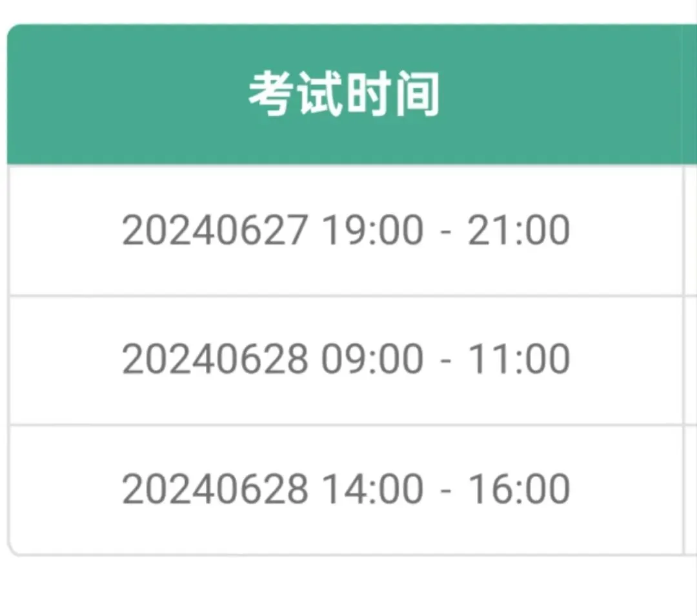
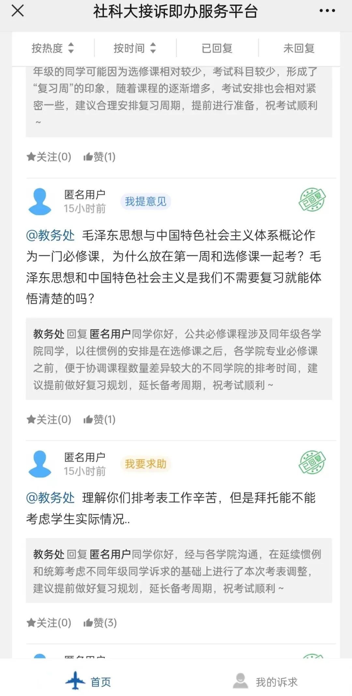
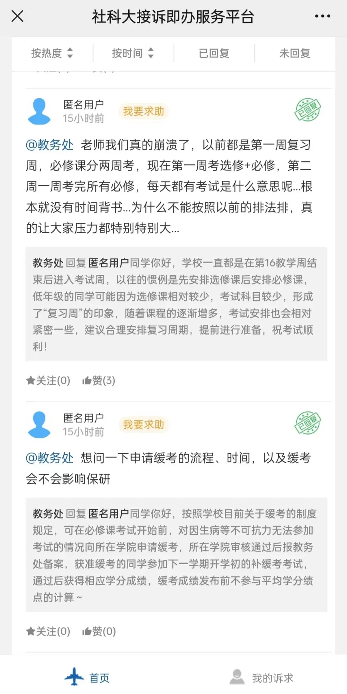
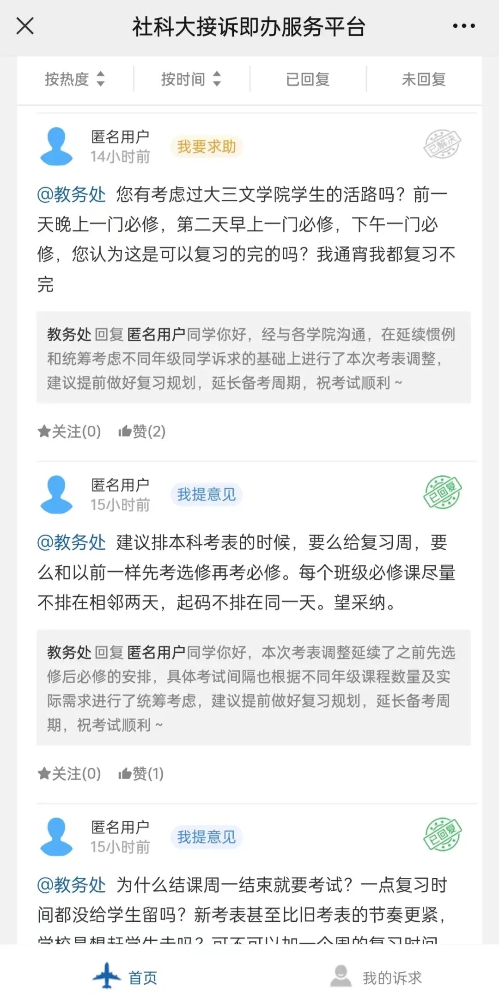
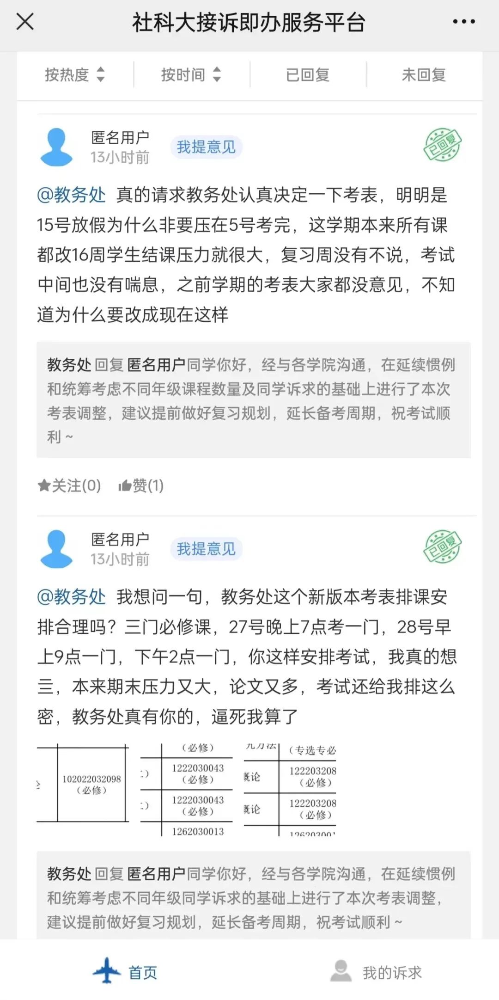
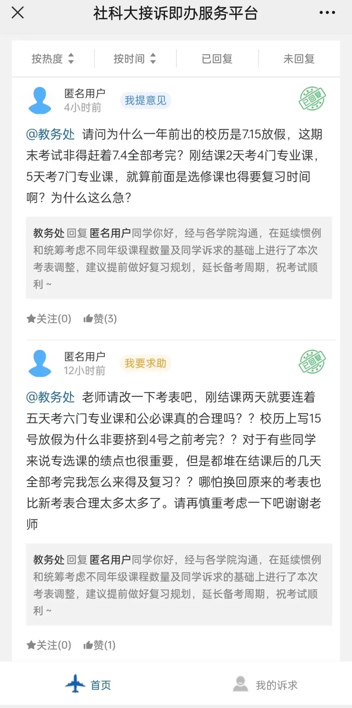
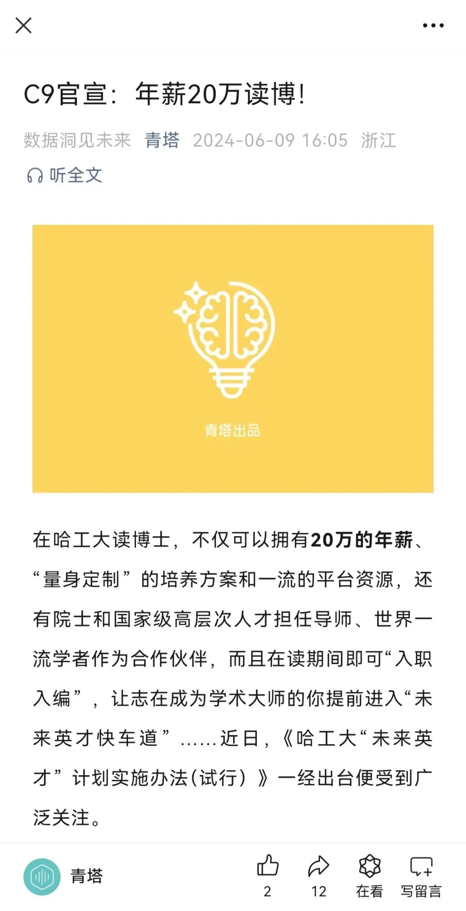
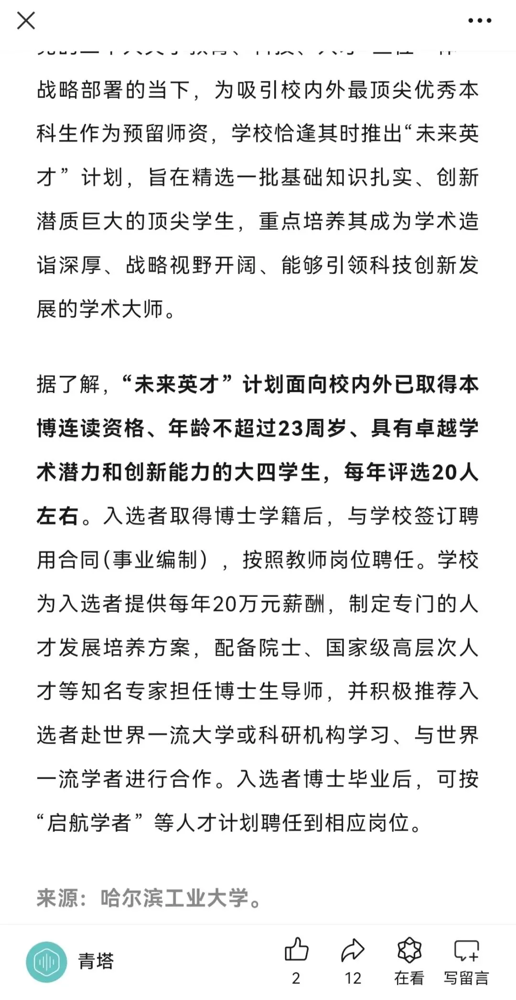

请相关部门及时关注并跟进问题。

## 1 教务问题

> “（良乡校区） 我真的很好奇教务处的老师们都是怎么排考表的，第一次发出来就撤回朝令夕改就算了，后面发的新考表更是成功让所有人不满意。老师们是没上过学吗？没有一点复习时间，结课周之后立马就开始考试，考试之间拍得特别紧，紧锣密鼓地考完让学生赶快滚蛋？我觉得大部分人相比于赶快放假回家更希望在充分复习完后稳重地考完试不留遗憾吧。”

“想问教务处：因为部分同学的意见而修改考表，是否考虑到了别的同学会不会受此影响？改考表是这么随随便便，不需要全体咨询意见的吗？”

> “投稿：我承认原本考试时间有一些抽象，我在1号考完后要在8号考最后一科，我承认那个时候我非常的不满。但是等我看到了新的考表，所有对原本考表的不满都烟消云散了，新的考表把我屈指可数的科目平摊在每一天，原本只用折磨5天，现在是从25号到8号的每一天，摊平了，这是很绝望的，原本的时间在新的考表下显得格外美丽，熠熠生辉，同样是25-8，原来的时间下我甚至能休息两天，在新的表下，我直接连轴转，我感谢教务处给我一个进行对比的机会，让我知道什么叫没有最差只有更差”

## “文学院新考表，不知道行政是干什么吃的，不多评价了。”

## “接诉瞎办。合理怀疑行政的老师是不是都是没考上研的合同工，来这儿报复学生来了。”

## 2 校园文化

## “校歌好难听啊，无法能对这学校产生归属感。

之前有同学在群里说来着，学校就是装死没消息，也不改”

## 3 食堂问题

“投稿！一食堂二楼筷子机里的筷子一股捂了的抹布味道！不是个例，拿了好多双都是这样！已经连续两天啦！请处理一下这个问题！”

“关键是为啥我买不到？ 不是有没有的问题 是投放量的问题 我不想去二食堂 多贵 没钱”

（注：该稿昨日漏刊图片，故重刊）

（见《

【读者投稿】抠抠搜搜过日子 每天只吃一食堂

》第3条）

## 4 补助问题

> “请自诩建设世界一流文科大学的管理层看看，对比一下与外校的差距。哈工大读博年薪二十万，社科大能不能达到3W？最起码也应该先达到别人的十分之一，即20000块。哈工大比我们更有title、政策支持，况且下血本建设一流大学，我们呢？天天苦着学生，硕博生吃不好穿不好，一个月只能靠一食堂维持生命，捡拼多多的衣服穿，太苦了，怎么能出的了大成果？”

（见《

【读者投稿】抠抠搜搜过日子 每天只吃一食堂

》第2条）
