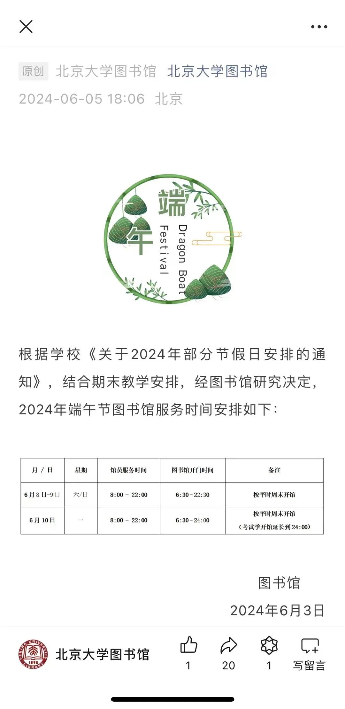
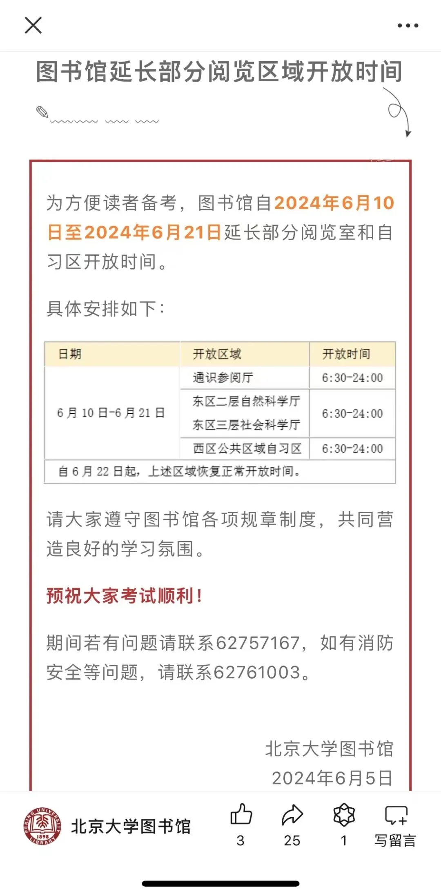
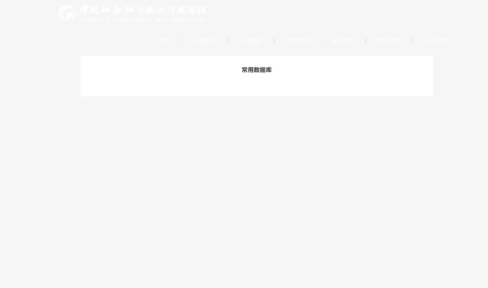
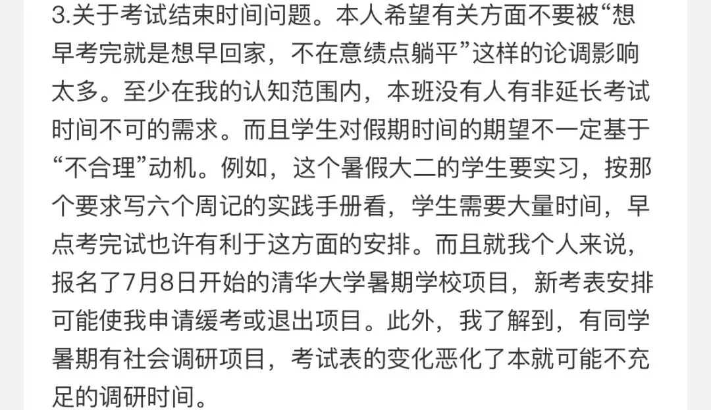

请相关部门及时关注并跟进问题。

## 1 图书馆

## “附北京大学图书馆 我只发 我不想说话”

## 2 校园网问题

## “投稿良乡校区

学校这网连打开学校图书馆官网都要等上一等哦，微信发个图片也要转半天，这还是端午在校人少一点的情况下，真不知道一天天更新都更新了个啥，社科大还真是干啥啥不行啊”

## 3 校园文化

> “吐槽校歌的同学真是够了，不喜欢你可以离开。人文之光是一种信仰，岂能以你个人的不喜欢更改？而且这种歌曲只有在开学典礼毕业典礼这种非常有仪式感的场合唱，你认为的好听就是好听吗？你想让什么歌当校歌呢？真是的吃饱撑的太闲了。”

（见《[【读者投稿】教务安排争议巨大 生活问题热议持续](https://mp.weixin.qq.com/s?__biz=Mzg2MjcwNzQ1Mw==&mid=2247488632&idx=1&sn=4e8a296c5f3a21e7185eab568fefef55&chksm=ce029feaf97516fc5175357deef5eaed89204358398a1856e93932daaf039439b621a3cf9fc5&scene=21#wechat_redirect)》第2条）

## 4 教务问题

“投稿接诉即办的这一条。按照校历的安排，学校本来就是在15号放假，你们的暑期学校和社会实践在报名时就应该考虑到时间问题，别告诉我你们是在15:57看到考表后立马进行申请并在18:00考表撤销这短短两小时之内对方单位通过了你的申请😅

要么代表自己，如果要代表其他人，请拿出调查问卷结果和统计数据。另外，请不要身边统计学，你身边没有，不代表别人没有需求。”

> “请学校各部门停止因为小部分的不满而随意地出台损害大多数同学的政策的行为。每次一被骂就改，你能确定是大多数人都在骂吗？你调查过所有人的意见吗？你们每次收集意见的渠道是什么，为什么从来不公开？难道是通过朋友圈吗？那有不满的人当然发朋友圈了，满意的人又不会发。”

“新考表有人不满意，旧考表也有人不满意，还有人两个考表都不满意，要不还是恢复原来的三个周考试吧，至少以前没有这么大的争论

另外，附一句程序员的经典名言：代码只要能跑就不要动！”

## “投稿：揣着明白装糊涂的教务处

教务处自己有没有反思过一点点，为什么每学期课表、考表都这么挨骂？考表骂的人很多了，我们再说说课表和课程大纲的问题。

本来在教务处官网上显示的课程大纲是以22级培养方案为基础设置的，经过一年的填报、磨合已经是相对完善的页面。不仅能够查询到本学期开的课程，还能够看到下学期的课。但这个页面被新系统取代了，可问题是新系统弊端重重。一个是不能覆盖之前学期的课程大纲，一个是学生也不能进行下载。更重要的是，填报迟缓而且不能及时更新。

看接诉即办和社论上的各种反映情况来看，大家只不过是想在选课前看到课程大纲页面，这很难吗？这很难吗？为什么这个工作非要拖到选课的时候呢？前面大家要求端午节前上线这个功能，教务处无视了这个诉求。那退一步，是不是节后第一天（周二）可以出呢？是这个诉求不合理吗？我觉得不是，之前都能做到的事情现在却做不到了。这就不是能力问题了。办事要讲效率，教务处排的课表要求我们晚上考试，我们是不是也可以要求教务处及时推出新学期课程大纲栏目，而不是在这揣着明白装糊涂。”

（见《[【读者投稿】教务安排争议巨大 生活问题热议持续](https://mp.weixin.qq.com/s?__biz=Mzg2MjcwNzQ1Mw==&mid=2247488632&idx=1&sn=4e8a296c5f3a21e7185eab568fefef55&chksm=ce029feaf97516fc5175357deef5eaed89204358398a1856e93932daaf039439b621a3cf9fc5&scene=21#wechat_redirect)》第1条）

## 5 奖助补费

“提高研究生群体补助已成为施一公等多位专家学者的共识。作为人文之光的学校，希望我校领导能尽快制定出详细方案，让广大社科学子心有所安！”

## “投稿《社科表》

研究生院创业未半而中道改组，今就业紧张，市场疲弊，此诚危急存亡之秋也。然小院之生不懈于内，鸿儒大士忘身于外者，盖追往昔之荣光，欲报之于社科大也。诚宜开张广听，以光社科遗德，恢弘志士之气；不宜妄自菲薄，引喻失义，以塞忠谏之路也。（注：特指“社科大跟国科大不能比”）

所中校中，俱为一体，修学授位，不宜异同。若有获学位于各所者，宜盖章明其院所之身份，以昭我校平明之理；不宜怠惰，使异于国科大之法也。（注：毕业证注明院所，势在必行，尽早实现，不要让更多学生留遗憾）

超市、物业研缘、新宇等，此皆良实，志虑忠纯，是以简拔以遗学子。愚以为校中之事，事无大小，悉咨学生，然后施行，必能裨补阙漏，有所广益。

研究生院，性行淑均，晓畅学术，试用于昔日，必称之曰能，是以众议举社科为智库。若能出资赈生，立财济学。必能使校生和睦，优劣得所。

厚补助，薄基建，此九八五所以兴隆也；厚基建，薄补助，此社科大所以倾颓也。往届前修在时，每与臣论此事，未尝不叹息痛恨。补助、奖金、经费、薪资，此悉立校强生之本，愿先达思之审之，则社科大之隆，可计日而待也。

臣本布衣，刷题于小镇，苟全应届生身份于当世，不求闻达于九八五。导师不以臣卑鄙，录于社科大籍中。由是感激，遂许导师以驱驰。后值在读，治学于穷困之际，果腹于食堂之间，尔来多年矣！

入学以来，夙夜忧叹，恐托付不效，以伤导师之明；故深耕项目，论文频出。今校名已定，师资已足，当奖率学子，提升补助，灭贫消忧，两入双一，兴复社科，还归一流。此臣所以报学校而忠导师之职分也。至于斟酌损益，进尽忠言，则应多察社论，闻听学生之意见。

深夜造篇，临表涕零，不知所言。”

（见《[【读者投稿】还是一千二百五](https://mp.weixin.qq.com/s?__biz=Mzg2MjcwNzQ1Mw==&mid=2247488553&idx=1&sn=34b0d4ae20b4387782a765be758ff418&chksm=ce029fbbf97516ad2577b636b23604a69c8c405a0692624fb348905061a0c4cdb0a2af1d9e61&scene=21#wechat_redirect)》第4.4）
