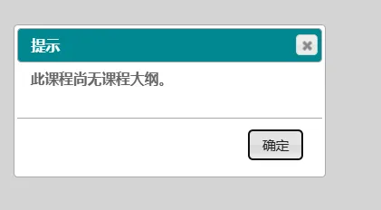

请相关部门及时关注并跟进问题。

## 1 食堂

> “望京食堂真的没法再吐槽了，您但凡去一个正常的大学食堂看一看，就会发现人家都是至少两个食堂，每个食堂三层楼，望京校区虽然小，但也不代表我们就该交高学费过苦日子。一共就五个窗口，四个窗口卖一样的菜，五个窗口的菜单三年都没换过，想问一下食堂经理，每天坐在那里到底起到什么作用？就算让你天天吃龙肉，每天三餐，一年365天吃三年也会腻吧。而且您的饭确实是难吃啊，我们还没得选。今天端午节的粽子，打开之后里面是粒粒分明的，我不知道是用普通大米煮的还是煮的时间太短。如果厨师不行可以换掉，不要求你天天换菜单，每周上几个新品对于一个厨师来说不是什么难事吧。做的饭真的没有我们学校任何一个学生的妈妈做的好吃，也不怪学生推测这些厨师大爷大妈可能真的就是领导或者关系户塞进来的。别说什么直接找经理建议，因为压根不会改。想提的建议实在太多，我自己都不好意思去了，因为你需要改的地方太多了”

## 2 校园活动

## “社论君你好，我想问一下大家 望京校区的快递进入校园活动什么时候开始啊！”

## 3 校园文化

“关于校歌，我想提出修改校歌的这位同学更是想通过让校歌的普遍传唱使我校师生能更好的融合为一体，校歌不仅仅是一首歌，也不仅只是在开学或毕业播放（多数人只能听，不会唱），校歌是校园文化的重要组成部分和传承者，是学校育人的重要方式，需要每位师生会唱，从而发挥校歌在形成集体荣誉感、归属感、自豪感等方面的重要作用。

相较于清华 北大 复旦 南大 南开 中山 武大 吉大 苏大 厦大 同济的校歌来说，目前社科大校歌确实存在着不适合合唱、会唱率较低、传唱不普遍的现象，你也大可不必出言不逊，指责人家同学。

社科大组建时间不长，需要各方的努力和建议，软硬实力都需要加强，我想通过同学们的意见、建议与催促使相关事项尽快改善，希望社科大的明天会更好，让师生更加爱校、护校，从而强校。”

（见《[【读者投稿】更新不到位 干啥啥不行](https://mp.weixin.qq.com/s?__biz=Mzg2MjcwNzQ1Mw==&mid=2247488660&idx=1&sn=9ee478283d0713c5b66e09a2574cc23b&chksm=ce029f06f975161034fddf6d99a0d0b7036d36f0a18376fb02c9200f7ced23663b02d50b73a9&scene=21#wechat_redirect)》第3条）

## 4 奖助补费

“提高研究生群体补助已是共识。作为人文之光的学校，希望我校领导能尽快制定详细方案，让广大社科学子心有所安！”

（见《[【读者投稿】更新不到位 干啥啥不行](https://mp.weixin.qq.com/s?__biz=Mzg2MjcwNzQ1Mw==&mid=2247488660&idx=1&sn=9ee478283d0713c5b66e09a2574cc23b&chksm=ce029f06f975161034fddf6d99a0d0b7036d36f0a18376fb02c9200f7ced23663b02d50b73a9&scene=21#wechat_redirect)》第5条）

## 5 教务问题

## “投稿：

新上线的课程大纲页面有些学院完全打不开，很多课都看不到课程大纲，点开让人焦虑。明天就选课了，麻烦教务处尽快弄一弄~急！急！”

## “投稿

近来这波考表杂技真叫人大跌眼镜。先是出台一个有疑问的“目前确定”版考表，然后又语焉不详地“统筹考虑”、“另行通知”，最后又塞给大家一个疑问更大的考表，之后便装作无事发生。在整个过程中，究竟是依据了谁的意见怎么样地统筹考虑，你不知我不知，可能教务处也不甚清楚吧。

令人讶异的是，在整个过程中，教学信息员、接诉即办平台等多种教务处标榜建设的信息沟通渠道似乎全然失效，教务处内部纠核、上级指导等把关机制好像毫无作用。最后大家能感受到的，则是新旧考表都并不令人满意、教务信息发布让人目不暇接，其结果就是相关行政管理的权威性、科学性、民主性都又一次受到了严重的打击。毕竟谁也不希望自己的考表竟成为了某些人表演杂技的工具，那么下一个沦为杂技道具的又会是你我的什么呢？思之令人悚然。

出现这样大的变乱，让笔者不禁想起在人文之光社论上阅读的第一篇文章，里面有这样一句话：“建立一个长效的沟通机制，搞一个沟通交流和收集信息的平台，定期召开见面会，由学生点名职能部门参加对话”。现在看来，学校这方面的建设仍任重而道远，教务处这次考表短期流变及其造成的恶劣影响便是很好地佐证。有些人可能会认为考表杂技正是校方听从意见的结果，那么我们不妨问一问，学校究竟听了大家的意见吗？笔者的评价是如听，因为这样的听是选择性地听、任意地听、换言之是为了听到自己认为应该是的结果而去听，从而在根本上与听的本意背道而驰。如果校方这么从善如流，那么很多问题比如补助宵禁查寝这些呼声一直很高的事早就迎刃而息了。所谓真正的“听”，离不开上文所引对完善公共制度建设的描述。如果不能很好地建立这样一种公开化且具有代表性的制度，那么各方只能是在利益冲撞间无所适从并不可调和，因为在根本不具有相互理解前提空间下的任何声音都具有杂音的嫌疑。吊诡的是，完善相关建设、打开这块空间往往才是让各方利益在拉扯中找到平衡的所谓公共利益的点。

仔细想想，校方是否乐见于这样一种情况？这问题有一个残酷的不是答案的答案：校方根本不在乎这样的情况。考表变与不变，取决于教务处认为这个表需要变还是不变，而不是与其密切相关的其他人认为这个表需要变还是不变。换言之，只有看着校方杂耍的眼睛，没有评判校方杂耍的双手，这就是学校现行建设机制给人的感觉。

然而这样漠不关心的情况持续下去必将是一个自我反噬的结果。因为不要忘了是谁真正有拥有这所校园，是谁真正需要肩负起治理校园的己任，又是谁真正能够享有这所校园。如果不去探索这些问题，那么它们将会像幽灵一般回荡在这所学校管理的每一个瞬间，最终引得恐惧淹没自身。一如考表杂技，以及以后仍会时时出现的“收到部分同学意见建议，经统筹考虑”这样的管理悲剧。

（见《[【读者投稿】更新不到位 干啥啥不行](https://mp.weixin.qq.com/s?__biz=Mzg2MjcwNzQ1Mw==&mid=2247488660&idx=1&sn=9ee478283d0713c5b66e09a2574cc23b&chksm=ce029f06f975161034fddf6d99a0d0b7036d36f0a18376fb02c9200f7ced23663b02d50b73a9&scene=21#wechat_redirect)》第4条）

（见《[如何办好「我们的」社科大](https://mp.weixin.qq.com/s?__biz=Mzg2MjcwNzQ1Mw==&mid=2247483666&idx=1&sn=c59d44ea36de5e68ba2f95223a90c935&chksm=ce028a80f975039672538d579000108468a49eda9b677f371da882ada94f04be4e4c6e824027&scene=21#wechat_redirect)》）
