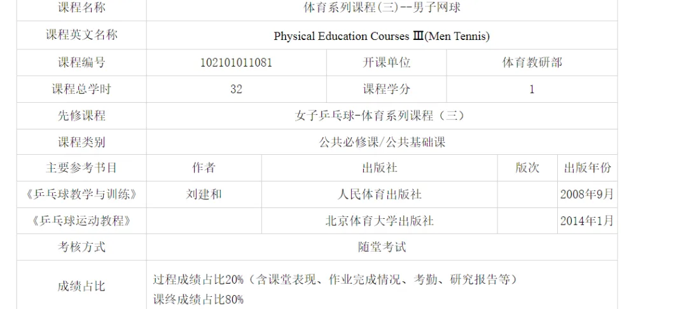

请相关部门及时关注并跟进问题。

## 1 奖助补费

“关于提高研究生补助的事，学校领导不是不知道，诶，接诉即办有很多次了，人文之光也发了很多次，你猜怎么着，学校就是不动。为啥啊，因为没有实际创造出他们需要重视的工作任务。嚷嚷归嚷嚷，反正也只是嚷嚷。

这边转一下学工部接诉即办的回复：已经收到了，感谢对补助的关心，提交学校领导了，欢迎致电81360225，或者到行政楼225面谈。 诶，什么个意思呢，你想要你就来面谈，我来说服你，实在不行，我也知道你是谁了对吧。政审要签字吧？档案要写评价吧？推荐表要写表现吧？想想吧。 反正接诉即办给我的感觉就是这个意思，更别提还落实到辅导员让辅导员拐弯抹角谈话呢哈哈，反正接诉即办是不发了，导员说的“那就是个面子工程”。希望人文之光社论撑住，别把投稿人信息爆出去。”

## 2 食堂

“求今天早上8:25左右，一食堂早餐的鸡蛋、茶叶蛋、煎蛋全没有了，往常不管没什么起码都还有鸡蛋，越来越离谱了!

接诉即办不能互动回复，在这里原文po出。后勤处回复:食堂的鸡蛋的销量也不稳定，有时候闭餐还剩下好多，有时候提前没了，这个实在不太好精准掌握。感谢你的理解。

我的理解:前面同学再怎么买的多，也很少见8点20左右就什么也没有了的情况。我后面又来了很多很多同学，排了很多长队，都没买上啊！

另外:接诉即办回复的页面用提问题同学的姓名和学号整个当水印铺满了页面背景，是怕被截图分享吗？”

> “二食堂自选处，大中午的吃饭居然不开空调，这么热的天，负责开空调的居然说不太热，不给开。那些领导者真该坐在这里吃吃看热不热，真是活该没人吃，早点倒闭算了，菜做的越来越难吃，服务也越来越差”

## 3 校园基建

## “树上的这些黄色的砧板应该撤了呀，现在都没有那种小虫子了”

## 4 教务问题

## “点开选课系统里的教学大纲，我看不懂，但大受震撼”

（见《[【读者投稿】听没听？如听](https://mp.weixin.qq.com/s?__biz=Mzg2MjcwNzQ1Mw==&mid=2247488665&idx=1&sn=4253ca731f489597c2cc9cbdebd3ebcd&chksm=ce029f0bf975161ddf65b188d562b665eaa64827307eaa75d41e4b091a19015feab4b67e0ace&scene=21#wechat_redirect)》第5条）
