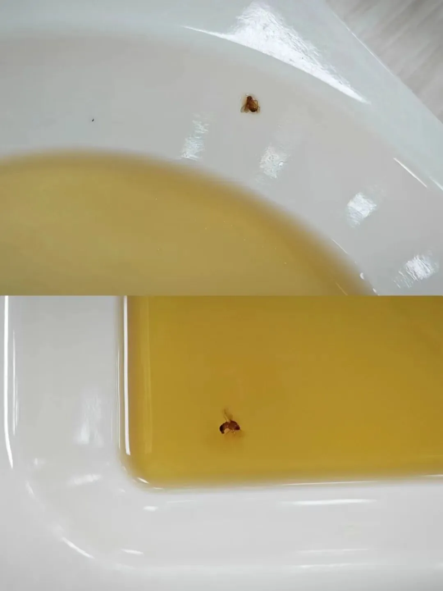

请相关部门及时关注并跟进问题。

## 1 美食节

## “美食节活动建议

首先感谢学校举办这个活动，还是费心费力了，提一些小建议，这个食材还是多准备一些5:30的活动，6点就基本上除了烤串，所有的摊位都清仓了，后来的同学都吃不到啊！！！尤其是小龙虾冰粉多准备一些吧！！！另外在旁边也听有些同学觉得小龙虾贵，稍微维护一下，本人是小龙虾超级爱好者，学校的这次小龙虾的品质是非常好的，至少我吃的这一份，个头绝对是油焖大虾的个头，这个价格真心不贵，至于味道的话，我个人觉得还行，就看大家各有各的口味。但是从成本价格来算，这一分不算贵。最后还是希望学校在明天的美食活动节，小龙虾多备一些货好不好！”

## 2 美味食堂

“人文之光，请提示一下良乡校区一食堂!最近餐具的卫生状况实属不佳!特别是勺子，没有洗干净，发现好几次了，油都还附着在勺子中央!!!请相关部门注意一下，谢谢!”

> “今天在良乡校区一食堂一层取醋被连续流出的两只小飞虫干沉默了，，，希望还是直接摆从超市买来的那种瓶装醋就好了，用完一瓶是一瓶，不会有旧醋还留了个底儿就往里倒新的导致混在一起都不新鲜了的情况，，，”

“12点，二食堂自选区的饭，除了米饭，基本全凉，这届承包商还能不能干？不能干赶紧滚吧，别搁这恶心大家，饭越来越差，服务也越来越差，二食堂都办成啥了，垃圾！”

## 3 学校招生

> “近闻本校将扩招贵州省，每个省的名额也要扩招，咱学校分数线是不是再降了？咱学校分数线已经是一降再降了，再扩招，最低录取分数线直逼末流双一流，是太想“进步”了吗？这么渴望和末流双一流比肩吗？而且大家高考报志愿，肯定会看录取分数线，你要是一次降，以后想升恐怕不会容易吧？！今日割五城，明日割十城，然后得一夕安寝...然则社科之分有限，考生之数无厌，奉之弥繁，侵之愈急。故不战而强弱胜负已判矣。至于颠覆，理固宜然。”

## 4 图书馆

> “投稿:把图书馆三楼304的温度调成27℃的人疯了吧，这两天热的要死，你要觉得冷，调成24、25我都不说什么，特么调成27℃?绝了，本身304就空间大，温度就高还闷，还大热天调成27℃，图书馆本身就空间挤，密闭性高，空调冷一些，要是觉得冷到时还能带个薄外套什么的，但我们这些觉得热的，总不能脱衣服吧”

## 5 奖助补费

“社论君，继续投稿一下研究生补助问题。前前后后这么天，这么多同学反应提高研究生补助问题，学校充耳不闻、一声不吭的态度实在让人失望。平时花架子整的不少，面对这些学生实在的诉求可真是一毛不拔啊。

我们之所以要求提升补助的原因无非三点，一来是因为这些补助的确满足不了生活开支的基本要求，二来与其他学校相比差距悬殊（不只理工科，而且社科大在文科或者综合类大学当中的博士生补助里也肯定是垫底的），三来是学校用在其他地方的支出总是离奇且多余。在我们看来，学校并不是没有能力提高补助到一个适当的水平，但是他就是不这么做，这令人无法理解。或许但凡学校能够切身考虑前两者，切实把同学们来上学需要生活这种问题的优先级提高，在这个问题上也不至于争议如此之普遍。

恳请学校领导们能够认真思考这件事，尽可能地为研究生们谋一些切实的福利。让一个本身资金并不充裕的学校拿出五六千的补助或许不现实，但是我们至少想听听你们在这件事上有诚意的回应。学校能够支撑提到什么水准，理由是什么等等。而不是现在置若罔闻。”

（见《[【读者投稿】没有面子的面子工程](https://mp.weixin.qq.com/s?__biz=Mzg2MjcwNzQ1Mw==&mid=2247488670&idx=1&sn=e8593c98aba89bcf2353694696e314be&chksm=ce029f0cf975161aef3e6a4ef165990f50115b5456f01967b8c2192b4a92d9c4557210b51144&scene=21#wechat_redirect)》第1条）
