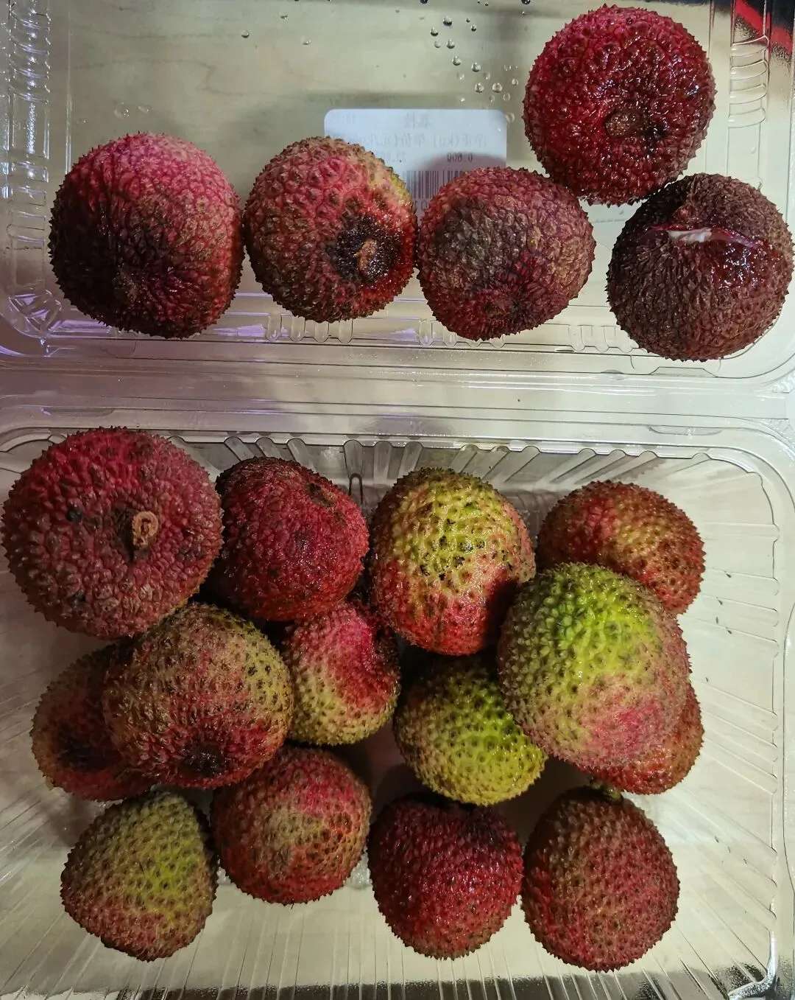
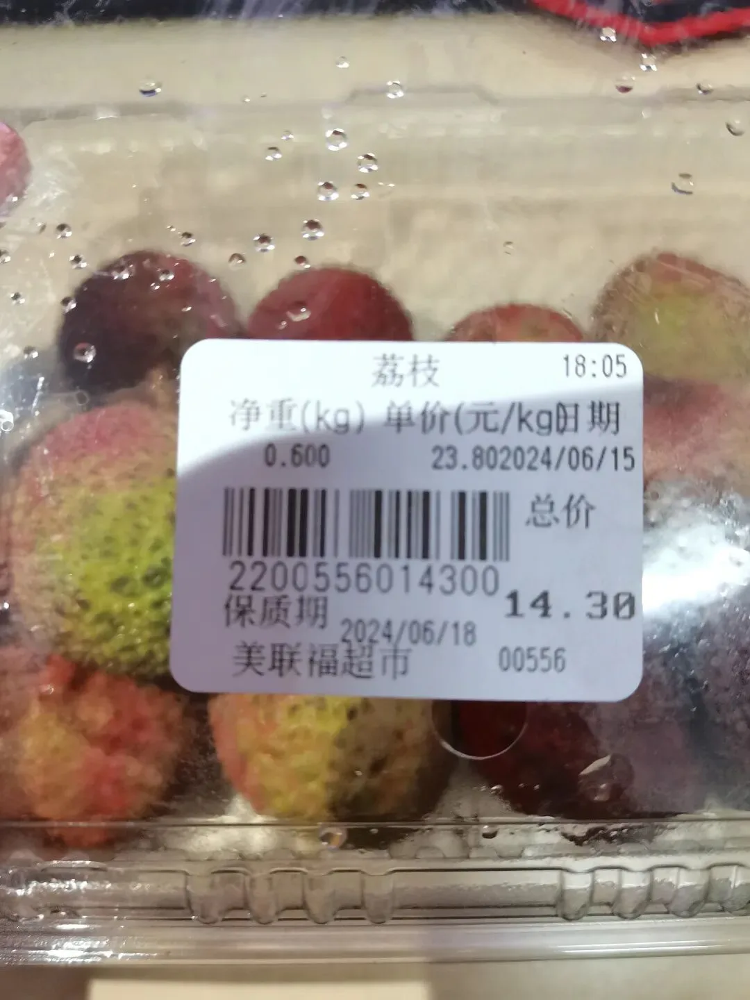
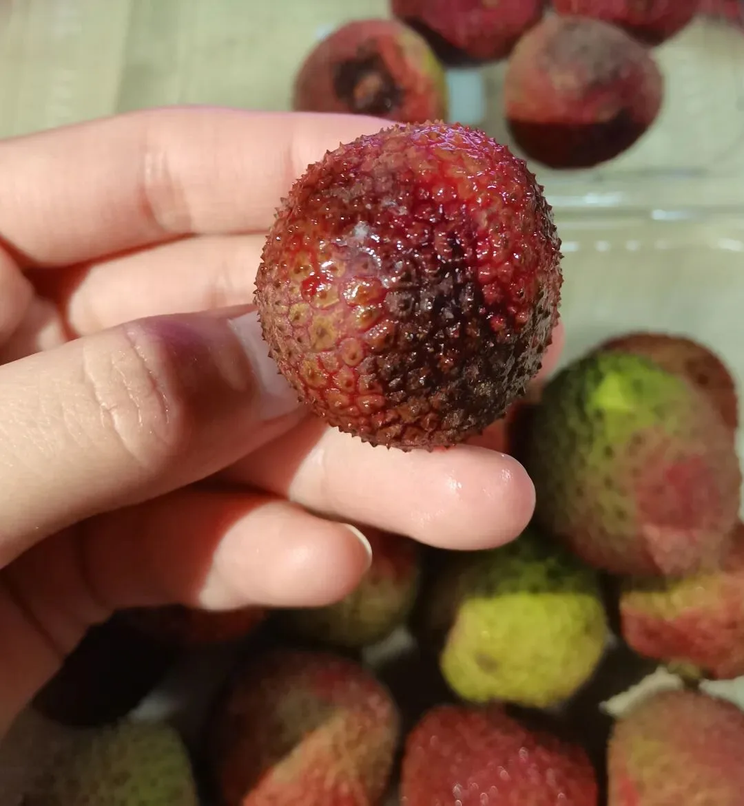
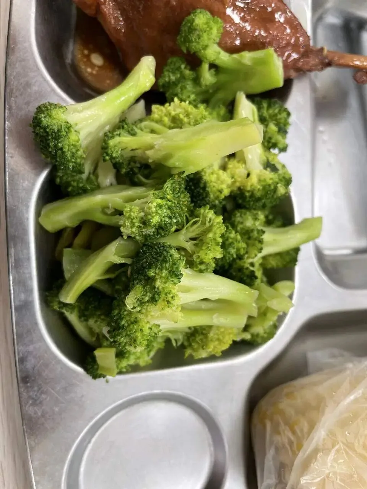
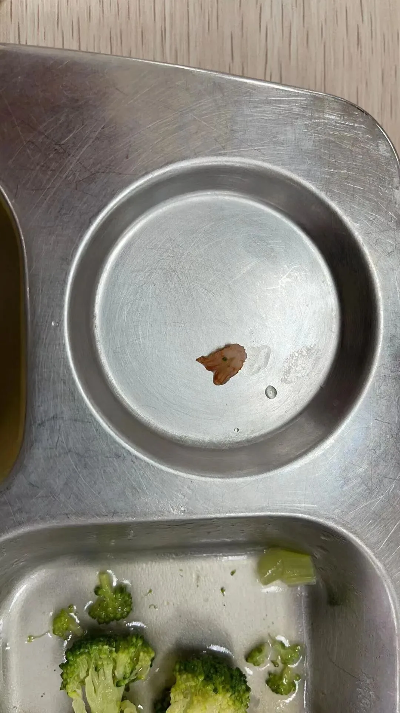

请相关部门及时关注并跟进问题。

## 1 奖助补费

## “2023年的科研奖励和证书什么时候发呀？再不发都快放暑假了。别推到下学期了！”

## “投稿补助内容：

《上社科大第一书》

校运之明晦，人才之盛衰，其表在刊物、项目，其里在资金、补助。古之翰林，今之社科，定纲纪、拟国是，国家文脉，兴衰在兹。至若改革开放初期，研究生院肇创，誉之“东风第一枝”。地虽不济，尚堪出资租赁客栈以供学子致力于学。是故八十年代，译著有焉、论著有焉，天下学术，集大成者，非社科院不能为也。

观今之社科，地不过三尺，俸不过二千。细察北京最低工资，“我市最低工资标准由每小时不低于12.18元、每月不低于2120元,调整到每小时不低于12.64元、每月不低于2200元”，睹之则深痛在心。年近而立，既无谋生之计于外，复腆脸索资于家内。哀哀父母，生我劬劳，今鬓发斑白，尚养一巨婴于家中，思之令人悲笑同发。

校则四非，财则一千。徒谓“大学者，非谓有大楼之谓也，有大师之谓也”，颇似“‘以礼义为干橹，以忠信为甲胄’，无益于自强实际”，何益有之？以致哭死董卓之讥。天下英杰有志于学者，欲投考于社科。问其补助，则曰：就一二百五。果如是，来者逡巡犹豫，遂往他处。在读困厄，劝退来者，生源流窜，必为后患，学运之不兴，可以想见矣。请资补助，使学生安心于学术，无复叽叽议于社论。”

## 2 教务问题

“投稿：截止到本周末仍然有相当数量的课程大纲没有完成上传，请问教务处工作效率在哪里？到底是谁在审核，又为何审核效率如此之低下？还未完成上传的大纲有：

当代世界社会主义思潮、中国传统美学、科学、技术与社会、西方马克思主义专题、宋明理学、普通德语、民法分论、刑法分论（2班）、知识产权法、中国古典文献学概论、语言学名著选读、中国现代文学史、外国文学史（一）、古代汉语（一）、传播法与伦理（2班）、西方社会思想史、量化与质性研究方法、社区概论、满语”

## 3 学校超市

## “投稿学校新开的超市：有没有好好为同学们服务一言一行就能体现出来。

今天傍晚去超市买水果，遇到的事情如下：

第一：我进去问有没有大西红柿，那个阿姨用嫌弃的语气嘟囔着说：“这不是有小的吗？小的这么大放这里你非要吃什么大番茄?”首先我想买这是需求没有任何挑剔，因为我看物架上没有但我想的是之前超市好像有买的哈，所以只是问下，结果得到的是那种“我有啥你就买啥”的霸气回应。

第二：我转眼就看见了心切的凤梨盒上的虫子，这里看到没有拍照，因为当时没想到要拿出来“宣传”，但是当时旁边是有另外的人的，那位女同学还给旁边的男同学说：你看这啥还有虫子! （此次没有物证但是至少有两位人证）

第三：去结账的时候，扫码的姐姐和买烤肠的小哥说：之前还有同学说，我们这买贵了，后来还不是依然在我们这买。（还挺骄傲的语气，我们还能在这买是因为你的东西又好又实惠么?还是什么原因自己清楚吧）之前研缘超市没收过咱的口袋钱吧，这个超市可不一样噢。

第四：我买了一盒荔枝，因为在冰柜里放过，盒子上有雾水，看不清里面的荔枝好坏，但是还是中招了。上面的都是好好的，盒子下面的就是酸臭坏的还有长毛了的。（下附图片）如果要狡辩说：荔枝装盒的时候都是好的，装了一段时间之后才坏的，我想我不会听这种解释。（一盒里能这么偶然坏好几个?短时间能坏到酸臭长毛那冰柜的作用是什么?）

所以，新超市扪心自问，有没有好好为同学们服务一言一行就能体现出来。”

## 4 食堂

“望京食堂虾仁西兰花里没有虾仁，我看了那份菜里总共都没有两个虾仁，阿姨找到找不到，想给盛都没法盛，怎么好意思写成“虾仁西兰花”！

续：找到了虾仁”

“我认为二食堂换不换承包商的问题，可以交给市场调节，同学们觉得难吃就不再去吃，赚不到钱它自然就倒闭了”（见《[【读者投稿】管理不利校 服务不便民](https://mp.weixin.qq.com/s?__biz=Mzg2MjcwNzQ1Mw==&mid=2247488684&idx=1&sn=14ef388b10b8efe8b95b88039f58df40&chksm=ce029f3ef9751628240840334608730e8979a88c43d360e152e68cc9edbcdf71ff8b73dd8324&scene=21#wechat_redirect)》第4条）

## 5 图书馆

“投稿：建议在图书馆一楼的机房附近多增加一些储物柜。一楼的储物柜比二三楼的少一半，但同学每天来的都很多，储物柜供不应求问题很严重。谢谢”

> “最近总看到有同学在投稿图书馆空调过冷或过热，其实每个人对温度的感知都不太一样，这样吵下去也没什么结果。所以在想能不能请图书馆的管理人员效仿地铁的强冷和弱冷车厢，把图书馆分成强冷层和弱冷层，让每位同学自主选择适合自己的学习环境。”

（见《[【读者投稿】管理不利校 服务不便民](https://mp.weixin.qq.com/s?__biz=Mzg2MjcwNzQ1Mw==&mid=2247488684&idx=1&sn=14ef388b10b8efe8b95b88039f58df40&chksm=ce029f3ef9751628240840334608730e8979a88c43d360e152e68cc9edbcdf71ff8b73dd8324&scene=21#wechat_redirect)》第3条）
