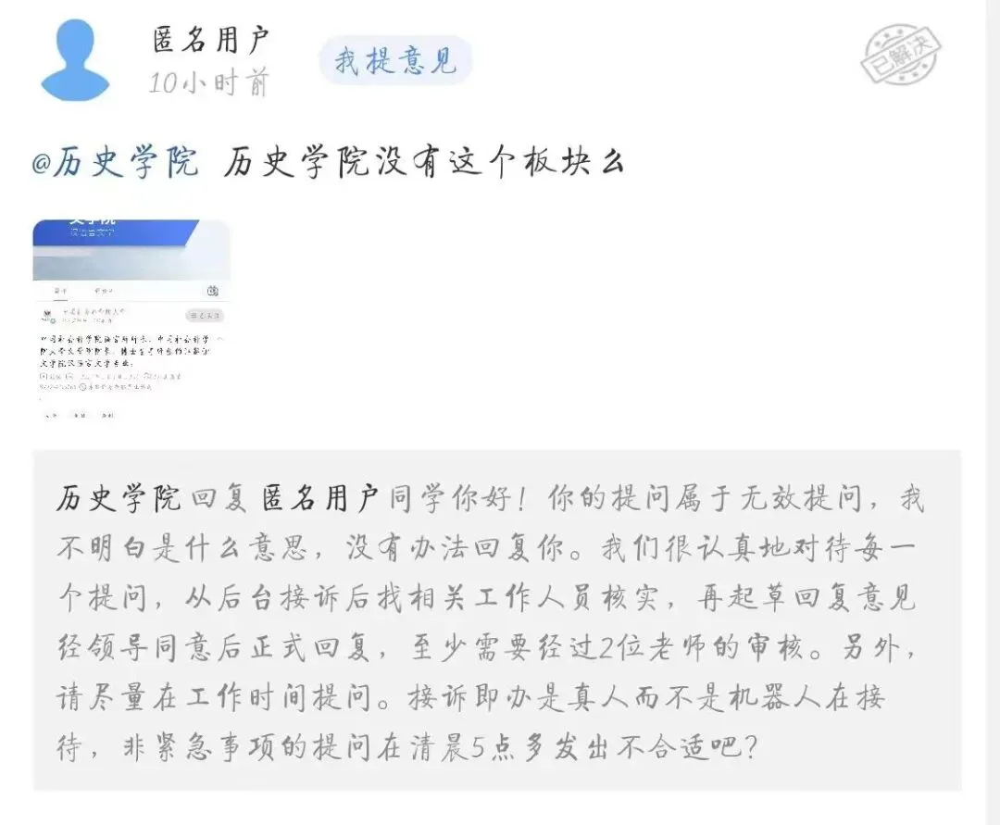
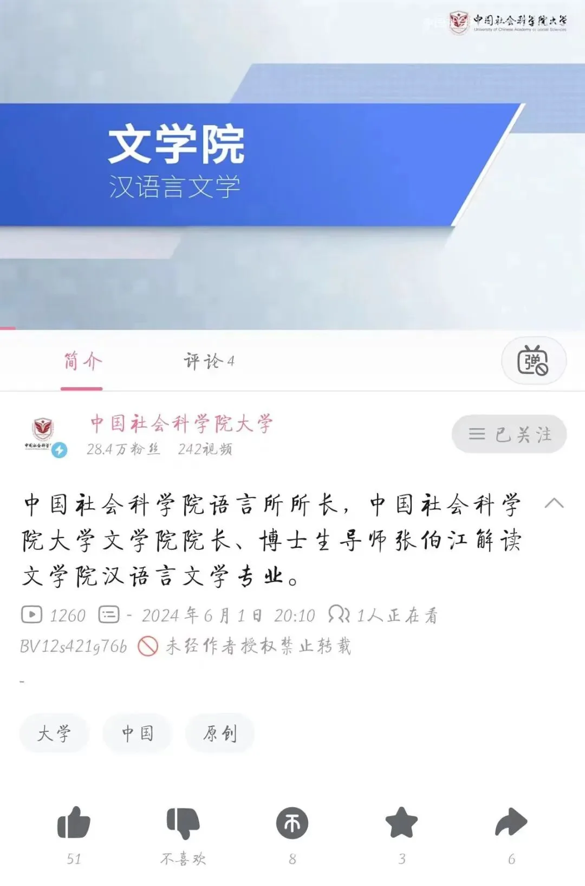
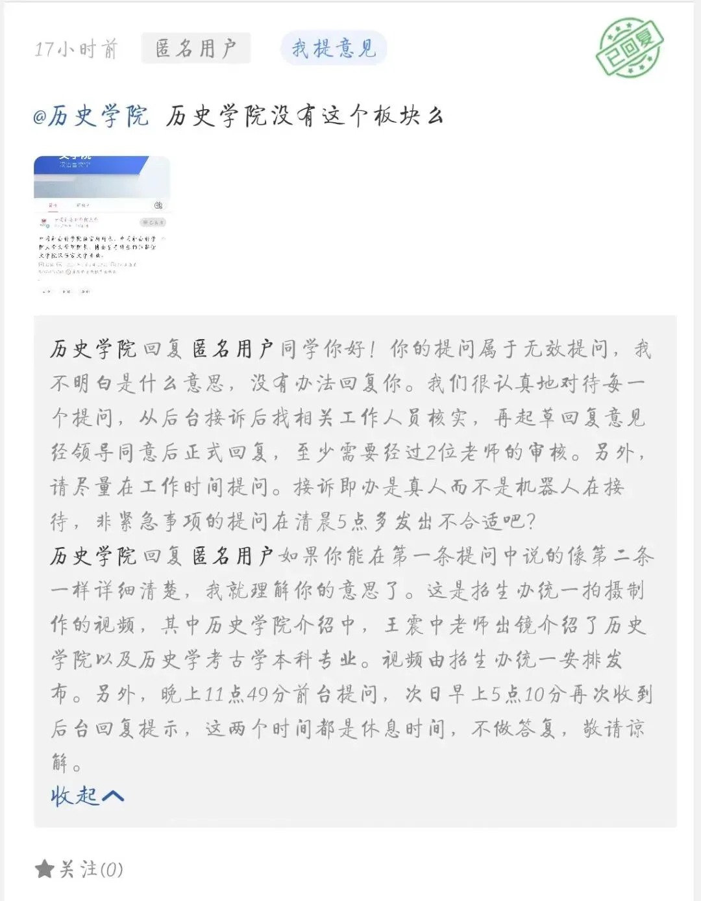
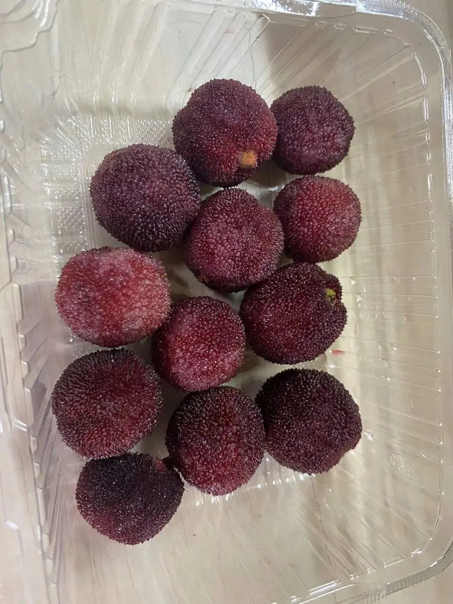

请相关部门及时关注并跟进问题。

## 1 接办平台&招生问题

“投稿接诉即办回复： 1.该板块系与“2024年学院简介”配套的“院长名师话专业”栏目，由各学院制作，学校官方公众号、视频号、社媒号发布，发布时标题和封面即如图所示。不明白截图遗漏了哪些信息导致不可被识别？截止投稿时，历史学院“院长名师话专业”已在公众号发布，尚未在社媒号发布，因而进行咨询，得到的回复却好像整个学院都不知道这件事一样。反映了贵校招生工作确实只是无人在乎的角落。 2.系统记录提问时间为6月16日23时许，即截图时间（次日9时）的“十小时前”，并非工作人员回复的“凌晨五点”，不知道何出此语。不少部门的回复时间在10h以上，看来似乎不存在全校范围内的强制某时以内回复的机制，不知道该工作人员为何选择这一时间、语气和态度作出这样的回复。 3.这么抽象的回复是你交领导批准、由两位老师审核之后作出来的？很好奇批准的是哪位领导。

补充：不知道“休息时间，不做答复”指的是不是休息时间发出的提问均不做答复？”

## 2 经济学院

“吐槽经济学院团学换届。不知道是我自己的理解，还是实际上的原因。学院的主席应该发布先发《关于公开选拔2024-2025学年xxx学生会各部门学生骨干的通知》，接着进行资格审查，在学代会上作为一个单独环节进行投票，出结果后公开发布拟任名单。

给大家描述一下经济学院的操作，今天中午学代会研代会团代会三会合一，请问何来资格三会合一。匆匆忙忙的举办，实际到场人都不到一半，请问何来资格投票。不仅如此，研会本科生团学下届核心负责人的结果，居然是内部公示，请问何来资格如此公示。”

## 3 食堂

“夸夸学校的羊肉串夜宵，丰富了喜欢夜里学习的我的能量摄取渠道，1.5的价格很美丽，味道也不错。不知道能经营多久。点赞”

## “标题：二食堂自选窗口

关于二食堂的自选窗口，这个学期以来的状况真的可以用每况愈下形容。首先，12点10分左右到食堂，5个加热台只有3个上面摆着菜（其中一个是主食），能选的菜对于刚下课、刚从图书馆出来自习的人来说真的是无从下手。菜的种类好像固定一周就是几种，先不提单调的程度（菇类每天都出现，不容易吃腻的人都已经吃烦了），同一道菜的品控也很差，有时候咸淡合适，有时候咸得过分。周末12:30左右到自选窗口，阿姨甚至已经要把沙拉菜收起来了，这么早的结束营业时间暂且不提，感觉每到周末的饭菜就因为敷衍而格外难吃。每天学饿了去吃饭的心情都非常一言难尽，唯一的希望是二食堂自选窗口更换承包商！更换承包商！更换承包商！”

## “投稿

回上次所谓将二食堂交给“市场”处理的那条。这似乎有些想的太简单了。现在贵校二食堂的生态位独一无二、可谓是占尽天时地利，坐拥北综的人流宝地。一食堂本来就人又多菜品又烂了，对于广大的社科大师生来说如果中午和傍晚下课还想快捷方便地吃点人食那还真得首选二食堂。市场得有市场，换句话得有竞争，大家如果觉得二食堂烂不去二食堂的前提是这个生态位还有一个二食堂。如果只是简单认为如果二食堂烂那么就没有人去所以食堂自然会倒闭，必然难有实效，毕竟天时地利的客观情况摆在那里。需要集中主动地施压去表达大家需要更换承包商，如果能想出一种保证新招标不会再招到这样承包商的制度就更好了。

因此简单以人流量多少来判断二食堂承包商是否需要更换并不妥当，这只会给其披上一套合法性的新装。相反，人流量更证明了二食堂办好的迫切性，而现在这个承包商存在的种种问题似乎并不值得让大家信任其能完成好这个责任。不得不吃，而如食鸡肋，这就是没有人和的二食堂。现在的承包商太黑心了，仗着二食堂的特殊地位为非作歹、不提供该给广大师生应该提供的服务质量，反而在承包之后糊弄食堂攫取暴利，明摆着一幅我就是招上标来你能把我怎样的嘴脸。最有代表性的就是北综正门那大大的“风味食堂”四个字和闭锁的包间，这北综也不是一栋规划的食堂吧，谁给你的权力让你直接在楼门上挂起自家广告的，还把包间圈占起来准备再赚一笔？自选越来越烂没必要再说了，非自选早就烂透了也不必多言、只有极少数窗口能配得上它卖的这个价格。

一个恶心的二食堂，害得多少老师和学生要跑出学校？你说反映问题吧，它又是虚与委蛇。所以如果大家以后还想在学校吃口好饭，应该自觉把火力集中起来了。校方也早应该担起自己优选招标的责任，顺应民意主动更换二食堂承包商了，这样下去只会让大家觉得学校这个招标是收了黑钱有猫腻的。”

（见《[【读者投稿】思之令人悲笑同发](https://mp.weixin.qq.com/s?__biz=Mzg2MjcwNzQ1Mw==&mid=2247488689&idx=1&sn=81342cbce2e274d486a4b828af946f1a&chksm=ce029f23f975163500a8829957c990fca46caf0916552ad55f4ccf168743ff18eaf9cfa429e2&scene=21#wechat_redirect)》第3条）

## 4 奖助补费

## “投稿： 学校什么时候给我们涨补贴？每个月这远低于低保的钱，让我们怎么生活？！”

（见《[【读者投稿】抠抠搜搜过日子 每天只吃一食堂](https://mp.weixin.qq.com/s?__biz=Mzg2MjcwNzQ1Mw==&mid=2247488561&idx=1&sn=84855c456390949155f0b52f48900fae&chksm=ce029fa3f97516b58b1fef6a19c32f98ab75026e23f7326ae43fcb488575ff37d015cb2aaea2&scene=21#wechat_redirect)》第2条）

（见《[【读者投稿】思之令人悲笑同发](https://mp.weixin.qq.com/s?__biz=Mzg2MjcwNzQ1Mw==&mid=2247488689&idx=1&sn=81342cbce2e274d486a4b828af946f1a&chksm=ce029f23f975163500a8829957c990fca46caf0916552ad55f4ccf168743ff18eaf9cfa429e2&scene=21#wechat_redirect)》第1条）

## 5 学校超市

## “学校新超市 买了一盒杨梅，回来宿舍打开一看，下层半盒完全坏的！”

（见《[【读者投稿】思之令人悲笑同发](https://mp.weixin.qq.com/s?__biz=Mzg2MjcwNzQ1Mw==&mid=2247488689&idx=1&sn=81342cbce2e274d486a4b828af946f1a&chksm=ce029f23f975163500a8829957c990fca46caf0916552ad55f4ccf168743ff18eaf9cfa429e2&scene=21#wechat_redirect)》第3条）
