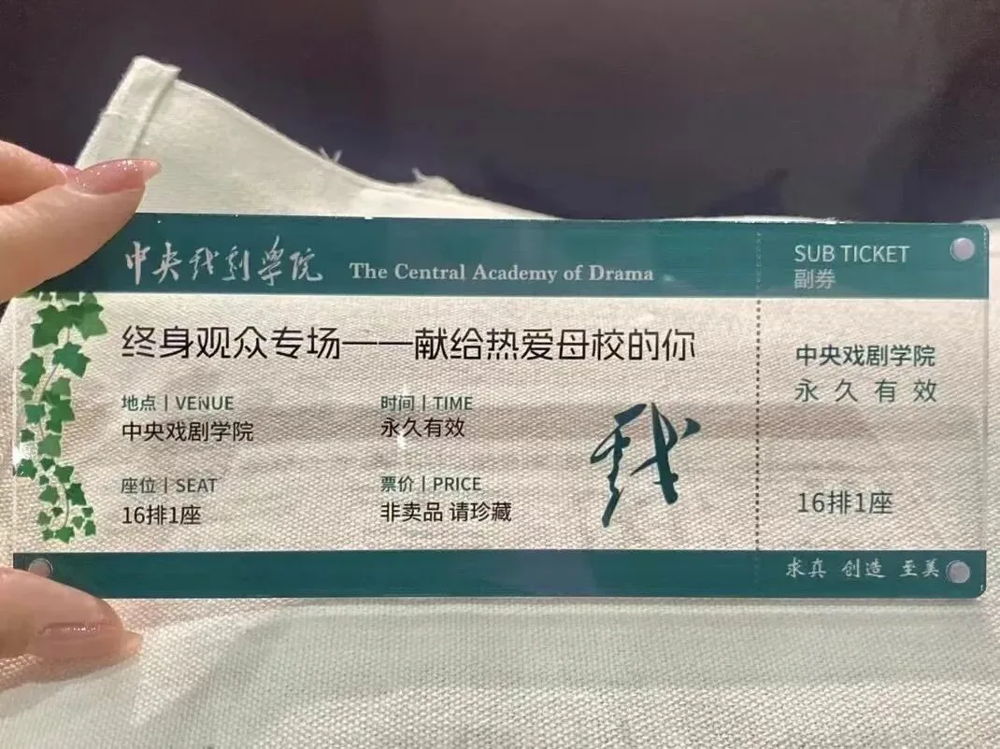
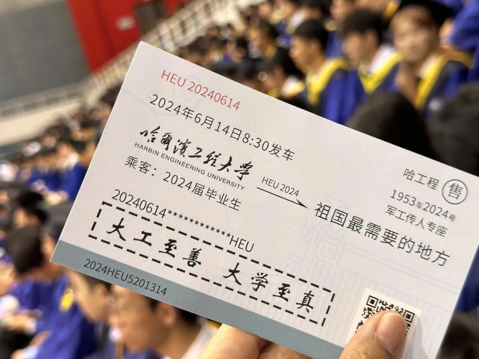
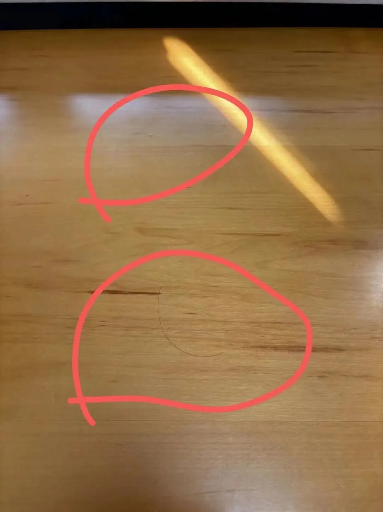

请相关部门及时关注并跟进问题。

## 1 毕业就业

> “投稿：麻烦学校早点发毕业证吧，五月中旬毕业答辩就完成了，拖到六月毕业证学位证杳无音信，很多学校早就拿着毕业证让毕业生去工作了，我们不会要等到毕业典礼才发吧。现在就业形势多么严峻，尤其是社科大清一色的文科生，又不是人人都能考上公务员，早拿到一天毕业证就可以签劳动合同有个着落。你们就业办和学位办和相关毕业部门真的不管管我们学校学生的死活吗？麻烦早点发了毕业证让我们去签劳动合同吧，三方协议毁约的企业一堆！！”

> “麻烦党委学位办早日审核毕业生能否毕业，党委学生工作处早日发放毕业证吧。现在就业形势真的很严峻，早点拿毕业证真的也是一层保障，既然学校给不了我们就业的保障，真的早点发毕业证吧。我当时签的三方协议上表明6.25日之前还未拿着毕业证去单位报道签订劳动合同视为毕业生放弃入职，真的很担心，没想到学校发毕业证学位证会这么晚，眼看就要六月底了，本来找了个工作就很难，感觉会被社科大的行政效率拖死。已经向党委学生办公室反应，人家也是一句尽快尽快尽快了不知道多久。 作为一个文科学校不应该更应该重视就业想尽一切办法提高就业率吗，现在文科就业多难就不说了。学校难不成只管做数据，真正有用的为学生实操多干一点不行吗，哪怕只是一个加快毕业证发放进度这么简单的事就只知道拖拖拖真的非常心寒。我签了这么样一个三方确实是我自己的问题，毕竟工作太难找了，找不到更好的。但是跟学校真的这种拖拉的行政效率肯定也有关系，真的太令人失望了”

## 2 校园文化

## “投稿：咱们的毕业礼物能不能按这个风格整？”

## 3 教务问题

“本科生的体育必修就不能给女生多开点球类运动/跆拳道之类的课吗，非就觉得男生好动女生好静是吗”

## 4 图书馆

> “社论君你好，坐标望京。想请大家使用完图书馆的座位之后，把从自己身上掉下来的东西清理干净，体谅一下后续使用者吧。使用的时候看到这些真的会很膈应。都是研究生了，素质也麻烦相应提升一下吧，感谢！（防杠：保持整洁干净卫生是幼儿园老师都会教的最基本的行为准则，如果有同学不觉得膈应，说明该同学承受能力很强，并不代表不清理这种行为是正确的，也不代表该请求是错误的。）”

## 5 大创安排

> “我想吐槽一下学校大创的答辩安排，在原有的大创答辩安排中，明明教务处指出的是，学院组织答辩后，学校的专家委员会进行集中评审定级，丝毫没有提校级答辩的事宜，今天突然通知周六校级答辩，周五就交ppt，无比匆忙且和之前的通知相背。 再者，本周已是十六周结课周，为什么所有的事情都要压在期末周处理？选课也好，大创答辩也罢，学校但凡有半点考虑过学生的压力都不会做出这样的规定吧？”

## 6 奖助补费

> “关于近期讨论的提升奖补标准，鉴于一次性提升全校学生奖补标准在实际操作层面难度较大，私以为不妨换个角度，从以下几个方面向学校提出建议：1、降低学校直接收取的各项费用，例如固定网费从每月收取25元降低至每月15 元；2、降低学校一餐厅各项餐食的价格，例如价格降低至现有价格的80%。另外学校可定期提供免费餐食，例如每周六午餐为免费餐；3、针对办理学生交通卡的学生，根据其交通卡的花费情况，对其进行补助。以上几项措施仅供参考，诸位如有其他意见也可进行讨论。另外，值的说明的是，一味地抱怨问题是没有用的，唯有向有权部门提供切实有效且可具有操作性的建议才能达到解决问题的目的。”

（见《[【读者投稿】你的提问属于无效提问……](https://mp.weixin.qq.com/s?__biz=Mzg2MjcwNzQ1Mw==&mid=2247488727&idx=1&sn=a1e2c9ad4e5821855c79cd4d45d3ff1b&chksm=ce029f45f975165377ca14a7e89d0112bf70af1445e3e2c47fbd3169ca36269cdab0fca9b180&scene=21#wechat_redirect)》第4条）

## 7 食堂

> “二食堂自选可不仅仅是12点下课的时候饭不够，就连tm周六日，他们的饭都摆不满加热台，真的就是一脸不想干的样子啊。多少自选铁粉都被逼走了。 投票也投了，要求换承包商是压倒性多数，足矣说明问题了，后勤部出来给个话。 现在这社科大真的是食堂办不好、超市也办不好，招完标就狠劲割啊，卖的贵服务还差，真是英明神武啊，建议写进招生简章。”

（见《[【读者投稿】你的提问属于无效提问……](https://mp.weixin.qq.com/s?__biz=Mzg2MjcwNzQ1Mw==&mid=2247488727&idx=1&sn=a1e2c9ad4e5821855c79cd4d45d3ff1b&chksm=ce029f45f975165377ca14a7e89d0112bf70af1445e3e2c47fbd3169ca36269cdab0fca9b180&scene=21#wechat_redirect)》第3条）
