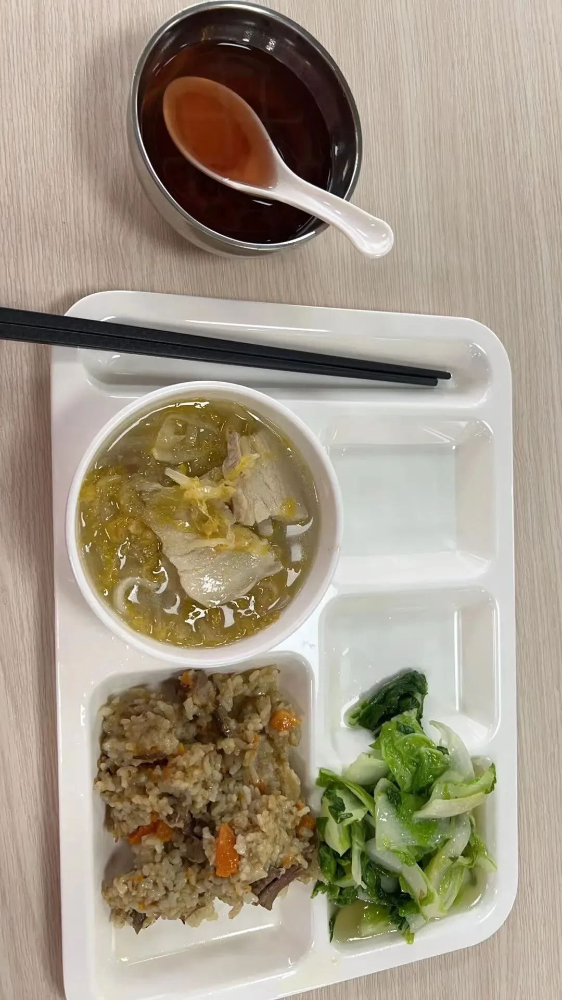

请相关部门及时关注并跟进问题。

## 1 毕业问题&就业

> “投稿：学校行政人员在制定毕业相关事宜流程的时候，能不能从毕业生的角度出发，而不是以自己的假期为限？7月大多数单位都要求入职了，甚至有些地方6月底就要入职，而且异地就业还会有一些手续要我们来回跑去线下办理，时间怎么来得及啊我问一下？你们是真的不问学生疾苦，只求自己舒服是吧？”

## 2 经济学院

## “投稿

本人是经济学院学生。最近学校的课余活动和学术活动都挺丰富，能看得出明显的进步。借这个平台对各位老师同学的辛苦付出表示感谢，希望学校越来越好。”

## 3 食堂

## “社论君好 夸夸一食堂的不知名烩饭 还挺好吃的！”

> “一食堂你不要欺人太甚，那么满满一盆的西红柿牛肉，你就盛一块肉，我必须要个说法，我花了肉菜的钱你给我盛一碗碗西红柿？学生的钱不是钱呗？你一家独大你就强买强卖呗？这个我必须要求食堂经理公开道歉。”

## 4 宿舍

“良乡校区宿舍三号楼这边是在施工还是有什么一直在运作的电器吗？从昨晚一直到现在巨吵，晚上睡不好，白天午睡也睡不好！

（见《[【读者投稿】各类问题层出不穷 奖补考核争议不断](https://mp.weixin.qq.com/s?__biz=Mzg2MjcwNzQ1Mw==&mid=2247487938&idx=1&sn=8ac83532f0a6cc9d9afde70c26495142&chksm=ce029a50f9751346ac910e901a18988ba215a5ee31c8f70cec7e3979438486e728200f00328d&scene=21#wechat_redirect)》第9条）

## 5 学校超市

> “投稿，学校新超市的西瓜真是一言难尽啊，我前两天看是1.6，今天看是1.8，我买了半个西瓜，花了15，西瓜不水也不甜，可以说的是过分难吃了。我在学校附近农贸市场买才1.5，水分又大，还甜，你这是价格比市场高而且质量比市场低啊，太恶劣了”

（见《[【读者投稿】各类问题层出不穷 奖补考核争议不断](https://mp.weixin.qq.com/s?__biz=Mzg2MjcwNzQ1Mw==&mid=2247487938&idx=1&sn=8ac83532f0a6cc9d9afde70c26495142&chksm=ce029a50f9751346ac910e901a18988ba215a5ee31c8f70cec7e3979438486e728200f00328d&scene=21#wechat_redirect)》第3条）
