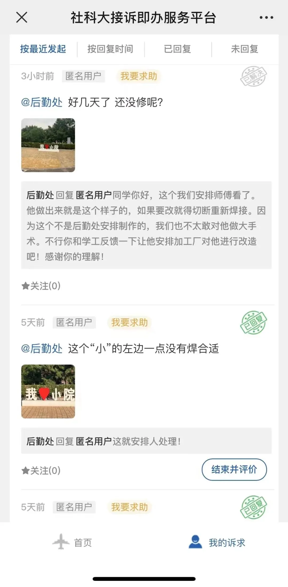
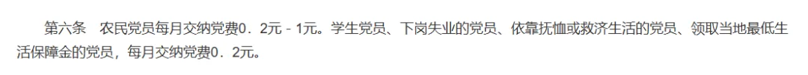
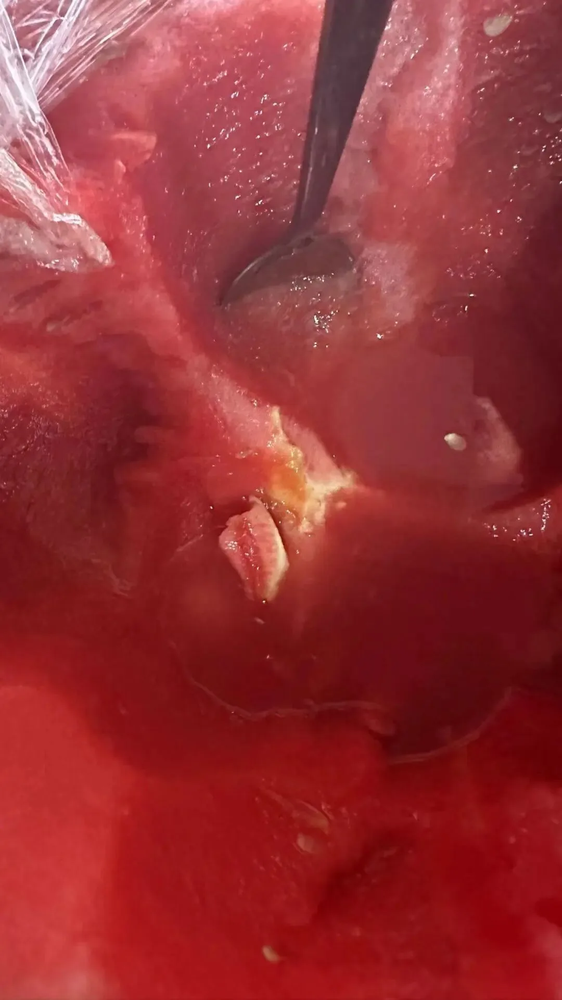
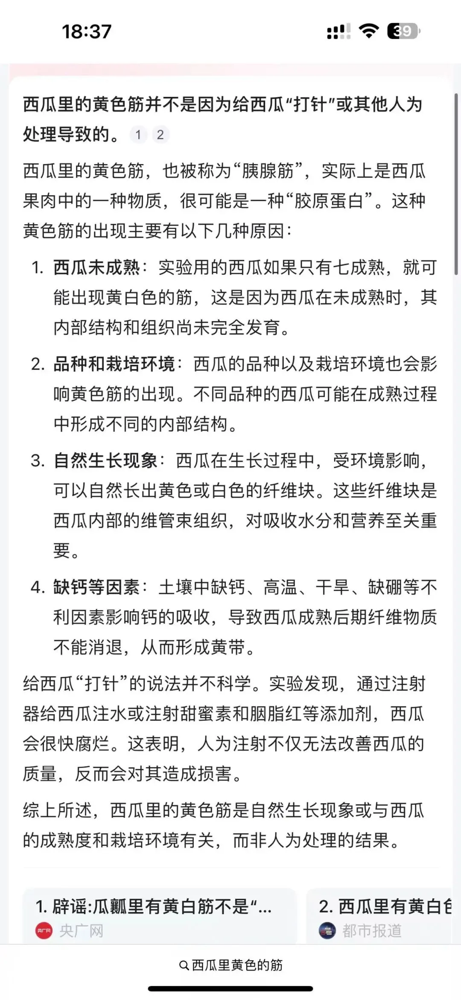

请相关部门及时关注并跟进问题。

## 1 接诉平台

> “建议学校各部门对不属于自己权力范围内的事项直接转你认为有权管辖的机关，做到类似一站式的一个申请解决问题，不要让学生来来回回申请，行政管理部门要服务至上，及时解决问题，为建设品质校园 争创双一流做出贡献。”

## 2 毕业问题

## “投稿：请问谁家好人大晚上开毕业典礼啊？”

## 3 缴费

> “有一个问题困扰我很久了，中组部发布的《关于中国共产党党费收缴、使用和管理的规定》第六条明确规定，学生党员每月交纳党费0.2元。本人向十几个学校的同学打听过，无论是本科生硕士生还是博士生，每月交纳的党费都是0.2元。不知道我校相关部门从哪里获得的授权，每月要问同学们收1元的党费？？？每月多收的0.8元干甚去了？？？强烈要求相关部门给出回应。如果没有合适的理由，请相关部门服从组织规定。”

## 4 医务室

> “您好，投稿医务室。 公费报销难度堪比社保，报销流程规章制度何处寻？ 报销问题。因为我是在北京医院做的肠胃镜，北京医院的肠胃镜资源比较紧张，需要提前一到两个月预约。我2.1开了转诊单，之后去了北京医院约上了肠胃镜。排到4.1才做了肠胃镜以及后续活检拿药。最近我去医务室报销，直接说我的转诊单期限只有一个月，也就是只能报销2月的挂号费，后续肠胃镜和治疗费用无法报销。问题是，根本就没有医生或者其他人提醒过我这点！！将近3000块治疗费只能自费。而且整个就医报销流程也没有章法可循。比如我在114挂号平台挂号，选择不了公费医疗，发票上的费用类型该怎么弄也没人说，整一个黑暗里盲人摸象！！ 辛辛苦苦在北京医院排队，最后还报不了！比社保还麻烦！”

## 5 宿舍

“请问基建处到底要被骂多少次才有做为？道歉信还贴在7号楼1楼没撕然后对面工地有开始半夜十二点施工？你们是口口口口的？有问题就鞠躬道歉但是就是不解决问题是吧？”

（注：该稿件有些用语过于激烈，故以“口”代替，请各位读者朋友们自行感受当事人的愤怒）

（见《[【读者投稿】往\_\_心里去做实事](https://mp.weixin.qq.com/s?__biz=Mzg2MjcwNzQ1Mw==&mid=2247488749&idx=1&sn=8ef702beeb439caab5c041bf4912c38b&chksm=ce029f7ff9751669c9e2672f94fefd5810626ea723ce553c542e483ed15b13b25cebf402ebac&scene=21#wechat_redirect)》第4条）

## 6 食堂

## “夏天了，一食堂晚餐能不能不要再搞一些中午的剩菜？”

（见《[【读者投稿】往\_\_心里去做实事](https://mp.weixin.qq.com/s?__biz=Mzg2MjcwNzQ1Mw==&mid=2247488749&idx=1&sn=8ef702beeb439caab5c041bf4912c38b&chksm=ce029f7ff9751669c9e2672f94fefd5810626ea723ce553c542e483ed15b13b25cebf402ebac&scene=21#wechat_redirect)》第3.2）

## 7 学校超市

## “再补一条，我西瓜快吃完了，看到了“黄筋”，合计着这玩意还没熟！”

（见《[【读者投稿】往\_\_心里去做实事](https://mp.weixin.qq.com/s?__biz=Mzg2MjcwNzQ1Mw==&mid=2247488749&idx=1&sn=8ef702beeb439caab5c041bf4912c38b&chksm=ce029f7ff9751669c9e2672f94fefd5810626ea723ce553c542e483ed15b13b25cebf402ebac&scene=21#wechat_redirect)》第5条）
