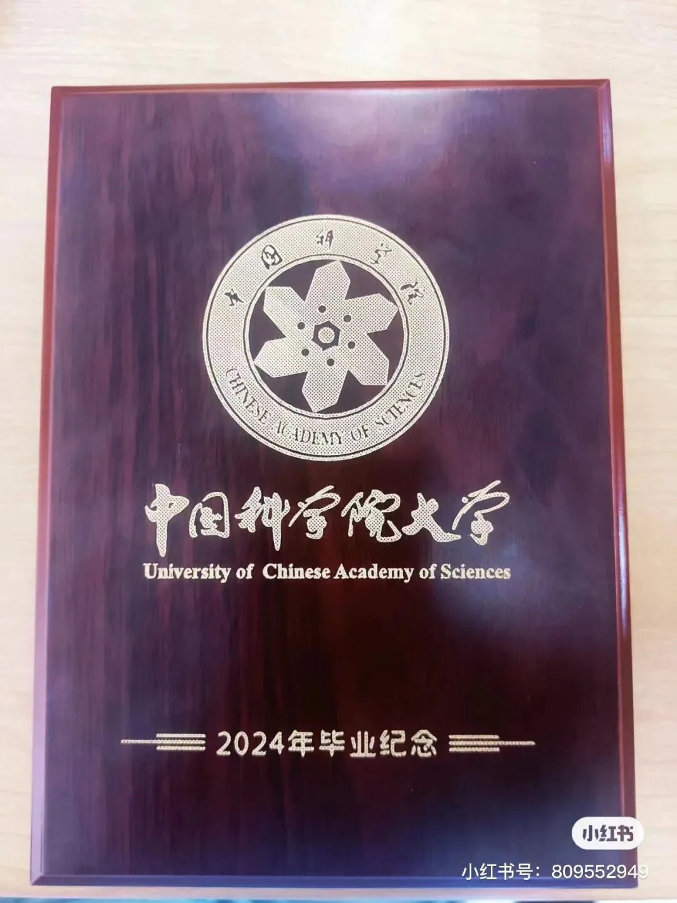

请相关部门及时关注并跟进问题。

## 1 奖助补费

## “投稿：还是那句话，我们的补助，学校啥时候做调整？？？”

## 2 毕业问题

> “法硕毕业生离校手续：一个离校手续里面十几项，图书馆交了电子版论文，离校手续里不更新？甚至要求办完离校手续后才发毕业证，逆天至极 补充：团关系接转完也不在离校手续里更新，就这效率”

> “就当造福后来毕业的学弟学妹们了。学院可不可以把学士服做的好看一点，重点是能不能把那俩垫肩拆了…穿上去我家都不用买冰箱了，我自己就是个双开门，矮个子穿着就像个扁扁的方块，丑死了，愁人…”

> “我们这晚上办婚礼的要么是二婚 要么是冥婚 晚上办毕业典礼是哪个二火领导拍板的？建议借用北理体育馆好好搞 反正也不远。历史上法大借用首体院场馆办毕业典礼 有先例 不丢人”

## “投稿：国科大的毕业礼物好棒啊！希望我们也能有这样的”

## 3 招生问题

## “麻烦相关部门看看别的大学招生宣传片怎么拍的，可以吗？”

## 4 信息建设

“希望学校做功能时穷举一下可能性 提交离校后一站式服务大厅直接消失 实在不行招个QA吧”

## 5 教务问题

> “如图，最近几天一直在蹲着选课的同学应该都能发现这些问题。细节不讲了。最重要的就是教务处不按照规定时间放课容余额。接诉即办就会说你那个套话。办不好≠差，你这样搬弄是非，没办好还死不承认，你食不食油饼？本科选课都做不好，还固定时间放名额，你谈什么公平呢。 某些公选课年年都没人愿意选，还不做调整，评教也不会看？非得线下跟你交涉你才会好好干活好好说话？不会干就赶紧棍”

## 6 查寝问题

> “投稿: 到底为什么要这么频繁地让宿管阿姨查寝，还这么早就来，对于晚上熬了夜上午想多休息会补补觉的同学，真的太打扰了。宿舍是基本的休息的地方，能不能尊重一下学生的个人空间呢？并且频繁查寝也给阿姨们增加不必要的工作量。 之前无论是在读本科学校还是硕士学校都没见这么频繁的，博士生年纪也不小心了，也不是小孩子不会注意消防什么的，相信一下博士生吧。 现在查寝差不多一个月一次了？这么频繁查寝的合理性到底在哪，半年或者一年查一次可不可以呢？”
