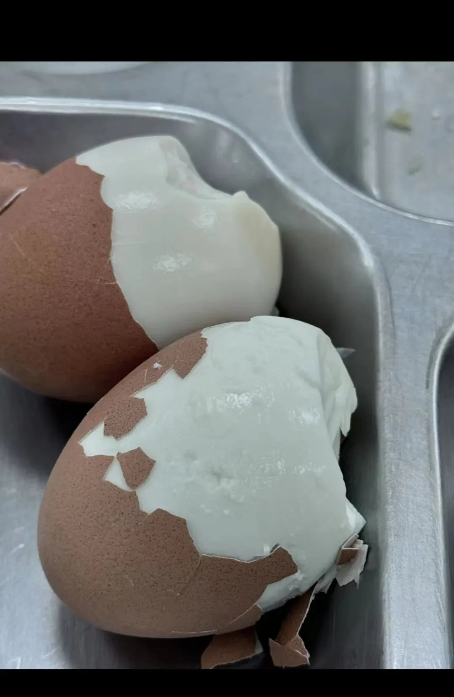
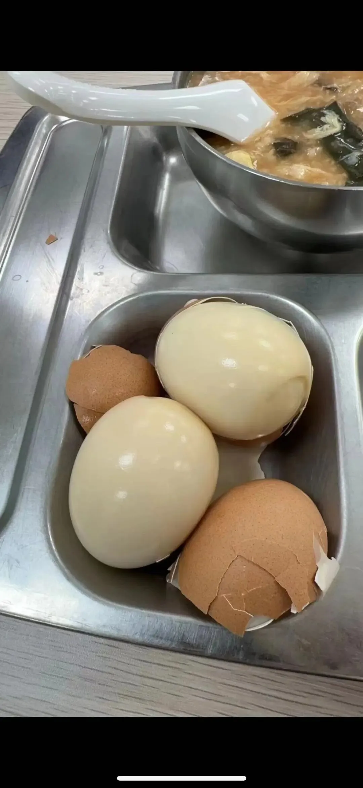

请相关部门及时关注并跟进问题。

## 1 毕业相关

> “夸夸应用经济学院2024毕业晚会吧，从门票到节目单都很有设计感，真的挺好的。节目安排、每个同学和老师以及外援的表演都很棒，还有回忆杀。游戏和互动环节很有趣，主持人控场和临场应变能力很不错，送的零食也充满了童年回忆，希望每个学院都按这个标准来！”

> “建议24届毕业生集体拒绝参加晚间毕业典礼，毕业典礼是结束，更是新的开始，大家都是来接收前程似锦、一路生花的祝福的，是走向光明未来的，不是走向晚间黄昏的，教员都说你们是八九点钟的太阳、世界是你们的，他老人家为啥不说你们是傍晚的晚霞？学校领导太不合格了👎简直就是没脑子！！！”

## 2 会务

> “事情发生在今天下午行政楼140的党纪大会之前。在开场之前有几位老师在第一排准备签到。其中签到处离门最近的一位男老师。我们学生问“请问老师，学生在哪里签到？”那老师一脸蛮横的回答：“我不知道！签到的事情别问我！”但是明明他就是在签到台的位置上站着看着其他老师在签字，不知道他说这个是什么意思？同时还有其他的几位老师听到了之后只是笑呵呵的，也没有回答。我不理解，他的态度是针对个人还是针对谁？支持学校调查监控和当时在场的老师，问一问本人他当时究竟是负责什么的？ 为人师表就是这样回答同学问题的？”

## 3 食堂

> “这样的鸡蛋真的是新鲜的吗，所有人看见了心里都有数。现场的颜色拍起来很触目惊心。 地点在望京，我一直都有吃鸡蛋的习惯，之前的蛋白是很白的，阿姨解释是煮久了，并展示给我他们吃的也是一样的，我很理解她们，但是我真的知道并不是所有变黄都是煮久了，那蛋白都块状絮状了，不难看出是因为不新鲜。我要毕业了，也不喜欢旁生事端，只希望大家吃到新鲜的鸡蛋吧。”

