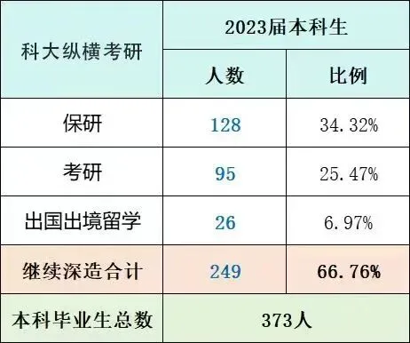

请相关部门及时关注并跟进问题。

## 1 毕业问题

“学校的毕业典礼有考虑过望京的学生吗，你晚上7点半举行，望京的学生回望京得几点了”

（见《[【读者投稿】毕业相关有褒有贬 会务食堂引发疑问](https://mp.weixin.qq.com/s?__biz=Mzg2MjcwNzQ1Mw==&mid=2247488786&idx=1&sn=25a5ac1493d1f3fb74317639765d8a98&chksm=ce029e80f975179613b9541c01a395a622e9de1033edc46c4fbb161b972572bacb850ba0d23f&scene=21#wechat_redirect)》第1.2）

## 2 校园基建

> “社论君你好，投稿。第一次看见能有学校把“基础设施与公共活动区域匮乏”说的这么清新脱俗的，能不能少来一些岁月静好式宣传，赶紧把那破楼修起来，发这些令人啼笑皆非的公众号推文是能刷GDP吗？这甚至还有错字，更幽默了。”

## 3 超市

> “投稿望京校区超市，今天买冰棒，拿出来发现涨袋了，对比了一下同款其他几只冰棒，确定是涨袋，然后我和店员说这一袋涨袋了，你们这个应该扔了，然后店员居然说没事儿？说很多都会这样？我反正是无语了，看到她把那一袋又拿进去了，不知道有没有放回冰箱，如果超市能看到建议你们扔了，然后手机搜一下涨袋的食物能不能吃”

## 4 食堂

> “二食堂自选一到周末，五个加热台，菜都放不满三个（注意说的是菜）？中午自选区也不开空调？ 觉得周末人少是吧，其实只是因为你的菜烂，人才少的。 二食堂相当于只有一个竞争对手（一食堂），还能把人都逼走，简直天才！”

## 5 奖助补费

“因为很多同学都在与性质类似的果壳对比，以现在的skd和现在的果壳对比是不公允的。果壳2012年成立，比我们学校成立早5年，再加上果壳是自然科学领域，本就比我们人文社科更具优势。而且我们学校也在不断努力，不停进步。就拿保研率来讲，我们学校今年保研率应该是34.3，而同时期（2019年）果壳是27.5，当然也不能说明我们比他们发展的好，毕竟果壳第一轮双一流就入选了，而我们错过了第一轮，第二轮也没有。但还是想说学校还是一直在正向发展的，我在学校这两年，每年都会新增定向选调的范围，其他学院不清楚，法学院今年还新增了检察院的宣讲，北京高院去年10月还与我校等9所院校建立了法治人才培养合作共建机制。我是能切实体会到学校一直在努力的。 还有很多同学提到提高研究生补助一事儿，即使我要毕业了享受不到，但我也希望学校能够提高，毕竟这对于学校也是一大好事儿，能够增强学校的吸引力和凝聚力。虽然我不是校领导，我也知道这个事情不是很简单就能决定的，我们可以每天催，每天提，但是很不想听到“怎么还没有提高”这种说法，好像是你说了就能一下子决定一样，显的这样说的人很没有脑子。 我们是处在陪学校一起成长的阶段，肯定有些不尽如人意的地方，希望我们学生能给予学校更多的包容、理解和支持。同时也希望学校的一些工作人员能够认真负责，多为学生考虑，身在其位谋其职，只要学校与学生共同发力，我们的学校才能够越来越好。也祝愿学校能够在下一轮双一流评选中大放异彩，一鸣惊人！

附一张我们学校2024年最新保研率的截图，消息不知道是否准确，也希望有确切消息的同学能够证明或者改正”

