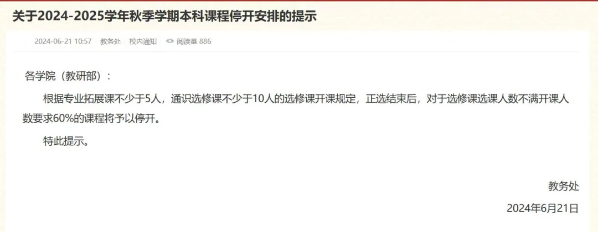

请相关部门及时关注并跟进问题。

## 1 数据库

> “学校竟然连“四库”全文检索都没买，雕龙是这方面最全的，但是没买全人家的四库系列，好一个“一流文科高校”啊，图书馆没啥古籍也就算了，毕竟您“年轻”（这幌子还能用10年），数据库也是捉襟见肘，额~”

## 2 教务问题

“以往每个学期都能出现明明人数差的很多，而要通过各种手段把某门课拉进退改选从而组织人凑人头的情况，这样干是对教学秩序的破坏和对其他课程、老师、同学的不公平。

今天正选就结束了，前不久教务处这个通知说的挺好的。只是希望教务处能够切实这么做。按这个标准，低于3人的专业拓展课和低于6人的公共选修课就应该停开。希望教务处能够及时统计，早日集中公布相关课程信息，维护这个规定的有效性——而不是再出现某些课明明没达到标准还要保留到退改选的情况。这背后体现的是教务处的公信力之所在。另有一个建议，教务处应该统计一下哪些课总是无法开设（人不够），这样的课除非特殊情况（班级人数较少、冷门语言），应该有一个调整机制，从培养方案中暂时拿掉。所谓一流大学的培养方案不应有这些质量不佳、以次充好的课程。某些课程年年排，年年都开不起来。建议是某门课程无论公选还是专选（除特殊情况），如果三次及以上无法开设的话，就应该至少暂停一年开设。免得耽误排课老师的时间，耽误安排教室。这种课就属于“水课”的范畴。社科大并不是课太多，而是需要给这些课挤挤水分，裁汰掉一些明显不合适的课，以正视听。”

## 3 学校超市

“今天到新超市准备购物，听见员工的对话，大吃一惊!在此分享给我的同学们!或许需要请新超市原谅!我们社科大的学生真的没有能力让你们短时间内快速挣很多的钱!

阿姨A:真是麻烦，水果还得给切，问切收不收费……

阿姨B:收啊，你没说打包盒要收费啊？五毛钱!人家理工大打包盒都是一块钱呢，就我们这都还嫌贵，真是……

作为学校的超市，同学有需要，也只是询问，能提供服务就提供，提供不了就拒绝，背后吐槽我们学生……虽然作为旁观者，但不免心生凉意，真真是觉得校园里的超市少了许多温暖了……

想起之前，疫情期间，在大家最难的时候，研缘超市会给同学们免费代购山姆，给封控的同学们免费准备新鲜的水果，那个寒冬里让我感受到了社科大的温暖!

现在……新超市，或许我不会再来消费了……”

## 4 奖助补费

“笑死了，一提到别的学校的优点，就开始跟这个不能比，跟那个不能比，但比起烂来可没见怂过啊，没能力办大学就别办了”

“投稿，针对“我们可以每天催，每天提，但是很不想听到‘怎么还没有提高’这种说法，好像是你说了就能一下子决定一样，显的这样说的人很没有脑子”。

我们诉求是啥？就是要提高。不需要任何成本的嘴上说的“学生满意”没啥用，我们需要的就是待遇的改善。不知道阁下的小脑袋瓜容量几何，能否想清楚这个最基本的问题？”

（见《[【读者投稿】花园美丽只独自 思想交融却餐厅](https://mp.weixin.qq.com/s?__biz=Mzg2MjcwNzQ1Mw==&mid=2247488797&idx=1&sn=a90b7614d8ef4470d1030595dd16f831&chksm=ce029e8ff9751799a38eefae0c1ebb507d71c20e0441f83a149d040b0740353509b40086abbc&scene=21#wechat_redirect)》第5条）
