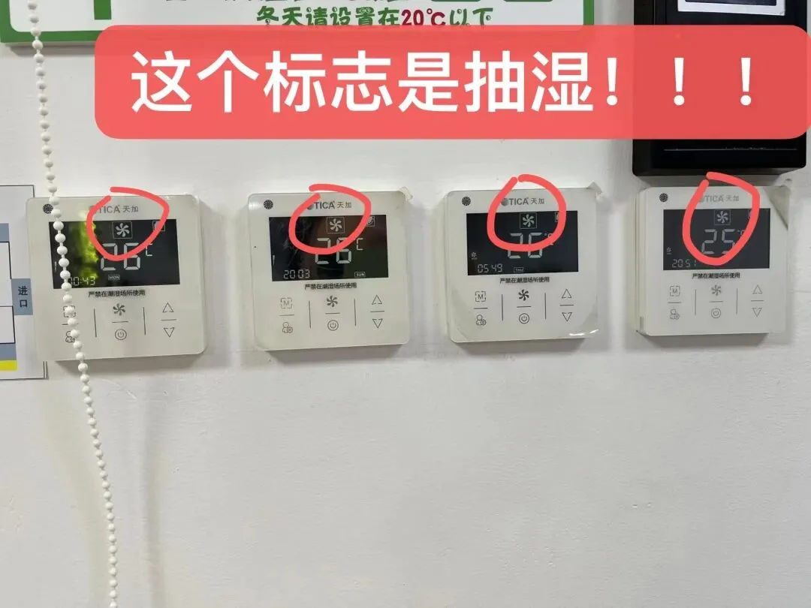
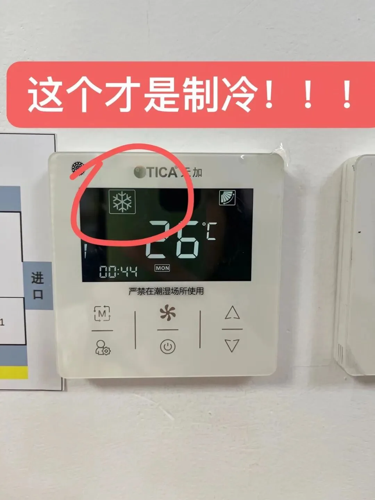

请相关部门及时关注并跟进问题。

## 1 学位证书

## “学学隔壁的双语版毕业证、学位证！”

## 2 图书馆

> “我真的求求某位人才不要再把望京图书馆三楼研讨室那边的空调调成抽湿了，再抽我就要变干尸了。我还寻思空调怎么突然坏了，25度都不制冷了，原来是被人调成抽湿了。连续两天了，每天来到都又闷又热，今天终于被我发现端倪了，原来是开的抽湿！！！！”

## 3 学校超市

“关于学校超市。对于新超市，因为去的少不了解不做评价，而对于研缘超市，其服务态度应当说是极好的，热情温暖，有问题解决问题的那种。”

## “研缘现在冰棍比新超市低，梦龙7.2，新超市9块，其他的自行对比。”

（见《[【读者投稿】学术生活又生新问 补助痼疾仍未解决](https://mp.weixin.qq.com/s?__biz=Mzg2MjcwNzQ1Mw==&mid=2247488809&idx=1&sn=ec7a58f6c5765160d35d59840e86b8d3&chksm=ce029ebbf97517adc00d0dca7afbf896dad760798d27fb3c0a618ce7957d13a9a5c15d9cebcb&scene=21#wechat_redirect)》第3条）

## 4 教务问题

## “社论你好，投稿。严重不同意24号第二条稿件的内容，凭什么空口鉴水课啊？

首先，退一万步说你可能觉得拉人头凑数很不齿，但从未有任何规定说这样是不合规的。

其次，水不水课需要群众共同说了算，你一口一个替排课老师节约排课时间，很难想象你到底是为了给大家提高质量还是为了教务处清闲摸鱼。

另，除了您说的班级人少、冷门语言外，还有很多可能都开不起来：任职教师第一次开课、相关类型课程在校内无前置、某领域问题专业性太强劝退不少人等等……一言以蔽之，根本没有想象的那么简单，而且统计根本没有价值和可参考性，我举个例子：多少身边人的教学评估是胡乱选胡乱圈的，想必此君应当清楚我非虚言，已经选了课的人不少都懒得评价，难不成你要出一个表问问没选的人，大家为什么不选？你甚至连统计的对象都找不到，除非给全校的人发一遍：“你选了吗——没选——哦那么为什么不选呢”（毕竟选了的那几个肯定不希望开不起来）

最后，水课与否确实可以以选课人数作为一个指标，但绝对也不可能是唯一指标。事实上在这所学校里，很多人都乐于选择一些水课并在课上摸鱼，只要期末赋分高或划重点；有些最水的课其实反而在一些必修课里，这些人的饭碗是铁的，如某q姓史纲教师、y姓体育教师等开设的课程。群众的眼睛是雪亮的，你想擦可以，不要拿块臭抹布过来糊弄我们。

（见《[【读者投稿】学术生活又生新问 补助痼疾仍未解决](https://mp.weixin.qq.com/s?__biz=Mzg2MjcwNzQ1Mw==&mid=2247488809&idx=1&sn=ec7a58f6c5765160d35d59840e86b8d3&chksm=ce029ebbf97517adc00d0dca7afbf896dad760798d27fb3c0a618ce7957d13a9a5c15d9cebcb&scene=21#wechat_redirect)》第2条）

## 5 公共空间

## “投稿

看了最近几期的一些内容，甚是感慨。现在社科大里可以看到这样一种怪现象，对权力我体谅有佳、有疑问我冷嘲热讽。有了不足，“挺身而出”麻醉大家学校已经很好了；面对问题，第一时间赶来嘲笑提出问题的人。你看嘛，有人反映新超市的问题，就有聪明绝顶者急不可耐地跳出来以为订出一本合订本；大家一直在说补助不足的事，就有自认妥帖者皱眉觉得这些“杂音”太过吵闹了，干扰到了学校的正常运行。

很可惜，权力不会因为这些人的趋炎附势高看其一眼，将别人踩在脚下也证明不了这些人的水平又如何。但凡思考一下，便能够想到大家批评哪个超市不重要，哪个超市存在什么问题才重要。旧超市存在哪些问题、新超市又存在哪些问题，大家批评的点能一样吗，这些被批评的点难道不应该被批评吗，想要获得一个货品优廉、服务良好的校园超市就这么难、该这么难吗？研缘出校之后价格似乎更加惠民，那么校方在招租过程中是否存在某些猫腻，这些成本应该转嫁到消费者身上吗......补助不足的问题也是实所共鉴了，在资源分配清正廉洁的情况下，至于让每个硕博都拿着全国倒数有名的补助吗，有些人还真就一毛不拔啊，这样的以及类似这样的很多的丑闻又让招生工作情何以堪呢。拿着本来应该服务于你的资源，去在黑箱中干着不明不白的事，给这样的人唱赞歌的人也是有点可笑在的。说到底，这所学校太多地方需要变革了，早日优化相关制度建设、提升行政管理水平对每一个人都有长远的好处，师生可以减少很多不必要的内耗一心一意谋发展，职工也能少干很多无谓的事情全心全意搞服务，对立与不解会少很多，每个人被记在身上的母校也不会是一个很差的状态。在这种情况下还大唱赞歌粉饰太平，实在是有点短视了。

说到可笑，觉得别人言论有问题很正常，但觉得别人言论可笑所以自己主动选择沉默就有点奇怪了。事本关己，断不能高高挂起；若有余力，则应当出力建设。一个相对打开的公共空间，如果缺乏在其中的人的建设，那便无异于并不存在。如果你觉得其他人的发言存在问题，为着自己和学校的发展，也不应该保持沉默。觉得别人有多垃圾所以你有多高贵肯定不是建设，能够指出问题在哪里，自己针对这个问题又有什么见解，想来才能够证明自己到底有多厉害。很多言论的确非常荒谬，但相信通过不断地论辩，还是能够披沙拣金、得出一些东西来的。少一点内核里的冷眼旁观，多一分实践中的公共精神，这所学校才能变得更好。究竟是粉饰太平、冷眼旁观问题提出者能给这所学校带来更多，还是对权力保持一种批判的态度、发现问题解决问题能带来更多，应该并非只有天知道吧。

最后还是要吐槽，有些人可以说是和他们在社科大遭遇的一切绝配。对于这些人，我其实是笑不出来的，只有极深极深的悲哀，不过又能说什么呢？尊重祝福而已。只好真诚祝愿每一个讲理的社科大人，莫要中了有些人分化瓦解的奸计，多一份敢于为自己发声的勇气，多一点善于推动整体发展的智慧。”

（见《[【读者投稿】学术生活又生新问 补助痼疾仍未解决](https://mp.weixin.qq.com/s?__biz=Mzg2MjcwNzQ1Mw==&mid=2247488809&idx=1&sn=ec7a58f6c5765160d35d59840e86b8d3&chksm=ce029ebbf97517adc00d0dca7afbf896dad760798d27fb3c0a618ce7957d13a9a5c15d9cebcb&scene=21#wechat_redirect)》）
