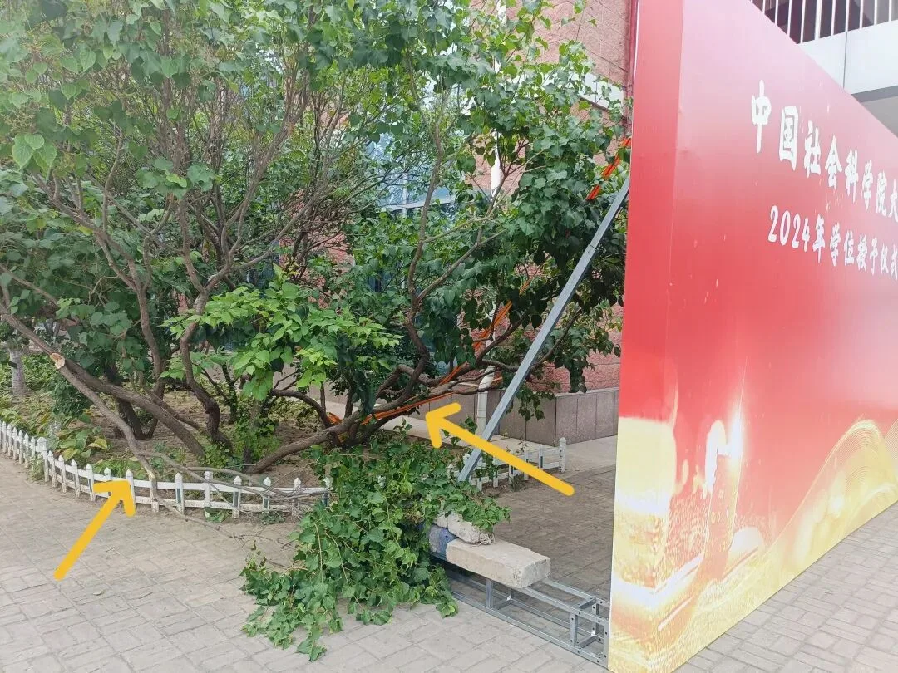

请相关部门及时关注并跟进问题。

## 1 招生问题

“投稿。skd部分人对于其他兄弟高校的傲慢令人震惊。比如前日有个大仙说山大（我猜应该指的是山东大学，山西大学可能尚入不了此君法眼）吉大不要来“碰瓷”skd，我很好奇，skd固然可以说自己背靠社科院努力打造一流文科大学，但skd无论在办学质量上还是录取分数上是否具备了足以轻视这两所老牌985（且还是人文社科有专长的985）的资本？须知绝大部分社会公众和用人单位只知985211双一流，创建双一流这个问题不解决，部分skd人的莫名自信——不管你高考考多少来此——都只能被视为一种毫无客观基础的傲慢。

补充：这种傲慢不但不会让人对你增加敬意，而且还会为“文科无用论”增加一个极具支持力的脚注。”

## 2 学校超市

## “引用：2024年6月26日

“研缘搬出校外反而更便宜，新超市胡作非为也不见管，真是戳破了某些人的面具，恐怕再也没法装下去喽。”

1. “更便宜”：“你怎么只看那些贵的，明明水果就更便宜。”（是不是很合理）。便宜至少有三种计算方式：

第一，从每个消费者自身来看，会获得自己日常消费品价格变动的直观感受（用以判断是否便宜），但这样的抽样方式会导致不同同学无法得出一致的结论；

第二，简单平均，把超市的商品价格（按类别）加总除以商品的数量。

第三，加权平均，将商品的销量纳入考量，（加总A类下每一个商品的价格✖️对应商品的销量）/A类销售商品总量。

第二种计算方式的假设是所有商品的销量没有太大的差异，但如果存在差异，第二种方式无法反映“大家常买的贵”和“大家不常买的便宜”的情况。

2. 此外，水果的“便宜”有其特殊性，相较于其他商品有明确的品牌、保质期、口味有相对稳定的价格，“水果”的价格区间更大。举个例子，同样的农夫山泉550ml普通装矿泉水，我们可以很直接比较不同超市的价格，但同样是“西瓜”，有一块的、三块的、五块的，相对应的是不同的“品质”。目前能看到的是新超市的西瓜价格略低于北门的研缘，但品质是否一致不知。若不一致说“新超市水果比研缘便宜”的说法便站不住脚吧。

3. 研缘搬出去可能各方面成本更低了，所以价格有下调。有时在想，是不是在校内消费，也需要交一种“消费税”，为校内的便利（房租）买单？（当然，毕竟学校也有管理成本，理解）。

以上只是一些想法，缺乏证据支撑（欢迎大家补充资料），仅供讨论。

最后有两个小问题：为什么“便宜”的“研缘”超市走了？为什么“更便宜”的新超市进来了？（应该是两个问题吧）

成为“清北”“一类”的学校或许还有很长的“距离”，但这不妨碍我们了解我们所在的环境和处境，没有证据支持的说法只是观点，是什么阻碍了我们了解呢？有一天我们走出这个校园，不应该只知道这儿有哪些“不足”，还应该知道为什么会这样（跳出“双一流”解释的路径依赖，不断追问）。去理解那些“大家都想改变”却无力改变的事实，少一些误解，以及为“可以改变的现实”而努力，毕业快乐！”

## 3 校园基建

“投稿：【如图】这就是“人文之光”的操作？树是这样拿来用的吗？一枝被折断，另一边树被作为固定点，用绳子拉住？”

## 4 食堂

> “投稿：请二食堂和麻辣烫窗口沟通好，到底米饭要不要钱，去年以前做麻辣烫的都免费米饭，为什么新的这一家一会要刷米饭钱不一会不刷，提前说好刷就刷了，但现在不同员工态度还不一样的。”

## 5 毕业问题

“什么？不搬出宿舍就不给毕业证？？？真的是闻所未闻，见所未见，社科大你是真牛皮啊！能滥用职权到这种地步，真是敬佩，这么霸气的行为真是应该广为宣传，写进招生简章。

之前听某某说知乎治校，有损学校声誉，学校还在成长，可是你们但凡干点人事，也不至于知乎治校，敢做就别怕人说，这成长速度未免有点太慢了，而且大概率是长歪了。”

（见《[【读者投稿】庸才当道 不公不平](https://mp.weixin.qq.com/s?__biz=Mzg2MjcwNzQ1Mw==&mid=2247488863&idx=1&sn=2dac6124a1fa7bb4802eafc275dc149e&chksm=ce029ecdf97517db27e8bb047cacef6ef65bc5a9335fe00062403099d188a8552f5d4a6903ea&scene=21#wechat_redirect)》第2条）

## 6 公共空间

## “投稿

近期可以看到学校出现了极化的迹象，这种现象则和校方对待问题的方式密不可分。极化的现象大概可以分为三种，极端的冷漠、极端的否定与极端的肯定。不去揣测心理，有小部分人趋向于为反对而反对、为肯定而肯定，要不愤激、要不苟合，都越来越脱离实际情况。比如说新楼即将盖成做个宣传本不是坏事。虽说“洋气”这种宣传确实很没水平，但不至于无限上纲上线，也不至于把疑问都打成不欢迎新楼的建设。学校有什么问题，实事求是地进行批评即可。除此之外，还很有一部分人则渐渐觉得学校已经“无可救药”了，做什么都不管用，逐渐地变化成对学校发生了什么都冷眼旁观，这都不是什么好的现象。

为什么会出现这种让人忧心的情况？很大一部分原因在于校方面对问题思维或者说处理方式的落后。面对问题反应非常迟缓、接诉平台等渠道建设也一直反响平平，没有拿出解决问题的方案、也不肯做出解决问题的态度，多是选择性地解决一些小问题、尝试以各类方法分化瓦解学生。你看大家一直呼声都很高的补助问题、吐槽不断的各类毕业问题、疑问一针见血的奖学金问题等等，这些问题都是大家切身处地能感受到的事情。试想一个人如果长期处在这些问题之中，去接办平台等各类渠道上又基本只能拿个敷衍的回复甚至得不到回复。这人血压能不上来吗？在这种情况下要不尝试自我说服学校生活已经很好了，要不不满就会继续发酵。长此以往，必然走向极化，这对整个学校都没有好处。如果我是校方的人看到极化情况我反正笑不出来，如果是真心实意想着学校好而不是看大家内斗乐不可支的话。

有什么问题，就实事求是地面对问题，开诚布公地谈论问题，就像之前笔者投稿所言“少一点内核里的冷眼旁观，多一分实践中的公共精神，这所学校才能变得更好”。为什么之前有人说问题的解决存在“窗口期”，看上去是因为问题真的越拖越复杂。就像这个补助问题以及其他一些老大难问题，在招生季大家看到心情会很复杂，加上积怨已久，自然都会有些很愤激的质疑吐出来，这个时候更见公共讨论的重要性。还是那句话，“真诚祝愿每一个讲理的社科大人，莫要中了有些人分化瓦解的奸计，多一份敢于为自己发声的勇气，多一点善于推动整体发展的智慧”。望诸君共勉。”

（见《[【读者投稿】教务生活各有见解 讨论空间异彩纷呈](https://mp.weixin.qq.com/s?__biz=Mzg2MjcwNzQ1Mw==&mid=2247488820&idx=1&sn=cdc08298f76266324523d3dfda781540&chksm=ce029ea6f97517b0e669f658418ed0671cac7baef44ac530ebfe9b4117b8357e212de416f763&scene=21#wechat_redirect)》第5条）
