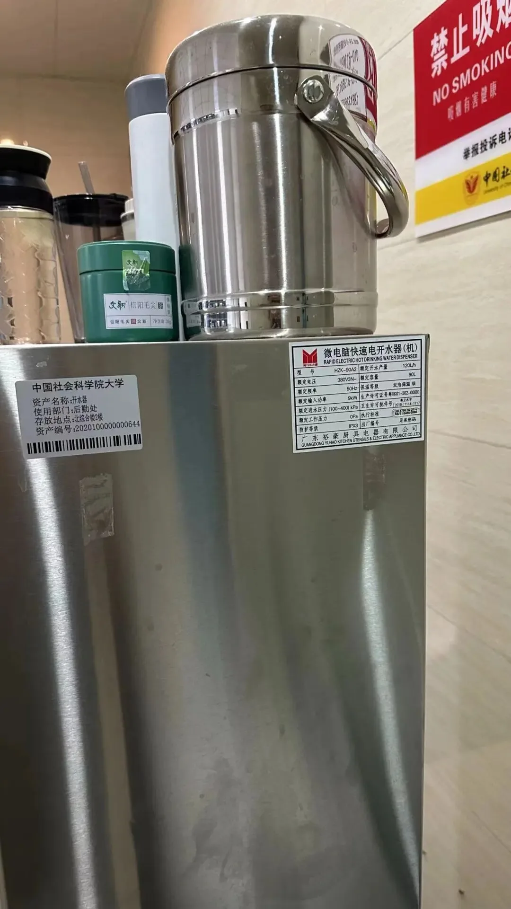
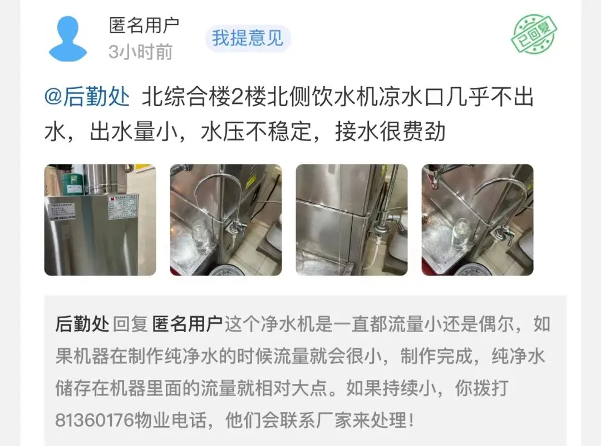
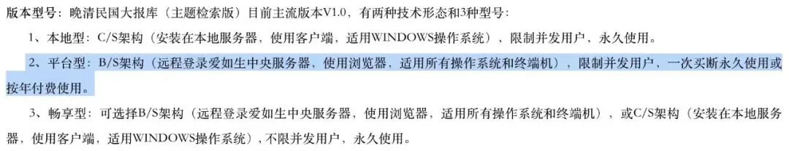

请相关部门及时关注并跟进问题。

## 1 接诉平台

> “投稿 我反应饮水机水流小，后勤处让我给物业打电话去，这个机器是后勤处的机器，咋还得我一个学生给物业打电话呢？那我给他提意见有啥用？让他给我一个物业的电话吗？我个人认为，应该后勤处自行联系物业，自己把事情解决好，不要把皮球踢回到学生身上”

## 2 图书馆

## “图书馆能不能买爱如生数据库的平台型？苹果电脑用不了本地型”

## 3 招生问题

> “（因投稿人声明撤稿，此条稿件作废）24级硕士新生 看了投稿感觉前途灰暗…本科是北京top211的国家双一流专业，因为仰慕社科大的“学术氛围”才决定考研来这 这几天刷社媒平台一些校友留言，真感觉有点后悔了”

> “学校本科招生组是两耳不闻窗外事吗，招生群内给高考生提供的信息完全不符合实际，估计还是用的刚建校的投档线和位次排名，湖北为例：省排文科700名左右才能稳上社科大？1000名国家专项接受调剂可以冲一下？大人您好时代早变了好吗，人家700名能擦边上北师大华东师大中山南开那又为什么会来这里，又不是刚建校那么充满幻想，现在你校最低投档线能拉到2000名都是求佛，你这么一套连招下来人家能上的都要吓死，想着算了不报了。这简直严重拉低学校本科招生宣传质量，感觉又是一年分数线大滑”

## 4 超市问题

“要交“消费税”的又是哪位大爷来反串的啊，怕是你也不怎么在校内超市消费吧，贵不贵但凡那两眼不是出气的就能看出来”

## “关于超市问题有几点想法

一，这是一个市场经济的时代超市定价贵还是便宜，也是自己意思自治的，无可指摘，即使他们一瓶水卖一百 觉得贵，就去研缘，用脚投票，比用嘴高效得多，最多七天就可见效。大家都很懂人文社科，不懂也至少都背得滚瓜烂熟，应该知道用嘴在诸多意见表达方式上是最无力的那一类。第二 ，就算用嘴投票，人文之光社论是向学校提问题，新超市老板知不知道这个公众号都难说，要提意见可以直接和超市提嘛，不过听不听是他们的事了。向学校提，我想不管是法律上还是道义上也没法强制让超市改进，超市和学校签的是合同，又没有上下级关系，在这开炮，也没打对地方。

第三，说到通过超市更换所反映的学校行政问题，有两种可能，第一学校也不知道超市开了会变成什么样，只是遵循招标规则价高者得，那现在这个样子也怨不得学校。第二，超市和学校有什么私下沟通，秉着疑罪从无的原则，除非我们能证明第二个可能成立，不然我们还是相信学校在这方面没有什么太大的过错吧，只能说研缘太好，新超市相形见绌。在这一点上放过学校行政，也是放过我们自己。”

“这个所谓要为学校的便利二次埋单的交税说只能说荒谬绝伦。如果说你要交了所谓的税的话，那你就具有使得学校更便利的权利，使得你的份额花的物有所值嘛。再者，其实你本来来学校学习就已经缴纳过自己的份额了，怎么还要再交一次？如果学校不够便利，反而是对不住自己上交的份额。不错，学生明面上交的这点钱似乎完全不足挂齿，但其实上学生低廉的学费背后必然隐藏着转移支付的巨大份额。贵校创收（这里是说给学校创收，不是自肥能力）的能力想来微乎其微，学生明面上没有交的钱，背后全是财政拨款。财政拨款不是有些混淆视听的人认为是上面的赏赐，而是纳税人的税金。那么问题就变成了纳税人给学校缴这么多钱真正是为了什么？想来不是供校方老爷敲骨吸髓、有些混淆视听的爪牙分一杯羹的，而是在于为了培养这个社会中的新人的。

所谓培养，在大学这个大家走向社会前最后一站似乎可以简单概括为掌握安身立命的生存能力和拥有整全人格的生命能力，前者帮助一个人怎么样活下去，后者则告诉一个人活下去是为什么。针对这两方面或言什么是教育有很多精妙见解，不再班门弄斧。让我们回到社科大这所现代大学下的一些问题。后勤保障无疑是学校生活的重要一环，与生活在大学中的每个人休戚与共。为了拥有基本的生活保障以便能够接受更好的教育，对后勤关注就既是一项天然权利也更是一项对纳税人的责任。而且通过对学校相关事宜的监督操练，也可以很好地习得走向社会怎样做一个合格的业主、怎样去培养公共关怀做一个合格的公民。前者是基本的生存技能，后者是整全人格中不可或缺的一部分。因此要说监督学校相关事宜，无疑合理且正当。这些内容其实已不知是多少年重谈的老调了，没想到4042年还能看到有人在这混淆视听，姑且笑之。

而从结构性的规训以及对其的拒绝来想这个问题。那么监督或者这个语境下的拒绝就更加重要。如果你连基本的怀疑都不敢表达，那无疑于是对某些要素背后现行结构的屈从，是对自我沦为再生产工具的默许，这除了无聊与懦弱之外，又何谈创制呢？即使作为不服从的沉默也不是默许，而是表达。”

（见《[【读者投稿】是什么阻碍我们了解](https://mp.weixin.qq.com/s?__biz=Mzg2MjcwNzQ1Mw==&mid=2247488869&idx=1&sn=204cf2c81ba78aaf8bf6b691929cb351&scene=21#wechat_redirect)》第2条）

## 5 毕业问题

> “哪个学校都是办完离校手续后才给发放毕业证的，包括北京大学，其中离校手续包括宿舍腾退，（具体规定节选：完成学校各项离校手续后，请携带红本研究生学生证前往教务办公室领取毕业证书、学位证书等毕业材料。）所以请别再无端指责学校”

（见《[【读者投稿】是什么阻碍我们了解](https://mp.weixin.qq.com/s?__biz=Mzg2MjcwNzQ1Mw==&mid=2247488869&idx=1&sn=204cf2c81ba78aaf8bf6b691929cb351&scene=21#wechat_redirect)》第5条）

## 6 公共讨论

> “希望矛盾不要激化，大家和气生财啊学校是大家的学校是每一个人的学校，大家都应该盼着学校点好，也团结一点。毕竟咱也。接受了九年的义务教育和高中三年的培养，有什么问题咱也心平气和的提出来，不要只是无端的喷着嘛。”

（见《[【读者投稿】是什么阻碍我们了解](https://mp.weixin.qq.com/s?__biz=Mzg2MjcwNzQ1Mw==&mid=2247488869&idx=1&sn=204cf2c81ba78aaf8bf6b691929cb351&scene=21#wechat_redirect)》第6条）
