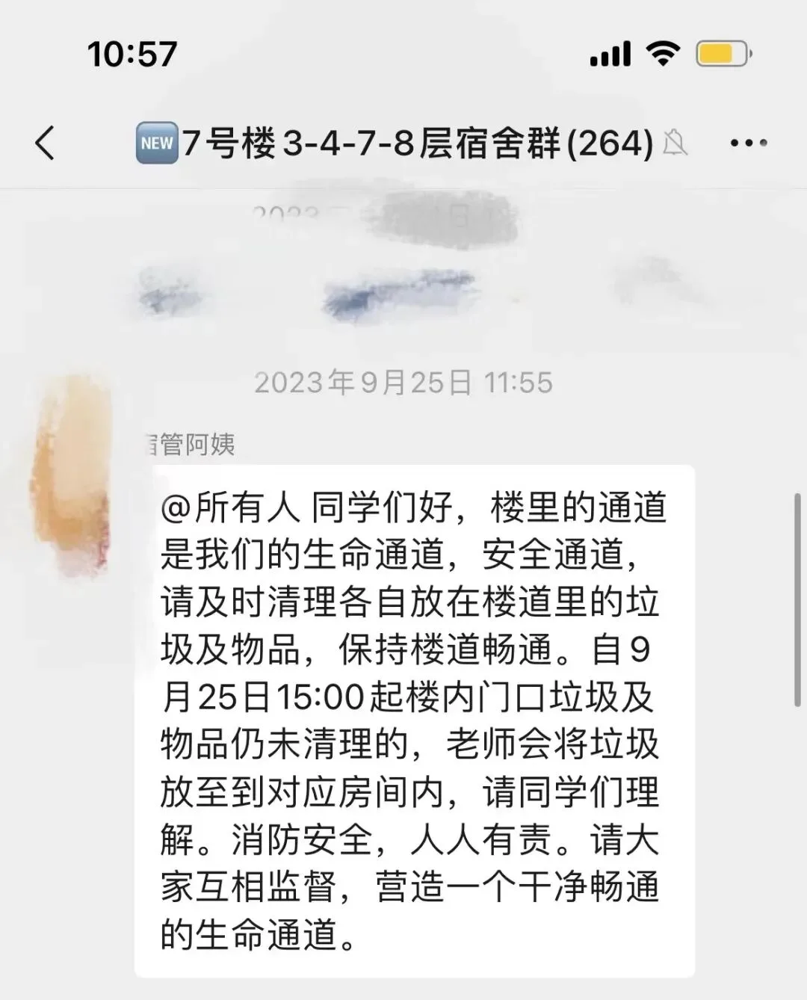
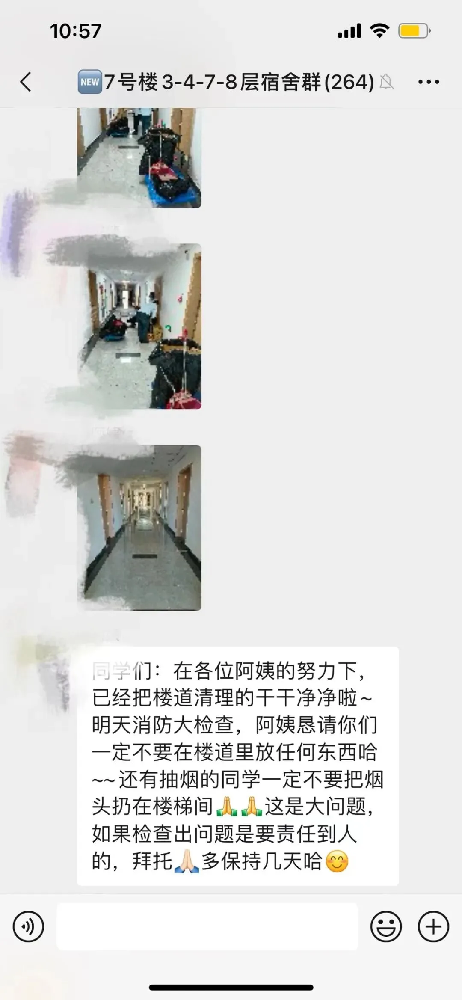
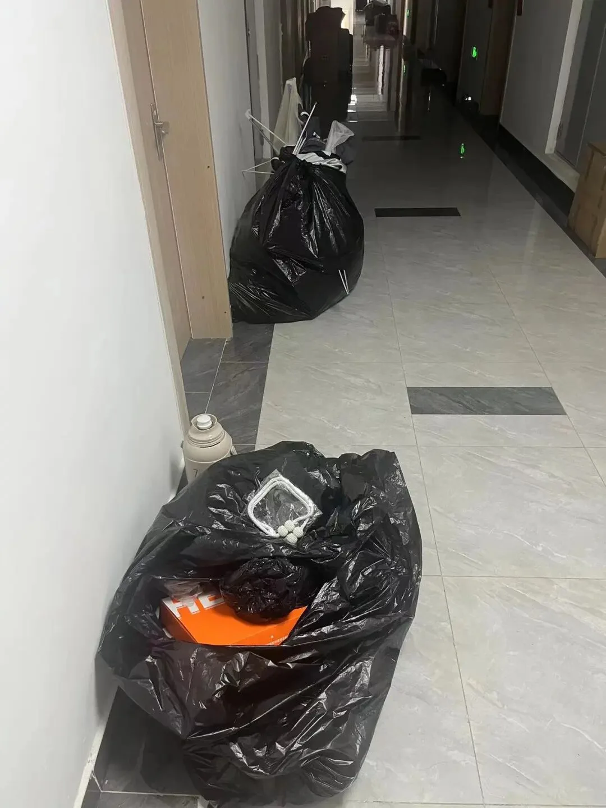

请相关部门及时关注并跟进问题。

## 1 招生问题

## “关于我校招生工作的吐槽

作为一名多次参与招生工作的学生，我想分享一些个人感受。近年来，我校的招生分数线逐年下降，这已经不是什么新鲜事。今年的分数线虽然尚未公布，但考虑到整体文科的衰退以及缺乏“双一流”等影响，今年的分数线估计也不会太乐观。分数线下滑的原因有很多，其中最核心的原因是学校硬实力的不足，但招生工作的薄弱也不容忽视。首先，今年的招生工作被分派到各学院，但每个学院为何被分配到特定地区的原因并不清楚。起初我以为是因为某些招生老师与当地有较深厚的联系，虽然部分情况确实如此，但仍有学院对分配到的地区完全不熟悉。如果学院被分配到之前完全没有联系的地区，招生效果会很糟糕。负责当地招生的老师要么完全没有接触过招生工作，要么对招生地区完全不熟悉，与当地的高校也没有联系，导致招生工作流于形式，效果甚微。其次，关于补助问题。虽然我相信几乎每个参与招生工作的同学都是出于对学校的热爱和责任感，但学校在补助方面的做法确实让人寒心。以下情况并非我个人遭遇，而是在招生过程中所见所闻，但都是真实发生的：1、某学生因机票时间问题，落地机场已是午夜12点，公共交通停运，只能打车回校，近400元的打车费用学校却不予报销，理由是每天的交通补贴是80元包干。对此，我想问学校，这样的做法是否过于缺乏人情味？如果不是万不得已，谁会愿意买这么晚的航班？如果不打车回校，半夜12点难道让一个女生自己走回学校吗？若在外面住一晚，学校会报销住宿费吗？2、今年招生工作没有额外的劳务费，这对于需要学生付出大量时间和精力的工作而言本就不合理。学生能拿到的补助只有每天100元的餐补和80元的交通补贴。出差在外本就会遇到许多突发情况，但学校对这点补助也要斤斤计较。比如某天学生在招生过程中被当地负责了一顿饭，学校就会取消当天的餐补。说真的，学生参加招生活动本不是为了挣钱，但学校对100元都如此斤斤计较，确实让人寒心。我相信每一位参与招生工作的同学，初衷都是希望学校越来越好。看到分数线逐年下滑，学生们心里也很难受，这才愿意辛辛苦苦地去各地为学校宣传。希望学校能反思招生工作中存在的问题，有则改之，无则加勉。愿学校的明天会更好。”

## 2 校园网问题

“就问社科大，贵校的网速，连贵校毕业典礼视频都点不开，看不了！！贵校怎么好意思的？？？”

## 3 宿舍

> “恳请考虑硕博士的睡眠将1号楼楼道拖地保洁工作推迟到上午10点后或下午16点后。1号楼住的都是硕博士，因为学习经常会晚睡晚一些起，早上8点刚过会听到楼道里保洁工作人员用力敲拖地用拖把的声音，因为是金属的所以很响，整个楼道都能听到，会打扰同学们睡眠，希望能移到上午10点后或者下午4点后这种一般非睡眠时段”

> “宿舍管理这么双标的吗？宿管清理打扫出来的垃圾可以肆无忌惮堆在楼道，而同学们在楼道放个外卖垃圾就要被大清早敲门要求拿进来？这么大的垃圾堆在楼道突然就没有安全隐患了吗？稍微有点权力就折腾学生，这种歪风邪气还要盛行多久？”

## 4 摆渡车

> “7.3第一天摆渡车发牢骚的同学。如果校巴准时发车没提前那就是个人问题，司机没办法预估你会迟一分钟两分钟还是三分钟。车上的其他同学也不会同意多等这一会，毕竟，为什么呢为什么要等呢？无规矩不成方圆，既然规定了时间表，那就按时间表进行。您要是迟了，麻烦骑车麻烦走路。”

（见《[【读者投稿】毕业季大办事](https://mp.weixin.qq.com/s?__biz=Mzg2MjcwNzQ1Mw==&mid=2247488894&idx=1&sn=8e74852eec57518e646d97ea387f4f71&chksm=ce029eecf97517faeac5731e1fa1022e45f945a66091a3c2982756085cfbbde1245dded1c631&scene=21#wechat_redirect)》第1条）
