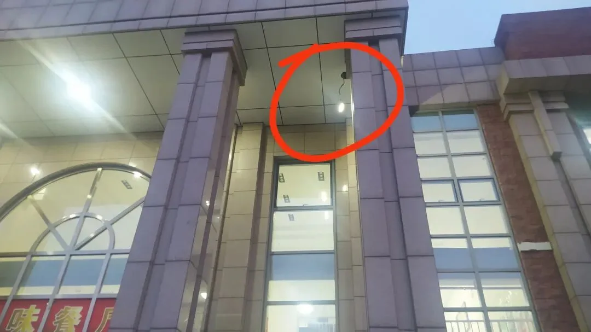

请相关部门及时关注并跟进问题。

## 1 闸机问题

## “北门闸机能用用，不能用趁早扔了，理了个发就死活刷不过去脸，这是智能还是智障？”

## 2 校园基建

## “风味食堂门口的灯掉了

## 3 就业

> “投稿：同学你好！我校2024届毕业生可以报考云南、浙江、山西、河南、河北、甘肃、广东、山东、重庆、湖北、福建、湖南等省选调生，具体关于学历层次的报考条件请查看相应省份招考公告。各省选调政策每年或有调整，并且公布公告的时间也不统一。”

（见《[【读者投稿】当毕业寄变成毕业“寄”](https://mp.weixin.qq.com/s?__biz=Mzg2MjcwNzQ1Mw==&mid=2247488916&idx=1&sn=ce6839e8a663b05b3229590bc5eab038&chksm=ce029e06f9751710540dbb4942f3c6915486d6e3d55dffc401bc38a5b33c34ad9ffc04c57655&scene=21#wechat_redirect)》第4条）

## 4 摆渡车

> “投稿，如果学校摆渡车租赁费用较高，暑假一个多月能否还是留几趟给实习的同学，减少次数但是不要完全取消，尤其五棵松地铁站的摆渡车，是学校为数不多早上“去城里”的，取消之后真的很不方便，算是给假期实习的同学一点寄托，不然这动不动挤两个小时早高峰的日子可怎么熬哇。”

（见《[【读者投稿】当毕业寄变成毕业“寄”](https://mp.weixin.qq.com/s?__biz=Mzg2MjcwNzQ1Mw==&mid=2247488916&idx=1&sn=ce6839e8a663b05b3229590bc5eab038&chksm=ce029e06f9751710540dbb4942f3c6915486d6e3d55dffc401bc38a5b33c34ad9ffc04c57655&scene=21#wechat_redirect)》第3条）
