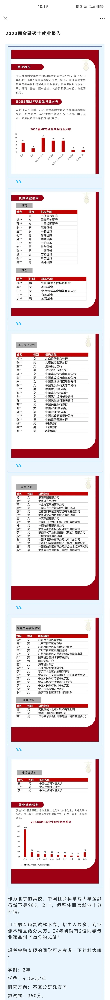

请相关部门及时关注并跟进问题。

## 1 食堂

“二食堂的桌子中这张最离谱，别的桌子也有。请负责人说明一下这玻璃下面的是这是霉斑或者是别的什么东西？让学生在这种环境下就餐，是否有点过分了？”

## 2 摆渡车

> “社论君好，同样是摆渡车问题，假期实习的同学还是挺需要的。如果为了降低成本，广阳城摆渡车能不能改成40分钟一趟，中午取消，只设早晚这样。实习的同学比较需要，谢谢社论君”

（见《[【读者投稿】就业实习正讨论 基建安保有问题](https://mp.weixin.qq.com/s?__biz=Mzg2MjcwNzQ1Mw==&mid=2247488920&idx=1&sn=a8f4ec70bddb6abaeaeb24b226e131f6&chksm=ce029e0af975171c24ffcecb93c93266915ece6d41dbb75a406b5ae3bf4d86516f003ed06ccf&scene=21#wechat_redirect)》第4条）

## 3 就业

“投稿：想请教一下社科大金融专硕的就业情况。偶然看到机构的评估，感觉就业很好的样子。哇，这还是我认识的社科大吗，厉害了。”

> “投稿，回那个所谓的选调回复。看了一下人家提问定向选调相关问题，结果回复大谈普通选调报考情况，真让人大跌眼镜，连选调生的基本情况都不了解，不应该吧；如果不了解，又回复些什么呢？不知道相关回复人员的这种回复是能表现面对问题虚与委蛇转移话题的行政方法，还是体现出对就业本职工作不清不楚糊里糊涂的行政能力，抑或是表达了对学生就业等大家关切的问题漠然视之毫无所谓的行政态度呢？”

> “看了就业投稿，山东省定向选调已有中国科学院大学、农科院研究生院，咱们社科院研究生院排除在外。还有东北地区：浙财、南审、西政等双非已进入东北地区的定向选调名单，我校也不在列。央选、北京、上海、江苏、陕西等的定向选调，我校又又又不在列。咱们社科大或者社科院的领导们能不能再努努力，多与地方省份走动走动，再拿下一些省份的定选呀！社科学子枯苗望雨、延颈鹤望，也可让人文之光实至名归！”

（见《[【读者投稿】就业实习正讨论 基建安保有问题](https://mp.weixin.qq.com/s?__biz=Mzg2MjcwNzQ1Mw==&mid=2247488920&idx=1&sn=a8f4ec70bddb6abaeaeb24b226e131f6&chksm=ce029e0af975171c24ffcecb93c93266915ece6d41dbb75a406b5ae3bf4d86516f003ed06ccf&scene=21#wechat_redirect)》第3条）
