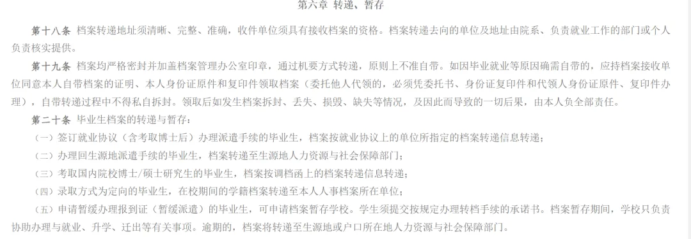
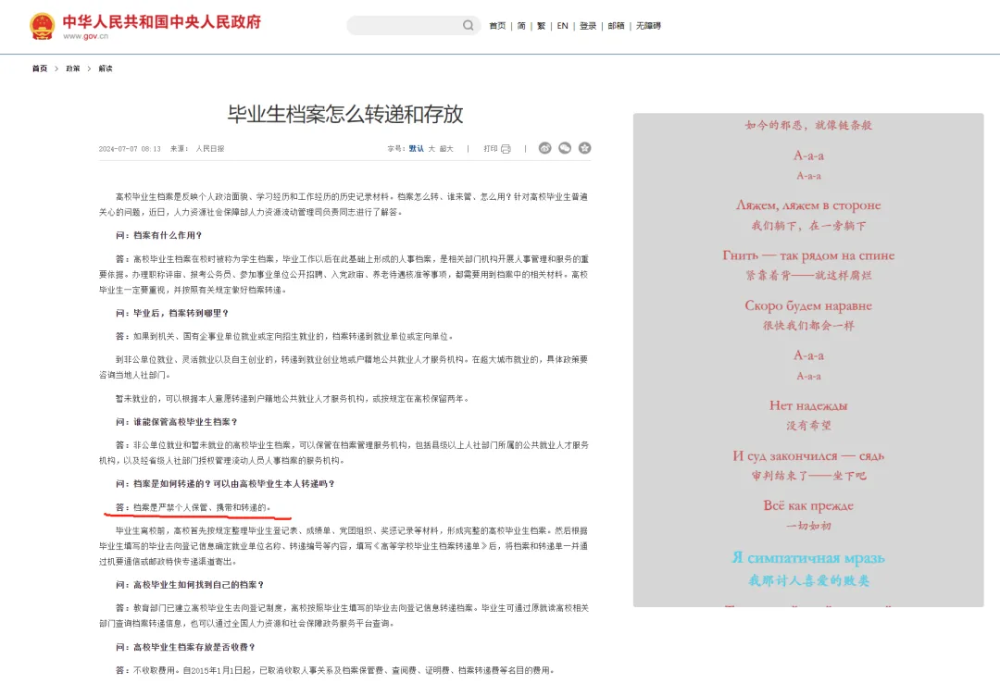

请相关部门及时关注并跟进问题。

## 1 假期值班

“投稿一下，学校假期值班管档案的良乡学生工作处为啥电话一直打不通？一周就这一次联系机会，几个人打电话都打不通，真的有人在值班工作吗”

## 2 毕业问题

> “【针对第五条】关于档案问题，现在毕业生早已无法登陆校园网查询自己的档案填写状态，当然是校方说什么就是什么了。但没想到校方还没说什么，学生就主动替校方争先恐后的发言。只能说，希望校方对得起你一片忠心耿耿吧。”

## “投稿

针对上期有个自称学生把别人的疑问打成“谣言”的“回复”，让我们简单分析一下。先不论其他，遍稽清楚公布在学校下属部门学工处官网上的《中国社会科学院大学学生档案管理办法（试行）》中有关“毕业生档案的转递与暂存”的内容，未见有一条允许在档案转递暂存之中允许档案交至毕业生个人手中，也就是原则上不准自带；就算确需自带的，也须呈“持档案接收单位同意本人自带档案的证明”（第十九条）。在这种情况下，负责转递档案的部门无论处于什么原因，如果自行将档案交至个人手中，就是违规操作。好比条文规定在情况A下可采取的操作只有a,b（在毕业生档案转递中是第二十条规定的五种操作，其中都是对单位或部门，没有一种说可以交给个人）；这个时候就算有出现在A情况下要求c操作的情况（比如将档案寄给毕业生个人手中），出于遵守规程的要求，部门也断然不可能自行接受不在规定范围内的c，如果采用必然有在请示上级部门情况下完整的解释以及说明，否则就是渎职。而针对自行转递的情况，先不论是否合乎国家相关规定，学校规定本身也要求持有证明。换言之，无论出现何种情况一定严格地留底并且档案交出与收取方均知情，档案转递部门是绝不可能以一句轻飘而不负责任的“档案邮寄系统每个人只能填写一次，在邮寄过程中，地址都是从系统统一导出，并按照学生本人填写的地址进行邮寄”作为针对这种问题的回应，而那个反映档案递交个人手中的稿件本身又明显体现出自己的不知情或者说不同意。而从情理上谈，不论档案制度本身的渊源与合理性，在档案制度下禁止个人持有自身档案乃至任何档案是必然的要求，因为这涉及一系列可能出现的档案丢失、造假以及其他不符机要精神的危险情况，作为处理档案相关部门应该具有这些起码的意识。 其次，这位朋友自称"参与的学生"，如果属实，那么则可以很明显地看出毕业季档案邮寄中不存在人手不足的问题，因为档案邮寄过程中行政工作人员明显有意识地要求了帮助。所谓人手不足无非是在规定的时间内现有人手干不完目前的活，行政工作人员已经有意识地要求了增援，那么在这种情况下还以时间紧张为由推诿塞责，不知道是想说自己对档案邮寄工作的任务情况估计严重不足呢（想必档案邮寄的各位行政工作者干了这么多年，这点经验还是有的吧），还是想表达在档案邮寄过程中存在人浮于事的行政效率不足以及对此的失察情况呢？这样看来，问题似乎越想越多呀。 还有，针对这位“学生”，很好奇其是以什么方式参与进去的呢？如果说是以勤工俭学的方式参与进来，想问一下档案工作相关部门又是在哪里发布的勤工俭学布告呢？整个征召过程有没有做到公平公开透明呢？而这些学生，最后又是否能收到补助或等效替代品，这些给学生的补偿的多少合乎相关劳务规定吗，还是严重地不足呢？看在这位同学的面上，也建议档案工作相关部门给大家再多发一点补助吧，毕竟现在学校的补助已经穷到为天下耻笑了，给大家多发一点、自己少尸位素餐一点也是很好的。毕竟活全是你们临时找的这些人干的，甚至包括回应，你们自己干了多少恐怕只有你们自己知道了。 最后，再补充一点，中央政府官网上于20204.7.7对“毕业生档案怎么转递和存放”进行了政策解读，其中明确要求“档案是严禁个人保管、携带和转递的”。不知道我们的档案工作及其上级部门对此又是否知情呢？

总的来看，本次毕业季档案转递至个人手中的事件，是档案工作部门一次重大的工作失误。这种失误，暴露出我们有些行政工作者缺乏基本的工作素养与能力意识，对本职工作与本部门相关工作条例极不熟悉，对国家相关政策方针缺乏基本理解，对学生未来前途发展缺乏关怀态度，导致行政效能极其低下、工作失误严重、服务态度极差，以至于引发广大师生的不满与不理解，并可能存在人浮于事的问题，甚至相关行政管理者也非常可能存在严重的失察以及管理不力的问题。相信这也是本校行政管理饱受诟病的一个体现，甚至说本校行政管理问题可能大抵如此。我校毕业季档案相关工作一直都为人诟病，也希望相关学校有司敢于以本事件为切口，顺着这个思路大力整顿自身队伍，不断提升服务水平。人在做，天在看，一个事究竟做的好不好，大家心明眼亮，不是让少数人出来把别人都打成谣言就能够解决的。就算堵的住大家的嘴，也不可能堵住大家的心，只有正视问题才能解决问题。”

（见《[【读者投稿】离离原上谱](https://mp.weixin.qq.com/s?__biz=Mzg2MjcwNzQ1Mw==&mid=2247488948&idx=1&sn=9dfb8ca73676b63afc1852eb0bae6546&scene=21#wechat_redirect)》第5条）

## 3 行政管理

> “投稿 检视校方有些行政管理者近来的种种表现，只有一个感慨：“真是说的比唱的还好听！”面对毕业季相关工作，我高唱“听取相关安排”、“要求”、“针对毕业生档案......等重点工作逐一落实”、“把学生当作自己的孩子”；假期将至，我主持暑期工作部署会，“部署”、“做好留校学生的服务保障工作”、“各职能部门要根据实际进行合理安排”。真是好话说尽、风头无俩。可实际上呢，我们这些师生教职工能看到的是什么？毕业季来了，档案给毕业生寄到个人自己家里而不是当地人才市场去了，不知道会对未来的就业产生多大影响；暑假到了，食堂的供给远滞后于学校实际需求，其他副校长来了都没饭可吃。试问如果是自己的孩子档案砸到自己手中你着不着急呢？又如果是自己，饿肚子的时候只剩下残羹冷炙又作何感想呢？可能自己的孩子根本不会考虑社科大，自己也不会“沦落”到与大家共餐吧。你在主席台上戴着假面高唱要求部署，我在校园里面迫收档案啃着残羹冷炙，这种巨大的反差感真的让人感到非常荒谬。 不再发这些感想，冷静发问，出现问题的时候校方相关行政管理者的勇毅部署又在哪里。面对这些情况，是否已经有了除打成谣言以外的实际办法及预案，是否将痛定思痛、下决心并有能力整治这些问题使其不再发生，是否可以有直视问题，通报问题并承诺做出整改的勇气。想来这个时候，才是真的勇毅担当的时刻。少一点虚作虚为的宣传空话，多拿出一些真抓实干的工作本事，相信这才是所谓的风清气正的行政风气。不要忘记，校领导是对重点推进的几项工作作出要求的。账是记在那里的，有些人对要求执行的怎么样，相关的工作做的如何，又是开了怎么样的“协调会”、“部署会”，每个社科大人都心知肚明。”

（见《[【读者投稿】离离原上谱](https://mp.weixin.qq.com/s?__biz=Mzg2MjcwNzQ1Mw==&mid=2247488948&idx=1&sn=9dfb8ca73676b63afc1852eb0bae6546&scene=21#wechat_redirect)》第2条）
