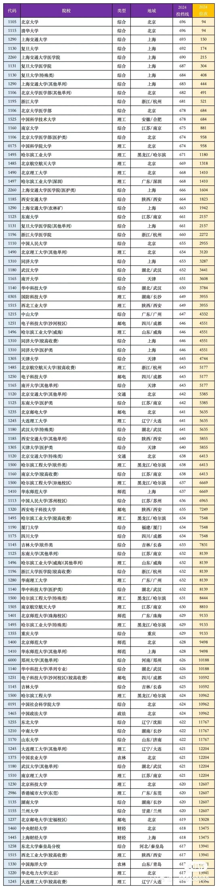
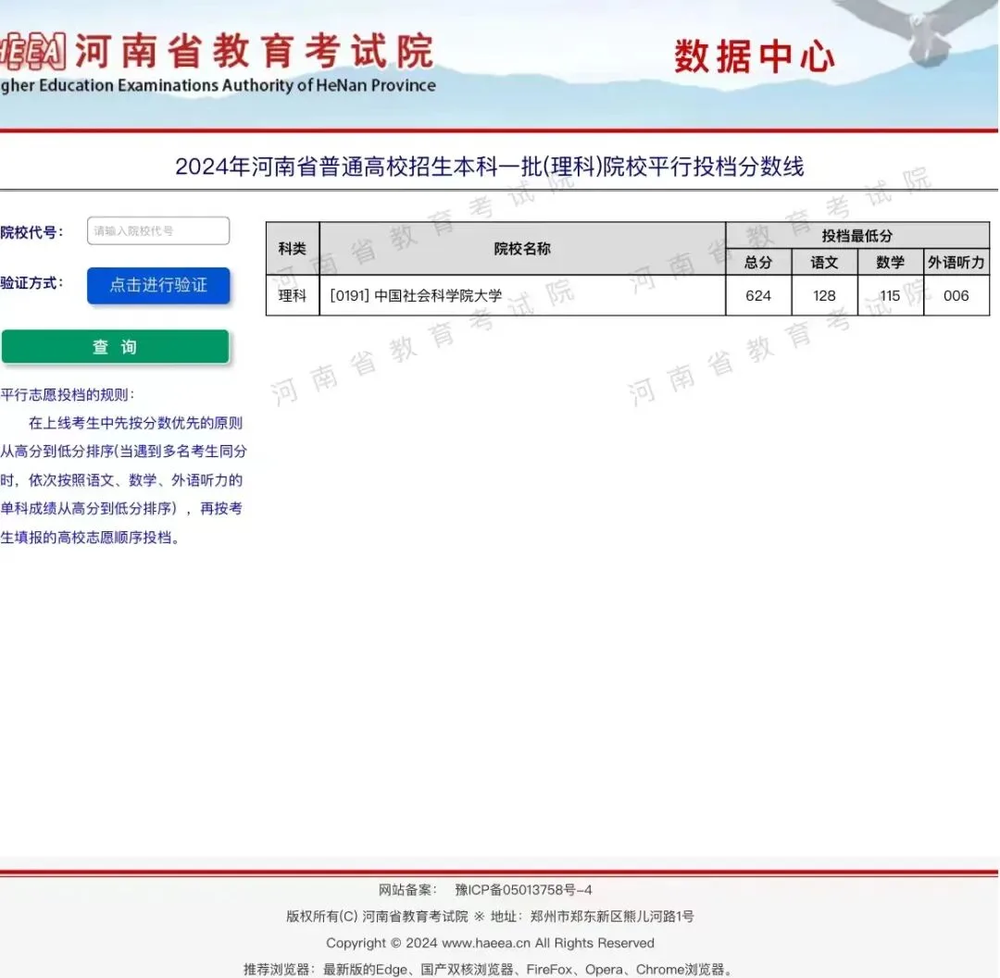

请相关部门及时关注并跟进问题。

## 1 开题报告

“哪个好人家的开题报告书\[国内外研究现状\]和\[文献综述\]是两个部分啊，外行写的模板？”

## 2 维修噪音

“投个稿 先吐槽一句，不知道我们学校硕博宿舍楼怎么回事，盖了也没几年怎么好像天天都在维修，到底是有多偷工减料。

你维修就维修吧，前几天还有个去处躲避噪音，现在图书馆闭馆了，留校的同学只能被逼着听噪音，实在太不体谅人心了！！大家留校是为了啥的，是为了在这听噪音的吗？？想问问，维修能不能后延下时间？？

有留校生在急等着维修的宿舍可能确实没办法，那些不着急的项目能不能等图书馆开馆再修？？”

## 3 学校超市

> “投稿:学校新开的超市能不能进点东西啊？学校还是有人的啊...架子全是空的？喂...好几天了喂...开学前都这样么...这样看来研缘超市搬了个寂寞，还不是每天出去买”

## 4 招生

## “好像是2024河南理科分数线 社科大

在下面 麻烦可以标注下”

（见《[【读者投稿】招生食堂有讨论 图书资源疑问多](https://mp.weixin.qq.com/s?__biz=Mzg2MjcwNzQ1Mw==&mid=2247488966&idx=1&sn=2a4b9c27c4705a57e14813fa2690952d&chksm=ce029e54f97517425de9761171e9a81604f2f21ffa176c3a273796dc6ae2aeea030013298d83&scene=21#wechat_redirect)》第3条）
