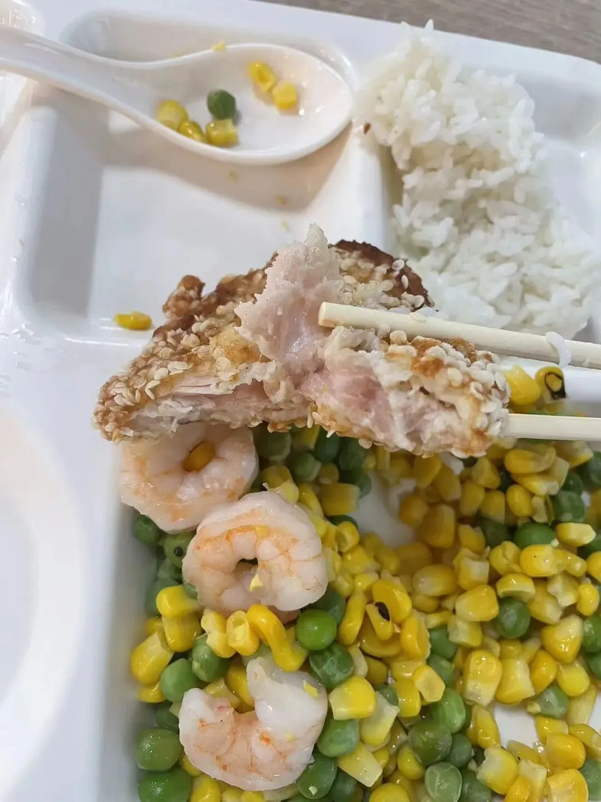

请相关部门及时关注并跟进问题。

## 1 校友通道

“社论君您好！前两天看到有同学吐槽学校的数据库暑假用不了，我也想提一个小请求：正值毕业季，有一部分毕业后升学的校友对学校的数据库仍有访问需求，特别是社科院毕业的博士论文。

学校能不能学一下国内其他高校，考虑开通一个电子资源的校友通道，方便已经毕业的校友进行科研。谢谢！”

## 2 食品安全

## “暑假食堂中午炸鸡排是急着出锅吗？中间的肉还是生的”

