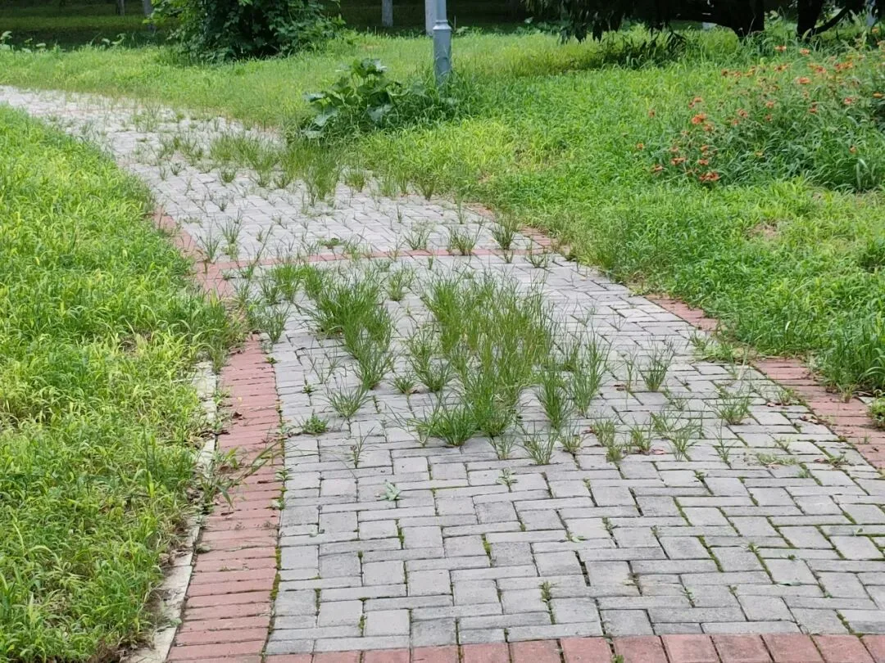

请相关部门及时关注并跟进问题。

## 1 就业

## “投稿选调：

老百姓看学校好不好，其实就是看就业好不好。争取定向选调，完全应该是社科大的每年度的重要固定任务。

去年院长去重庆签协议一大堆，包括人才引进，仍然没有把社科大纳入重庆的定选。这恐怕不是实力问题，是学校和院部的态度意愿问题。招就处不会真的分不清普通选调集中选调、定向选调这些吧？

‘中国哲学社会科学研究的最高殿堂，党中央的智囊团’，居然没有地方政府的定向选调……”

## 2 宿舍

“各个楼门口的爱心雨伞就是摆设啊。虽然写着‘雨天送您回家，诚信送我回架’，但是没有钥匙根本用不了！”

## 3 路建

“良乡校区花园路上草都这么高了，还有其他有些路也是。能不能趁着假期除一除草，现在这样真的好像学校无人打理了一样……”

