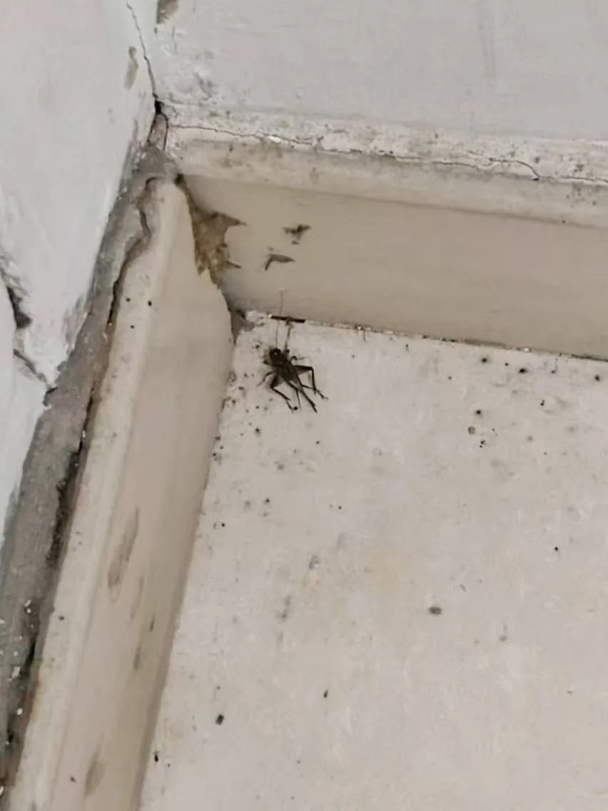
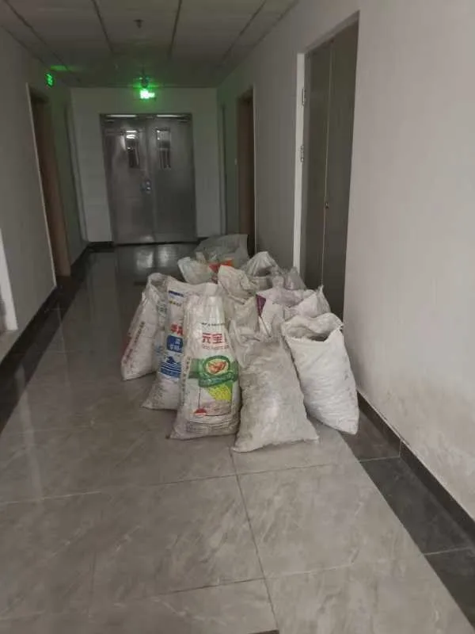
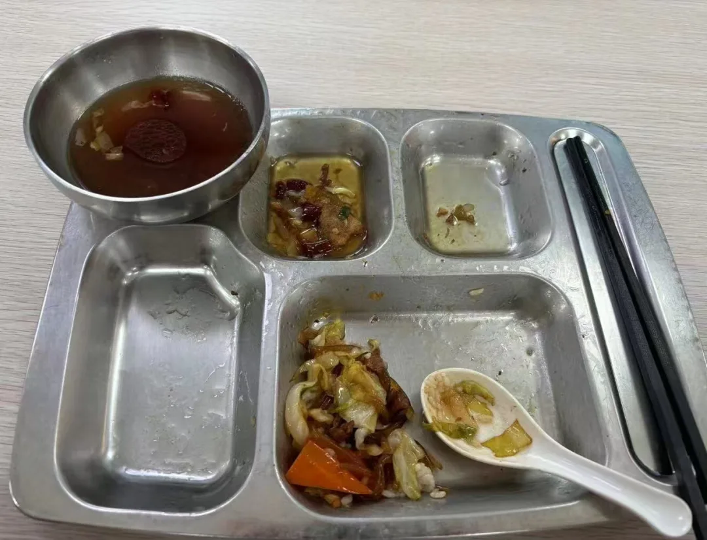

请相关部门及时关注并跟进问题。

## 1 教室卫生

“麻烦学校能不能假期也稍微找人清理一下教室这些地方，满眼过去都是大虫子，太吓人了”

## 2 宿舍

“良乡校区学生宿舍楼，这样就不阻碍逃生了哈。果然学生是弱势群体，放个垃圾袋或者一把伞也得让收回去，不然会阻碍逃生”

## 3 望京食堂

> “社论君你好，想反馈一下望京食堂炒菜油量过大的问题。食堂夸张到每天每顿的每一道菜都是巨量用油！盛菜的时候打饭的姐姐帮忙沥过油，吃的时候又沥了一遍，还打了绿豆汤涮了一遍，还有这么多油！真的很担心毕业之前就吃成高血脂高血压脂肪肝冠心病主动脉粥样硬化啊…能不能求求炒菜大师傅，控制一下自己倒油的手，别嚯嚯菜也别嚯嚯吃饭的人呀！”

## 4 我们最幸福

> “学生会推文：什么叫skd学生的幸福指数已经是next level了？学生幸福与否难道不是广大学生说了算吗？有任何问卷表明广大学生认为幸福指数提高吗？没有，我没看到。所以，我又被学生会这个官僚集团代表了。我愿称skd为新幸福孤岛。”
