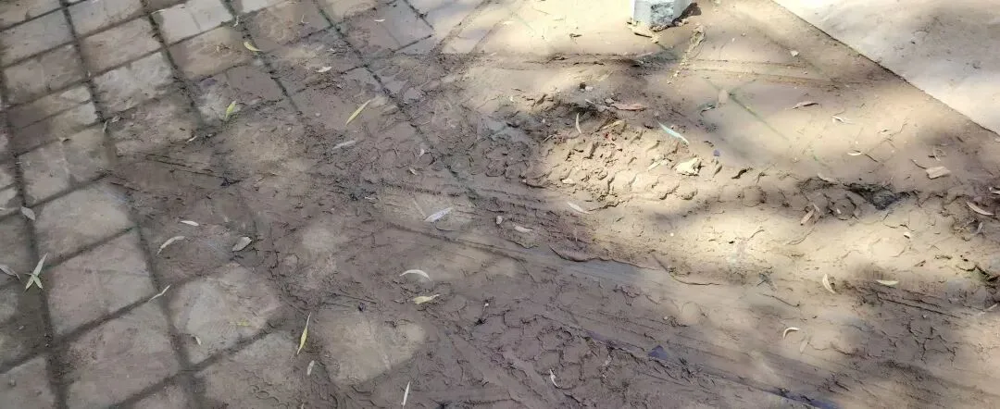

请相关部门及时关注并跟进问题。

## 1 毕业&就业问题

## “投稿

毕业证早点做、早点发！

毕业证早点做、早点发！

毕业证早点做、早点发！

重要的事情说三遍。

有的毕业生已经贴钱上班一个月还没入职！！

七月入职的六月二十号左右就要开始走流程，但是这个时候我们的毕业证都没做出来，如果走不了就要八月份入职，但是现实情况不可能让人八月份再入职。

我不是第一个，我听过上一届同样的故事，且我也不会是最后一个，25年、26年及以后毕业的师弟、师妹们会面临同样的问题。

请学校重视一下毕业证的问题，关乎所有学生的切身利益！”

## 2 校园安全

> “六号楼下，施工处残留了一些泥土。恰好在拐弯处。因为前面堵住了所以这个弯儿所有自行车和电动自行车都要经过，留下很大隐患。今天中午一点，我骑行路过此处，拐弯加路滑，造成人仰马翻，脚部已摔流血。主要原因确是我不小心，不过也希望学校还是不要因为施工留下这种隐患了。因为除了我之外也有可能有其他同学会在此处摔跤，所以提醒一下。”

## 3 校园卫生

“社论君你好，投稿望京校区除虫害。最近雨多积水也多，又潮又闷，只要一出门就会被各种蚊虫咬一身包，望京校区能不能尽快除一下虫呀，谢谢！”

## 4 食堂

“良乡一餐中午排队都到桌子了，难道不能多开窗口或者提前一下时间吗？吃一次饭要排队几十分钟。”

（见《[【读者投稿】离离原上谱](https://mp.weixin.qq.com/s?__biz=Mzg2MjcwNzQ1Mw==&mid=2247488948&idx=1&sn=9dfb8ca73676b63afc1852eb0bae6546&chksm=ce029e26f975173072e1ac5a68b66e1925abdfe6bce22e6660570c073452c815e923f0b1950d&scene=21#wechat_redirect)》第2条）
