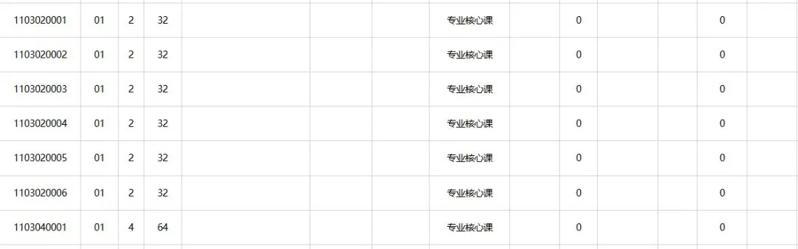

请相关部门及时关注并跟进问题。

## 1 校园网问题

## “投稿：良乡校区的网络太慢了吧！这么慢的网络还这么快用完，是怎么回事？”

## 2 奖助补费

## “新学期马上开始了，我们的补助仍然是1250吗？？？？？？？？”

（注：补助问题反映已久。关于补助问题的更多讨论，读者朋友们可自行点击文末“奖助补费”tag阅读相关文章）

## 3 论文开题

“学位论文开题需要走线上系统可以理解。不过这个系统设计不太合理，对于上传的正文文字居然有字数限制。例如，选题意义和研究价值 2000字以内，研究创新500字以内，等等。这点文字根本满足不了博士论文开题的需求。

开题在即，建议有关部门扩展下字符限制。

只听说过学位论文和开题报告设置文字下限的，没听说过设置文字上限的。”

## 4 教务问题

“今年这个新生的教学安排为什么到现在了还没出来？查阅“全部课程安排表”，我们惊讶的发现，离开学还有一周，这里面大部分开给新生的课程既没有授课教师的信息，更没有时间地点和课程大纲。往年，新生的课程安排都是跟着老生的课表一起出来的，即便说新加了几个专业，那么大部分课程也是之前开过的。

过了一个暑假，课程信息依然是残缺不全的。如果说这么多课还没找好老师的话，那确实给人一种浓浓的草台班子的感觉……

希望能在新生入学前教务处能把各门课的基本信息填上去、把这些课程的课程大纲都填上，这样既便于新生选课使用，也便于降转的老生提前规划。现在这样弄得让人觉得很被动，也让人觉得不靠谱。”

## “投稿：分数线下降到底是什么锅？

马上又是一届新生入学了，仔细看看各省的分数线，绿油油一片的跌。这种感觉就仿佛买了一只股票，完了出道即巅峰。在读的日子里，眼见skd缝缝补补又一年，想想分数线跌成那样子，也不奇怪。也说明现在的学生可能清醒了，不像之前一样当韭菜了。话说回来，领导有没有一个时候哪怕是午夜梦回的时候也可以想想，为什么分数线会成那个样子？

我建议领导不要把罪全部归给大环境或者张雪峰，扪心自问，你的本科教学质量到底如何？说是小班化教学，可是人少了，开的课也少。社科大宣传的时候号称是科教融合，号称是各个研究所支援办大学。可是呢，除了那几个学院，各个研究所到底开了几门课？然而并没有，有的对接的研究所压根不给本科生上课，有的研究所就开一门课。一个支持学院的研究所所开设的课程还比不上一个高水平大学的教研室。想想也觉得可笑。如果不上课，那么所谓社科大最大优势到底又怎么体现呢？可是呢，就开了那么可怜的一两门课，学生们已经感恩戴德了。不敢比，更不敢想了。说多了，都已经失望了。

20年的时候，社科大给各个本科学院聘了一堆来上课的“岗位教师”。四年过去了，其中有多少老师是拿了聘书还能坚持来上课的？13个学院里面，好一点的可能有一半多，剩下的，谁看谁知道。建议教务部门和校领导做做统计，如果不来上课的话，那个聘书的工本费是不是都浪费了。省点钱吧，不行了还能改善一下食堂呢。

当然了，也不是没有变化。今年的培养方案号称是作了全新的修订，但是呢？截止到8月20多号，我们还是看到有相当多的课程没有授课老师的信息。我想如果不是教务老师犯懒，那就可能是没找好人。你还不能催，催的急了就开始糊弄了事。开新专业很美好，科教融合的愿景也很棒，但落实下来能有多少，我们不敢想。对接的考古、金融等几个研究所究竟能开几门课，我们也不敢想。眼见招了一大堆新老师，可是如果新专业全部要靠新老师来上，那被牺牲的人只是可怜的学生——成了制度缺陷的牺牲品。那么你还指望分数线会高、声誉会好吗？再这么跌下去可就真离普通一本不远了。

但愿吧，但愿能实现“举全院之力办大学”的奢望——但最好是在大家没有彻底失望以前。”

## 5 繁冗之训练营

## “投稿

不好说社科大这个新生训练营是什么，但这些参训新生真的非常令人同情。周五晚十点多在良乡校区里路遇有人正对着一群学生煞有介事地训话，说着什么任务与纪律，像极了所谓颐指气使的教师爷。听了一会才知道，这是在“训练”参营新生呢。不清楚这个培训日程究竟是多么“紧凑”，居然晚上十点多还在那里对着新生大谈特谈，多少有点幽默了。

当时就觉情况不对，后来了解一下相关情况，更是大吃一惊。时间紧张，安排草率，通知仓促而没有定准，且充斥着大量给学生摊派的无意义工作，让大家从早上七点累到晚上十点多。目前的训练营好似那些收割学生的研学团，学生收获感不强，一天下来却是劳累满满，纯纯被折腾，而且只收获了被折腾。

新生训练营标榜“帮助新生在班团集体建设、大学生活适应和校风学风弘扬等方面具有重要意义”，应该是一项很好的工作，可在我校行政的勇毅安排之下，形式主义之风盛行，总体给人以权力压榨初来乍到的新生为所谓的学校宣传工作做嫁衣的感觉，看不出对新生适应大学生活有多少帮助，倒反而像是高中轨迹的延续。可惜高中的安排有着为考学而奋斗的实际且长期内容，我们的训练营却以漂亮的虚浮宣传为导向。如此训练，恐怕能够让人体会到的是这所大学行政草台班子的集体建设，欺软怕硬的工作风范，以及形式主义的愈发泛滥，属实让人痛心。”
