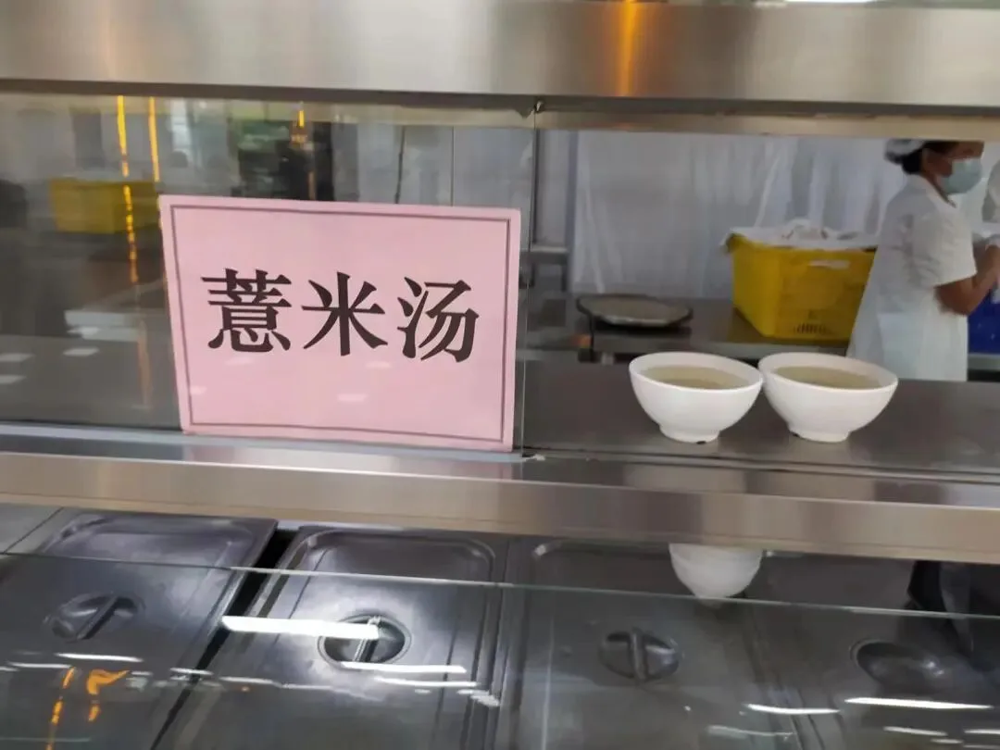

请相关部门及时关注并跟进问题。

## 1 食堂

## “点赞8.26中午的食堂！下雨就煮了薏米汤，这玩意儿可以祛湿的。”

## 2 宿舍

## “投稿题目：对于学校博士宿舍分配的疑问

内容：与其调查同学们睡得早不早，不如调查博士生计划住不住宿舍。据我所知，二人间也有不准备常住的、四人间也有计划常住的，为什么能够按照户籍进行歧视性的差别对待呢？为什么按照户籍假设一个学生是否计划住宿呢？距良乡最近的河北县城二十公里，不说住在延庆密云，住天通苑都是60公里。

现在的现状是，有的二人间实际上一人独享，却有想要常住的人去住四人间，那么学校这么安排真的是因为资源紧张吗？这样的现状更凸显因为户籍进行区别对待是一种歧视性政策。

希望学校真的能够充分统筹安排资源。”

“请问学校，四号楼为什么不做任何改动，直接将此前的三人间用作双人间？如果真的资源有限，那么二改三之前的家具呢？”

> “投稿：想知道为什么要把京籍硕士安排到逼仄的一号楼四人间？是默认京籍都离家近可以天天回家？还是觉得京籍就是原罪，不配有桌子和衣柜？学校的寝室资源就欠缺成这样吗？必须得四个人塞到一个房间？ 我们不能和同班同学住得近，不能有自己的书桌。是想让我们第一天就对学校失望然后退学吗？都是研究生，考一样的卷子进来的，我们又错在哪呢？”

> “今天有幸参观了硕研的宿舍环境，简直叹为观止，可以用恶劣来形容，甚至不如有的大学本科宿舍。小小的屋子，住四个人，上下床，没有衣柜没有可以学习的独立书桌。咱就是说，招得起硕研却是连起码的学习环境都提供不了？就这么一个小房间，冬天的衣服都没有地方挂，放在床上当被子盖吗？消防设施也不规范，你们真的就是这样接收来读书的孩子吗？！”
