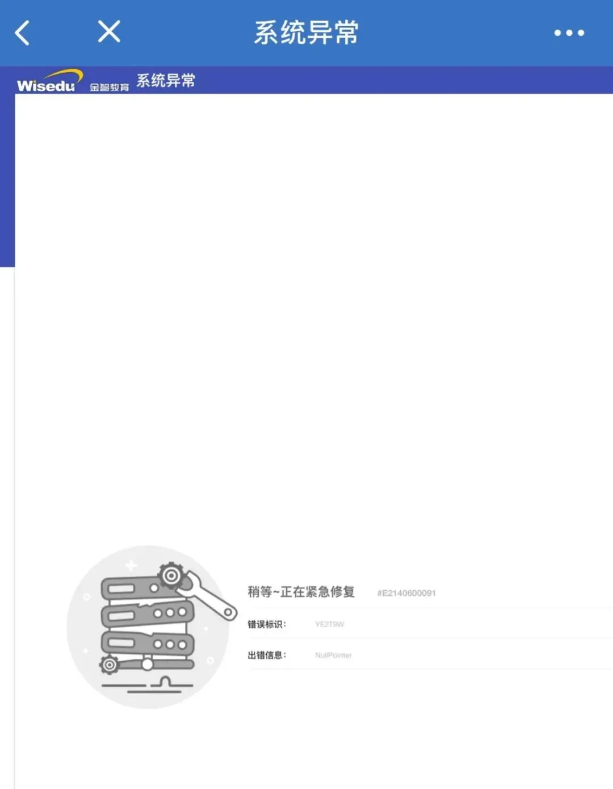
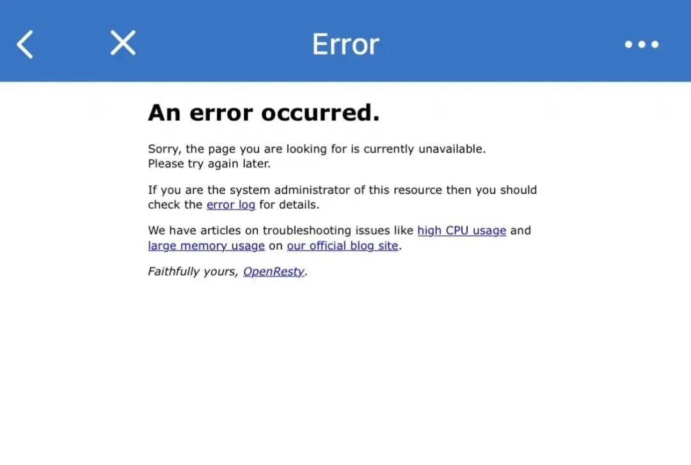
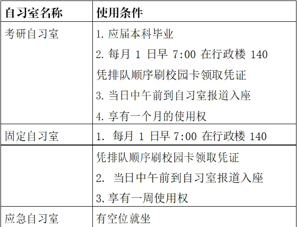

请相关部门及时关注并跟进问题。

## 1 食堂

“投稿:良乡校区的早餐一直很不错，但这几天豆浆明显变得很稀，不能因为人多水也跟着多呀！希望能尽快恢复原样！谢谢！”

## 2 图书馆

## “望京校区图书馆公共秩序问题：

有些同学长时间在阳台那片背书，其实隔音没有你想象中那么好。声音确实很影响在里面自习的人。如果有需要的话可以试一下图书馆新设的静音自习室。”

## 3 国护队

## “建议国护队加强队员训练，尤其是对体态的矫正。开营仪式照片上看的太明显了。”

## 4 报到&注册问题

“投稿：学校就会添麻烦是吧？给你交学费了还得形式主义一下回学校点个注册。折腾下在职的和不方便回来的，嫌报考自己这里的太多了？”

“线上报道，明明在学校，结果定位到1公里外的地方了。这精度也太差了吧，定位不行的嘛，麻烦签到位置放宽一些。”

> “投稿。学校这个定位报道是在做什么？29号通知30号必须到校，研三的学生没有自己的安排？行，必须到校，我来了，系统崩了，甚至崩出两个界面（见附图）。到底是谁拍脑瓜子想出来的这种奇怪的政策？读了十几年的书，头一次见到这种离谱的报道形式。新的搞不好，至少可以不用乱搞吧？”

## 5 自习室

## “关于良乡校区自习室清理的思考与讨论

一、事件定性

在笔者行文时，在同学之中已经出现了“支持清理自习室”和“反对清理自习室”两派，笔者的观点是：自习室应当被清理，但不应当如此执行。

笔者认为，教务处本次所执行的自习室清理活动，是一次矛盾转移，是将自习空间使用问题的主要矛盾从教务处（管理方）转嫁到良乡校区本硕博（使用方）之间的一次活动。经由此次活动，教务处成功激起了学生群体中不同年级、不同自习需求的同学的矛盾。教务处则可以美美隐身，享受着前文所述两派中某一派的支持，继续享受工资待遇。

在引发良乡校区自习资源紧张的种种因素中，良乡校区的自习基础设施不足只能是次要原因，根本原因在于教务处作为自习空间管理方的“不作为”和“懒政、怠政”，不按有关规定执行对自习空间的定期清理政策，反而指望通过 “一刀切”的方式解决自习资源紧张的问题。具体论述如下：

二、政策背景

1. 良乡校区自习空间紧张

良乡校区现有固定自习空间为：行政楼 139 教室，南综合楼（原党校楼）部分自习室，北综合楼西侧板房自习室（下称“板房自习室”），七号楼地下一层自习室和八号楼地下一层自习室。

2. 关键节点将近，学生自习压力增大

秋季学期开学，本科生处于考研、考公冲刺关键阶段，需要稳定的学习空间（至于为何单独强调本科生需求，后文再行论述）。

3. 现有自习空间占座现象严重

笔者在写作本文时，身处的板房自习室教室上座率为 27.8%（5/18）,即屋内 18 张桌子，只有 5 张桌子上有同学学习。根据笔者自 2024 年 3 月以来对板房自习室的观察，在板房自习室的 6 间教室中，有 1 到 2 间自习室的上座率会超过 50%，其余自习室均达不到这一水平。自习室空置现象较为严重。

4. 现有制度无人执行

校教务处推行并张贴于自习室墙面的《自习室使用公约（试行）》（下称为“《公约》”）中规定，“禁止连续占座而不使用，固定自习室内经查实连续二天占而不使用的座位，将进行清理”。但是在实践中，自笔者于 2024 年 3 月落座以来，教务处管理人员从未对无人但有东西的空置座位进行过清理，放任大量座位被个人物品占据，造成了空间资源的极大浪费。

5.今年没有设置考研自习室

通常情况下，学校会在秋季学期将研教楼的六个教室设置为考研自习室，今年反常的没有设置。尤其是在新楼要投入使用了还取消了原有的研教楼自习室设置，很反常，没想到教务憋了个大的。

三、政策出台

8 月 29 日 17:22 分，校教务处通过移动校园平台发布了《关于良乡校区教室空间常态化管理的通知》（以下简称为《通知》）。通知的主要内容可概括如下：

《通知》将板房自习室划归“考研自习室”；将南综合楼、行政楼自习室划为“固定自习室”；将七号楼、八号楼下自习室划为“应急自习室”。使用方式见下表：

四、政策影响

《通知》的出台意味着对现有自习空间的清理，是对现有空间的“格式化”，在一定程度上起到了重新规划自习资源的作用，对学生产生的积极影响和消极影响如下：

1. 积极影响

《通知》的出台能够在一定程度上让有学习刚需但没有自习位置的同学获得资源，便利了他们的学习。

2. 消极影响

对于长期在板房自习室学习的非考研年级学生而言（既包括研究生，也包括其他年级本科生），《通知》的出台让他们失去了固定的自习位置。

对于在各个自习室长期学习的学生（此处是不包括占座不来的同学）而言，《通知》的出台意味着他们需要先把自己的东西清理干净，再在每周或每月的早上去排队抢位，增加了一定负担。

单看本次政策的影响，似乎没有说很触及某一群体的利益，《通知》给了大家排队竞争的空间，看起来一切问题都不是问题。笔者之所以愤怒，是因为校教务处在解决问题的各种方法中，选择了最差的一条，激化了学生矛盾，完美体现了你校行政拉胯的特点，是生动的“开学第一课”。至少，这个《通知》把我这个在校 5 年的本硕转化成了“小黑子”。分析解读如下，这块没什么条理，纯输出，请与我一起为教务处思考。

五、政策分析和情感宣泄

既然教务处有清空自习室这种“格式化”的勇气，为什么不能执行好《公约》中规定的，以两天为周期清理占位座位的制度呢？我从 3 月份坐到板房自习室，期间自习室 18个桌子每天都那 6、7 个人，暑假期间更是算上我只有 3 个人，那剩下的空间是你教务处租出去了？还是你教务处“选择性失明”，等崔书记一来跟打了鸡血一样开始一刀切了？猪撞树上了你知道拐了，犯错误判刑了你知道悔改了，大鼻涕流到嘴里你想起来甩了？

我们学生的时间也不是跟你闹着玩的，你又要我们清理，又要我们排队，你教务处但凡按照规定执行清理，用得着那么多同学抱着书本来再悻悻而去吗？现在把矛盾转移到考研的学生和其他学生中间了，你谁啊，你大英国正米字旗是吧，专门霍霍海外殖民地引发人民矛盾是不是，严查你们祖上是不是跟克伦威尔入过关？

你的《公约》是写给我们学生的，还是写给建国门领导的，你又不愿意管，指望我们学生自治呢？把你那工资给我，可别让你劳动力再生产了，全是废物。

你要是做不到两天一清，你五天一清呢？来自习室半年了，我后边那哥们那面包过期仨月了，你也没来清过啊。教务处领那个工资干啥用的，是设计不合理的考表还是来专门为难学生的？

六、政策效果预测

当你发现教务处在过去的半年中视有关规定为空文，就不能相信教务处能够执行好他承诺的清理规则。这就不多说了，校领导、行政画的大饼就新生没吃过。

已经发生的是，《通知》引起了学生中不同群体的意见分歧，一上知乎，好了，招生宣传白干。建议招生办同级监督，严查教务处，那边肯定有人不想让你们晋升。

七、写在最后

《通知》一发，我很无语。我知道临毕业年级很重要，我也明白大家的需求，我每次看见屋子里那些没人的位置都想给他们收拾了，因为在这个小学校，就是要我们学生之间互相扶持才能多一点慰藉。

我只想在我现在的位置上继续学习，过去的 180 天里，我只有不到 14 天离开了这个屋子，我不明白我的研究生身份就是赶我走的理由吗？你教务处先把所有自习室里面的占座的东西都清一清，清完了位置还不够本科小朋友们坐的，我自己会撤，但是明明有那么多人不来，你为啥把我和他们要一起清出去呢？

在教务处的矛盾转移下，我希望同学之间不要争吵，主要矛盾在于教务处的“乱作为”（常态化管理不知道要不要再出个行程码了，真会取名）。

新生们，这就是社科大教务处给你们的第一课，远比崔书记讲的震撼；本科小朋友们，我衷心的希望你们考出去或者保出去，别在这再待了。

读了五年书，我知道所有高校的行政多少都会有点错误，没想到社科大的独具一格。你社科大为什么要 2017 年建立呢，你要是 2020 年建立多好，就不能把我骗进来了。”

> “关于自习室，提几个或许可行的建议，供各方评判，一味指责不提出建议不是好办法，如果有更好的办法可以提出供校方参考。 一、将部分自习室（如1/2）设为长期使用自习室，实行更加严格规定。领取排号后，每周一上午需要前往140刷卡续用。 二、长期自习室实施固定座位+定时检查制度，每周不可少于4天在位自习。 三、未按期续刷者默认清理，每周少于4天者按违规处理，一个月内或一个学期内不可使用长期自习室。 四、剩余部分自习室供短期使用，按现行方案进行。 五、新综合楼投入使用后适当调整自习室资源，减少如七号楼教室宿舍等不必要的房间存在。 以上建议仅供参考，如有优化欢迎大家提出。”

> “关于良乡校区自习室的问题：学校能不能让同学们自己投票决定一些事情（或者学代也可以）。这种关系到同学们切身学习体验的事，毫无征兆地直接就发通知吗？明明出台以后大多数同学都不接受，老师同学都费时费力，何必呢？”

“如果教务处觉得自己办法特别好，希望周一领卡的时候处长（或制定者）在现场，别躲在后面拿保安顶雷，看几百号人有没有不骂你的。

这项自习室新规简直在羞辱学生，闻所未闻，见所未见，给新生打个样哈”

“你好我要投稿。请问同学对自习室意见呼声这么大，难道管理人员就不想想新的办法吗？直接周一回来等着清理是吧。”

（见《[【读者投稿】宿舍基建讨论继续 自习新规争议巨大](https://mp.weixin.qq.com/s?__biz=Mzg2MjcwNzQ1Mw==&mid=2247489055&idx=1&sn=6e8dc1b93a774b060b66334186cf1b32&chksm=ce029d8df975149b79ab33d583aaceba8893e5cef1bec9852ca568e0aa1e2a6a39b54e49e7cc&scene=21#wechat_redirect)》第2条）
