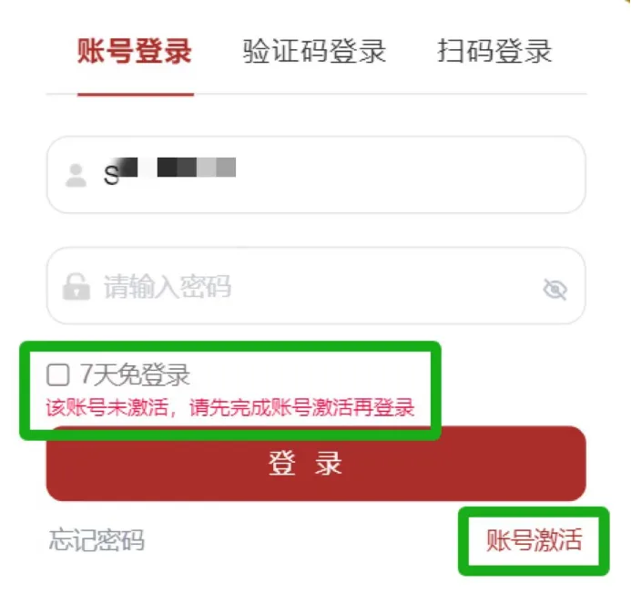
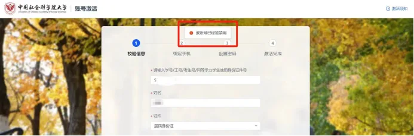
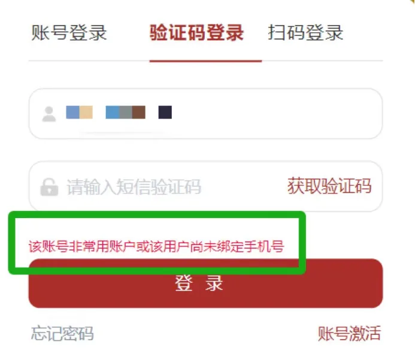
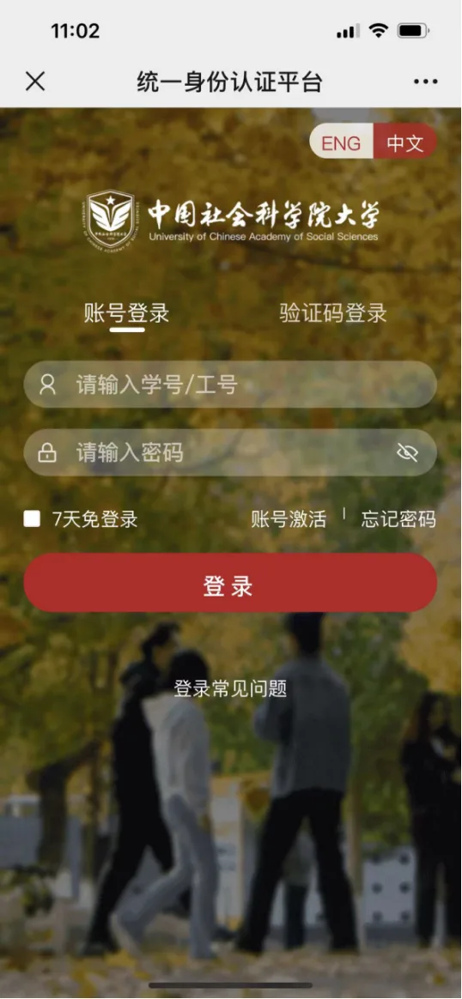

请相关部门及时关注并跟进问题。

## 1 教务问题

> “大一新生选课请问能不能合理一点啊。如果最开始就不允许新生选的话为什么要给新生选课的权限呢？总不能说您认为工作量太大了所以不想干就寄希望于新生能够在没有任何提示的情况下按照您的想法来实施吧。天呐！这样子九月九日的退课可真的是一点意义也没有了。难道作为比我要年长并且阅历丰富的你们不清楚吗？”

## 2 国护队

“回复上期，感谢同学对国护队的关注，假期刚结束即发出了加强训练的督促。新学期伊始，队伍的训练将从本周末恢复。

下周一（9.2日）上午7点将于东门举行例行的周一升旗仪式，也是新学期第一场升旗仪式。届时欢迎全校师生观礼，于红旗飘扬的清晨开启崭新的学期。

行动诠释忠诚，汗水浇灌荣耀。不被看到的风雨兼程，是日月轮转的不懈守候。欢迎所有有志于护卫国旗，关心队伍发展的同学加入社科大国护这个大家庭。

本领过硬，使命必达！”

（见《[【读者投稿】自习新规反对声烈 线上报道地图开疆](https://mp.weixin.qq.com/s?__biz=Mzg2MjcwNzQ1Mw==&mid=2247489209&idx=1&sn=5a69a7d7cdf4b112274d8ef934a4311d&chksm=ce029d2bf975143dad39f3c846eb2becca674ecfc63bec76284dcc4eab942e6fd83535addd5b&scene=21#wechat_redirect)》第3条）

## 3 图书馆

> “投稿：图书馆三楼外文阅览室后面，每次都有人把空调温度调到27℃的人疯了吧，您要是觉得24℃25℃冷的话能不能带上个外套？说了多少次，24℃、25℃哪怕是26我都不说什么。调到27℃，今天平均气温才27℃，靠窗每次都是热的一直有汗，调到了24℃或者25℃ 没过一会又被人调回去了，求求了，你要是真觉得25℃还冷，就带个外套行不，或者你说一声我免费送你个小火炉。”

（见《[【读者投稿】自习新规反对声烈 线上报道地图开疆](https://mp.weixin.qq.com/s?__biz=Mzg2MjcwNzQ1Mw==&mid=2247489209&idx=1&sn=5a69a7d7cdf4b112274d8ef934a4311d&chksm=ce029d2bf975143dad39f3c846eb2becca674ecfc63bec76284dcc4eab942e6fd83535addd5b&scene=21#wechat_redirect)》第2条）

## 4 自习室

“同本硕五年老skder，看到需要每周一去排队领什么破卡的通知，最直观的感受就是想退学，想尽办法去有更多资源的地方读书写作。结果报道又必须定位，学生是狗吗？非要拴上链子？学校没有空间，需要学生向外寻求已是失职，又不让学生去广阔的天地追寻自己的理想抱负，死死地拴在校内。

高翔院长说过，要为每一位社科大学子提供充足的发展空间，尊重每一个人的发展。如今，别说思想空间、学术空间了，物理空间都被如此剥削。请问贵校要培养哪门子大师？作哪门子学问？都是形式罢了。 提供方便合适的学习环境本来就是学校的义务，需要同学们屡屡争取学习的地方，已是学校的严重问题。占座现象之所以出现，本质上就是因为资源过于匮乏。我来做学生该做的事情如今还要靠抢？真成“非我求童蒙，童蒙求我”了是吧？“哪里不能学呀”这种话也不是学校领导们该说出口的，哪管你是后勤处保卫处校长办公室还是教务处。那是不是哪天呼吸一口您社科大小花园的空气也要排队买门票了？——哪里不能呼吸呀？非要呼吸清新的？ 学校领导又要说：“学校还处于发展阶段，资源有限，有朝一日…”

学校的难处学生可以理解，这是我第一次在社论投稿，实在是由于义愤填膺。我不过是想找个地方安安稳稳地学习而已，其它问题一般能理解则理解，能够通则沟通。可是一个学生又有几年的青春时光来挥霍着陪你等待“有朝一日”呢？ 可笑。 真的，师弟师妹们，勇敢地闯到更大的世界里去吧，社科大的学子配得上远比这广阔得多的天地！”

> “自习室，占座不用的资源要管理，但是每天都来的人为什么要每天搬来搬去，考研压力大到睡觉时间不足，结果你让我天天搬书吗？ 负责人看不到学生的反馈吗？不出来回应一下吗？ 不作为，很长时间不管不问，导致不自觉的人占用公共资源！ 现在乱作为，要把学生逼上绝路不成！”

> “7号楼下面建的简易房，原来是想把收了大家的东西集中存放在那里呀。哇！都能想到这个，为什么不能多建几个简易房自习室呢？ 自习室管理那么多方案，你不会管可以学习其他高校吧，却非要用这种离谱到nm都不认得的方案，把师生关系搞那么紧张，还想要好口碑，做梦吧！在这个学校上学，最阻碍学习的就是教务处。 人文之光，毫无人性。 不把学生当人看，学生也不会把你当人看。”

> “关于自习室问题： 1. 看看别的学校，有几个学校给学生这么多固定自习室用的，都享受了这么好资源了，还要啥自行车？ 2. 看看我们自己，为什么学校总是出这个规矩那个规矩，就没认认真真地想过，难道这不是反应了我们自己如此地难管吗？ 3.自习室问题的根源在于位置的占而不用。18个座位的自习室日常只有三四个人用也是让我震惊了。这么多公共资源遭到如此地浪费。用句难听的话讲，站着茅坑不拉屎好意思吗？那些把书一放那就再也没去过的人就没想过别人也要用吗？放那就代表是你的了吗？还有起码的廉耻吗？ 4.建议学校不要设这个固定自习室那个考研自习室了，我们不知好歹，享受不起。定再多的规矩也会有人不遵守的，开再多的教室也是不够用的。因此，倒不如，全部教室用来上课，个人用品一日一清，严格管理。大家都别想着这档子事了。平安无事。”

“自习室事件的本质就是50%甚至更多占而不用的人，损害了20%经常使用和其他找不到座位的同学。很多言辞激烈的其实是占而不用的群体。

2.教务老师们也很不容易，很多同学根本不是在聊问题，就是在情绪输出，甚至有点骂人的感觉，谴责。

3.再次实行两天一清，这个结果是很好的。不过后续实施还需要老师和同学们的共同维护。 自己有事就找人来坐，这样才能有序运转。

4.当然，个人建议寒暑假和法定假日，可以适当放宽两天的期限。”

“投稿 关于自习室问题，表达两点看法： 首先，校方此次自习管理绝对有失当之处，有关行政管理者不能将相关争议其简单理解成一个施行新措必然面临阻力、规定推行一段时间争议就会平息大家就会“习惯”的问题。自笔者阅读公众号始，尚未见有一次管理措施能在某一期中引发如此巨大的争议，竟在两天之内便有二十多个稿件几万字激烈批判同一个自习新规并获得了广泛的关注，且有行政管理人员在强制推行措施中与自习室使用者爆发冲突，这充分说明校方的自习新规的确在多数自习室使用者看来带来的不便大于对问题的解决程度。而接下来的季度是考研升学等事宜的关键时期，强硬性的不便规定恐难以被轻轻放过。 再者，面对争议性问题，需要以对话寻求共识而非挥舞权力暴力大棒的方式达成解决方案。相信校方行政管理者不是没有这种智慧，“治气”式的管理情绪将带来严重后果。在学校管理中以行政强制力强硬推行某项巨大争议性规定无疑会带来巨大的行政管治成本，并对校方行政公信力、学校形象等带来巨大、长期甚至不可挽回的损害，更可能造成某些难以预见的悲剧性后果。故而关于自习新规，校方应暂缓施行并尽快就相关问题与自习室使用者进行广泛、公开的协商，对自身管理措施进行说明讲解消除疑虑，并在充分吸取相关同学切身体会的基础之上调研寻找出大家都能接受的方案。无论是学生教职工还是校方行政，都应该相互信任、寻找共识，简单粗暴的管理模式解决不了任何问题，而只能带来更大更多的不满，积怨日久、必致灾难。如果争议问题都以强制暴力推行，兴许短时间内可能会有些许见效，但长此以往必然是对行政管理能力的根本性蛀空、因为赖以支持正确决策的实事求是式调查研究将不再可能。

藉由此事，每个社科大人都会看到一所自诩为社会主义一流文科大学的高校之行政是如何看待自己的学生以及怎么理解服务师生学术科研需要的，而历史将铭记这一切。”

（见《[【读者投稿】自习新规反对声烈 线上报道地图开疆](https://mp.weixin.qq.com/s?__biz=Mzg2MjcwNzQ1Mw==&mid=2247489209&idx=1&sn=5a69a7d7cdf4b112274d8ef934a4311d&chksm=ce029d2bf975143dad39f3c846eb2becca674ecfc63bec76284dcc4eab942e6fd83535addd5b&scene=21#wechat_redirect)》第5条）

## 5 报到&注册事宜

> “匿名：报到需要到校开定位是不是当硕博士生都是小baby怕走丢了哭鼻子爸爸妈妈担心呀？不然这种政策的目的到底是什么呢？脑袋一拍，哎哟，手机定位报到真先进嘿，真不错嘿，咱也弄一个吧，那硕二硕三博三博四的呢？还有很多不需要回学校，在外实习搞科研出田野找工作开学术会议的呢？是，给留了个后门，可以申请非定位报到，但是申请非定位报到需要书面申请导师签字，要是能回北京找导师签字提交书面申请那为什么还要申请非定位报到呢？可以，逻辑闭环了，死循环。还得是你啊社科大。下面行政人员也到底知不知道遇到这些情况该怎么处理呢？多少年了，多少次了，发布政策通知行政人员、辅导员跟学生一样不知道怎么处理，懵逼树上懵逼果，懵逼树下辅导员和我。还得是你啊社科大。”

“报道系统定位在非洲大西洋上，缴费数小时仍显示学费未缴清。前前后后折腾几个小时，真的很服气。”

“学校能不能再加强下信息系统的建设。作为一个已经毕业滚蛋的人，想继续出国深造，那就得申请出国成绩单吧，居然校园门户都登不上去了。

我用账号（学号）登录，告诉我账号未激活：

那我去激活，告诉我账号已经被禁用：

我尝试用手机验证码登录，告诉我手机未绑定：

我尝试扫码登录，结果手机弹出“账号登录”和“验证码登录”两种方式……

我真服了，是谁设计的这么完美的死循环系统……于是只能给网络中心打电话，大周末的，值班老师的态度还真挺好，跟我说帮忙问问，过了一会儿回电话说，我们毕业的时候赶上校园门户更新，所以我们都上不了这个系统了，需要成绩单得给研究生学位办打电话，他们那边会帮忙处理。

太服气了，都2024年了，校园门户升级的时候，都没法把以前学生的信息迁移过去吗？这个技术难度很大？我们这些赶在校园门户升级前毕业的人以后都得打电话办事啊，咋不写信呢？而且我在本科校园网办这个事，几分钟就好了，校园门户在我们毕业后也升级过，但毕业后还上得去，成绩单毕业证明这种东西在一个 “可信电子凭证服务平台”上都能免费申请、下载。所以学校能不能强化下信息系统建设，方便毕业学生，解放值班老师。”

“投稿-开学注册报到 在接到关于本学期注册报到的新规定后，我深感学校为提高管理效率和学生体验所做出的“精心设计”，实在是“用心良苦”。然而，对于此次注册报到方式的改变仍有几点想要讨论： 学校在决定涉及所有学生的注册报到方式时，是否充分征求了学生们的意见？是否考虑到研究生，尤其是在职的和高年级研究生的特殊情况？研究生的主要任务是科研，假期正是我们能够连续长时间进行课题调研和学术活动的重要时间段，有时候很难在开学的时间段完成既定的科研任务，而这种强制性的定位报到方式显然忽视了这一点。有些同学不得不在工作的时间赶回学校，拿出手机，定位报到。对于许多正在外地进行调研和学术交流的同学，这一规定不仅不合理，而且执行上也存在很大困难。

二、注册报到的有效性和合理性也值得商榷。如此要求所有学生以手机定位的方式报到，不仅无视了研究生的实际需求，还将导致大量研究生以书面申请的方式进行报到，给辅导员和学院行政部门带来额外的工作负担。如果进行暂缓注册程序的话，有些学院还要求附上自己和导师的电子签名，附上缴费成功的截图和说明等等，无疑增加了各位同学的负担。显然，这不仅无助于优化注册流程，反而增加了管理的复杂性，影响到学生和学校双方的效率。 三、通知的时间安排也极不合理。在8月29日晚上8点06分才收到新的注册方式通知，而8月30日就要去报到，这不仅严重缩短了准备时间，也没有做到提前通知。这种仓促的安排加剧了学生的不满，显然没有考虑到我们在外调研、返校困难的现实情况。 四、学工系统注册报到的系统能否承担这样大量的用户同时操作。显然，30号大家报到的过程中也感受到，系统频繁出现崩溃，定位不准确，有些甚至定位到了大洋彼岸。由此可见，学校相关部门，对定位注册报到并没有做到一个正确的估计，也没有做足充分的准备，连优化系统这种基础条件都没有预期的话，何谈这种方式可以优化注册流程？难道是想优化学生？ 基于上述四点，强烈建议学校恢复往年更为灵活和合理的注册流程。（可以的话，能不能请社论君做一个投票，看看大家对定位报到的态度） ”

（见《[【读者投稿】自习新规反对声烈 线上报道地图开疆](https://mp.weixin.qq.com/s?__biz=Mzg2MjcwNzQ1Mw==&mid=2247489209&idx=1&sn=5a69a7d7cdf4b112274d8ef934a4311d&chksm=ce029d2bf975143dad39f3c846eb2becca674ecfc63bec76284dcc4eab942e6fd83535addd5b&scene=21#wechat_redirect)》第4条）
