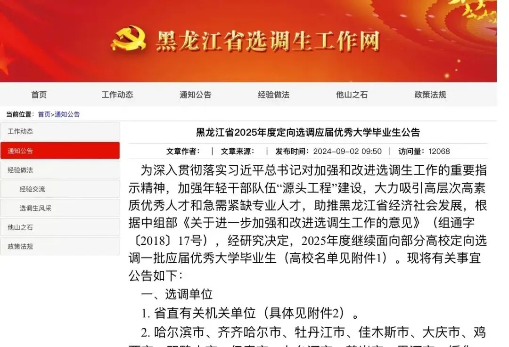

请相关部门及时关注并跟进问题。

## 1 宿舍问题

> “博士生宿舍问题：博士新生抱着二人间上床下桌的期许入校，打开房门发现是原先硕士的“三改二”配置。公寓办表示新学期面临新生人数多，家具不足等实际困难，并表示登记后上报学校最终定夺解决方案。不知道这问题打算最后怎么解决？最终解决方案还是让大家理解学校实际困难，教大家如何利用上下铺收纳+就寝，吃苦耐劳、拼拼凑凑过四年；还是如同自习室规约一样，将现有多余家具公示，让大家去140排队取号申报换领？”

## 2 食堂问题

## “二食堂牛肉板面档口炸酱面里的淋巴肉……”

“良乡校区的一食堂每天都要排很长时间队，不同的菜分布在不同的地方，打饭师傅需要跑来跑去效率很低，建议学习一下其他高校食堂的不同菜品分档口打饭，提升一下效率”

## 3 奖助补费

## “希望学校早点发9月的低保！🥺”

## 4 摆渡车

“新生，不知道怎么向学校提建议。我想，这么多硕博需要去社科院院里上课，能不能开通一条良乡校区直达社科院的校车线路呢？”

## 5 选调问题

“黑龙江打响选调公告第一枪，多所双非院校在榜，社科大再次遗憾落榜（ps：社科大负责就业的老师看好了，这个才是定向选调的公告，跟普通选调的不一样！！）”

## 6 空调

> “回复8月31日第3条：现在已经秋天了，26、27度的温度正合适。这位同学你觉得“靠窗热”，那麻烦别靠窗，或坐到空调底下。你凭什么要求别人穿外套？你要是觉得别人调到26、27度不合理，凭什么认为你调到24、25度就是合理的？敢情就在这里giant baby，全校都得惯着你这个宝宝呗？”

（见《[【读者投稿】风波未定？](https://mp.weixin.qq.com/s?__biz=Mzg2MjcwNzQ1Mw==&mid=2247489244&idx=1&sn=b4cb61469b7eb866b1bb7002bddab828&scene=21#wechat_redirect)》第3条）

## 7 军训

> “回今天投稿一，虽然天气并没达到“让部队停止训练”的程度，军训过程也是对意志品质的磨炼，但是大部分大学生的体质状态并不能和长期训练的解放军战士同日而语，希望学校和教官能够在考虑实际情况的基础上，灵活调整训练与休息时间，避免学生中暑”

“投稿，听说上届军训时安排了对军博和中国考古博物馆的参观，想问问我们这届军训是否会有类似安排？”

“第一点，军训强度是不是真的有点太大了?每天都在太阳底下暴晒，而且位置分配也不是特别合理，有的连队一直在阴凉处，有的连队在的地方天天大太阳。

第二点，军训的时间安排是不是不太合理?举个例子，这次军训下午的休息时间是17:30-18:30，但这一个小时内要完成走到食堂，排队打饭，用餐，再走回宿舍休息，然后再去操场，实际上有很多同学吃完饭就直接去场地了，真正休息调整的时间太少太少，而且下午训练又是时间长且累的时候，给一个小时休息是不是真的太少了呢?是否可以稍微延长下午的休息时间，给学生更多支配的空间?

第三点，军训中途休息的时间规划有问题，而且并没有完全严格进行，这种情况在军训前两天是最离谱的，很多营的休息时间完全不一样，有的时间间隔很多就可以活动喝水，有的要站很久的军姿，踢腿才可以休息，今天听那个排长讲是训练50分钟再休息20分钟，这种休息时间有点少吧，而且中途去上厕所有的连安排的是一群人一起去，然后走端正那种，但其实有的同学去厕所需要时间久一点，比如拉肚子这种特殊情况，教官有部分是未考虑到的，学生们希望军训中间的休息时间能够再长点。

第四点，军训内容过于平庸，还是老一套的军姿，走正步之类的，但其实学生很多在初高中期间已经多次重复训练，多次重复进行训练真的对学生素养有提升意义不是特别大，而且也很乏味。其他高校的军训流程，是会让学生更多地接触军事知识和武器，了解我国军事发展的过程以培养对军事强国的意识，军训期间是否可以穿插一点其他活动以此充实学生的知识，这样既可以做到与后续的军事理论课程进行衔接，又可以将理论与实际相结合，我想这一点需要教官以及学校方面考虑一下，比如请一位在校研究生（教官或其他人）真正讲一下在部队的体验以及军旅生活，这样的亲身经历才够接地气。在这种训练过程中是否能问一问学生想要什么呢?

第五点，军训很多时间是在选课后进行的，但这样却忽略了一个问题，许多大一新生选择的选修课或拓展课是第一周就开课，但第一周恰逢军训，有学生进行询问是否能请假上课，给出的答复是否定的，但这样的答复忽略了这样一个问题，有部分课程专业难度较大，缺席第一堂课有可能后面的课会因为概念的缺失很难跟的走，不让请假上课是否不太合理?许多学生是希望能够请假上课跟着走的。而且，2023届的新生军训是可以请假上课的，也得到了批准，但2024届却不可以，请问这样做真的合适吗?教官说会跟教务处讲删除第一堂课，问题是这第一堂课大二大三的学长学姐在上，而且确实存在，有一部分课你要第一节不来，你可能就被踢出去了，若存在这样规定的课程，大一的同学如果不来，是否真的能参加后续的课程?

第六点，一部分教官称军训相关服饰丢失后将很难再购买，请问学校方面能否建议设临时点（超市or其他）在军训特定时间段出售腰带 体能衣等物件。

第七点，军训衣服外套和体能衣发的时候只有一件，但军训14天外套洗了晾晒一晚上是不足够的，这期间可能存在穿自己的衣服去军训的情况，但有部分教官对此有点膈应，不允许学生穿自己的衣服参加训练，但学校跟学生讲可以穿自己的衣服，这就会对学生产生困惑。

以上是本人在军训安排过程中发现的不合理之处，希望其他同学能够进行补充，校方和军事训练组织方也能够充分考虑学生的意见，进行不断的完善，军训固然重要，但我们需要的是一个更加合理的安排以及更有趣的内容，这样的军训才更有意义。”

## “画饼画猫难画虎 唱喜唱衰不唱爱

关于新生的一点杂感

以往的军训（暂且不论特殊时期）都是讲座与正式训练分开进行，训能正常练，讲能认真听。欢欢乐乐，美美与共，岂不快哉？我近距离观察了这一届新生的军训，同时也通过认识的新生，去了解了一些他们的想法。

他们怀揣着对社科大的向往来到了这里，可结果呢？讲座军训穿插，群聊轰炸，信息繁琐，可怜的新生睁眼就是军训，闭眼前想的还是军训。哦，对了，他们还要忙着选课，忙着反馈，忙着和周末不上班，但是选课在周末的教务处打电话。我的直系学弟，甚至在深夜里请教我到底选课怎么选，到底该怎么进去选。

我次日在操场散步的时候碰见他了，他一夜未眠。

140教室里，在台上，高高在上，精气神十足的大人们，用热情与想象擘画未来数十年大有可为的美好蓝图。在台下，四五百汗流浃背，目光涣散，穿着“难受，掉色还不透气”的军训服，神游天外，思驰九霄，仿佛已然看到了一所伟大学校的终点。从唾沫星子中飞出的，是大人们的掷地有声，而后进入新生们耳中，再到它点入良乡，亦或是望京的土壤里，有些已过去了7年…

让子弹飞一会，总是会中的…吧？

画过的大饼可以不兑现，但是从你嘴里头说出来的话，从你各个部门作出的一切决议，不论是你作出的，随后修订的也好，让人怒赞的，愤懑的也罢。我们每一位中国社会科学院大学的本科，硕士，博士学子，都记得。

我很难想象，在可笑的管理制度，和极度折磨的军训后，他们还会以怎么样的心态继续面对这所大学。于是我不禁思考，我们要求真的很难做到吗？行政教务互不扯皮，时间合理一点，管理规范一点，制度人性化一点，能让这些新生正常且可持续地训练。一所号称培养“大写的人”的大学，一所以“人文之光”扬名的大学，居然在关注具体的学生方面令人啼笑皆非，甚至令人哑口无言。甚至让人文之光公众号保持了良好的更新节奏。

我不想评，也不愿评……

是的，你们，就是手机前那群不经意的，甚至带着不屑的你们，看得见我说的话，那是因为我说过了！你们飘在天空中，看着一群多么可爱的学生们，把他们当做外人，把他们等闲视之。所以，我们这群脚踏实地的，认认真真的学生，才会被玩弄，嘲笑…

我在此之前，从来没有一次向人文之光投稿过，因为我一直固执地认为，学生上大学是学习去的，不是去和有关部门斗智斗勇去的。但那位学弟布满血丝的双眼，和我的一位老学长在朋友圈里痛心疾首的控诉，我这一次终于意识到我应该说些什么了。

当某些人习惯了俯视蝼蚁，那么万事万物，都将被他们一而再再而三地视为草芥。

这就是我的理解，因为我们不是鸡肋。

9月2日”

（见《[【读者投稿】风波未定？](https://mp.weixin.qq.com/s?__biz=Mzg2MjcwNzQ1Mw==&mid=2247489244&idx=1&sn=b4cb61469b7eb866b1bb7002bddab828&scene=21#wechat_redirect)》第1条）

## 8 自习室

## “关于自习室问题后知后觉的一点讨论

（申明：利益无关，我是每天背着电脑、书、水杯等早晚往返图书馆的一名研究生。）

看到8.31号学校出台自习室管理的调整方案，我才真正开始注意这件事。仔细回看了来龙去脉以及“人文之光社论”的投稿，心里难免失望，自习室问题真要成顽疾了。

的确，调整方案强调后续会严格进行动态管理，“凡通过监控录像或收到反馈连续2天未使用的桌位，核实后将被清理至7号楼北侧简易房仓库中”。让我们想象一下，假设存在一些“占而不用”的同学（这是必然），学校派出一名行政人员，负责查看监控，他需要查看每一天的早九到晚九、每一间自习室的每一个座位的使用情况，才能确定这些同学果真是在一些“连续两天的时间段”之内从来没有出现。这样的工作放在任何地方都是不切实际的，当是刑侦破案呢？而且，但凡这些同学在一些“连续两天的时间段”内出现了小半天，学校是清理还是不清理呢？至于学生反馈，还是不抱希望了吧，既得利益者心满意足，利益无关者毫不在意。即使有同学想反馈，他又怎么能确定这空座位的主人两天内确实没有来过呢？普通学生有那个闲工夫，有那个权限去调查吗？

所以，可以断定，后续自习室的使用和管理与以往并不会有区别。

接下来的讨论，我想先厘清两件事：一是学生群体内部的分类；二是自习室管理的三种不同举措。

按照与自习室座位的关系，学生群体可以分为三部分。一部分是有固定自习室座位需求的同学，以考研学生为代表，按照该群体自身在“人文之光社论”的说法，他们对于自习室座位“占而又用”，每天要从早学到晚；一部分是无固定自习室座位需求的同学，以在宿舍或图书馆等地学习的学生为代表，他们与自习室并无太多交集；一部分是“薛定谔式”需要自习室座位的学生，他们找到一个座位，后续用的频率不高，总是“占而不用”。

学校对自习室管理举措，也可以分为三种。第一种是散漫管理，很少清理，长期以来一直如此；第二种是“一刀切”管理，每一天或两天晚上清理（插一句，在其他高校这才是常态，但在社科大，这算一刀切，值得深思）；第三种是中和前两种的妥协举措的温和管理，即隔一段时间清理一次。如果以“洗牌”比喻，那么分别是从不洗牌，一天洗一次牌，一周/一月洗一次牌。一次洗牌代表一次资源的平均分配。

那么我想问了，什么样的学生才不希望资源流动起来，以进行平均分配？是已经长期占有和希望长期占有资源的学生。对应到学生群体，就是那些“占而又用”和“占而不用”的学生。“人文之光社论”上声音最大的就是那些“占而又用”的人，其观点可以列举如下：

1、我们要为了考研（或其他）而奋斗，每天学习很多资料，不能/不想每天都背这么多资料（或大型显示器）往返自习室。学校就非要折腾我们这些苦逼学习的人吗？

2、我们和那些“占而不用”的人不一样，我们每天从早学到晚，座位利用率很高。能不能在管理“占而不用”现象的时候，不要误伤我们？

首先反驳第二点。很多人以为“占而又用”和“占而不用”是很好区分的，但实际情况根本不是（极端的“占而不用”，比如一周都不来一次，不在讨论范围）。大家扪心自问，你在自习室有个固定位置，但一周里会不会有一天时间出门游玩/办事？一个月会不会有两三天时间出门游玩/办事？那么多的日子里，会不会有某天上午睡懒觉，某天晚上出门聚餐？你认为出席率更低的人“占而不用”，但在出席率更高的人看来，你不也是“占而不用”吗？如果非要划定明确的界限，“占而不用”是连续两天不入座，这就需要作出努力才能判断，因为实际的界限是如此模糊（岔个题，今晚八点半左右去考研自习室和固定自习室看，几乎没有空位置，但落座率只有1/4）。

有一些同学为了管理“占而不用”现象而不误伤，想出很多办法。我认为大家初衷都很好，但这些办法的可行性也许甚至不如学校8.29出台的办法。

比如，一个办法是电子化管理。自习室座位像图书馆一样实行预约制，这个办法缺陷有很多，最明显的是成本高。其次，只有预约入座但没有签离是无意义的，大家依然可以预约长时段但大部分时间离开。没有门禁系统是无法保证有效签离的，但没有人希望自习室门口装闸机吧？最后，我总觉得一个学校的自习座位管理要有层次，图书馆是严格的、秩序井然的，自习室如果也是这样，未免生态太过单一，相信每个人都会觉得我们的学习生活局限在一张巨大的网里。

再比如，一个办法是打卡。考研自习室和固定自习室实习每日打卡制，如果有人连续两天未打卡，就被清理座位。乍一听很好，但是想象一下实施的具体场景：一个行政人员站在自习室门口，来的同学登记打卡，每个学生来的时间不同，可能从早七点到早十点一直有同学陆陆续续来打卡，每天都是如此。每天要一个行政人员等学生们几个小时来打卡，这个事儿是不是也挺好笑的？如果这样太费事儿，那就集中时间打卡？让这些同学都七点或者八点来登记打卡，自习室门外排起了等候打卡的队伍。行政人员过时不候，这好不好？每个人的作息都不太一样，有人能保证自己每天都能在规定时间打卡吗？其实，学校8.29出的新规，本质也是打卡，打卡频率是一周或一月。大家真的觉得，每天打卡比每周、每月打卡更好、更自由吗？

最后，反驳第一点。考研的人需要考研自习室（固定座位），考公的人也想要考公自习室（固定座位），做科研的人也想要写论文自习室（固定座位），日常随便学学的人也想要固定自习室（固定座位），没有人不想要固定座位，没有人不需要背着沉重的学习材料。那为什么优先满足考研人的需求呢？难道考研比其他学习内容更高贵或更娇弱吗？自习室可以按照学习性质进行分类，比如安静看书和出声朗读，但没有按照学习目的进行分类的道理。学校出台新规，目的不是折腾考研人，而是为了公平，对广大学生最重要的公平。况且，这方案已经是四不像的妥协产物了，想要固定座位的人，一周/一个月早起努力争取一下也不乐意吗？

如果觉得学校的新规落在考研个体身上是一座沉重的大山，我也可以提些建议。考研需要看的一二十本书也不是每天每本都看，只选择今天要看的四五本背着往返不会太重的。学校这么小，走几百米不会累垮的，还有助于强身健体。此外，出去看看吧，那么多学校的大学生，每天背着沉重的书包穿梭在更大的校园里，在图书馆、空教室寻找座位，没有人喊着要固定自习室的固定座位。学校真不是折腾你虐待你，哪怕在家里，父母也不会满足你的很多需求。出了校门，不能称心如意的地方处处都是。

最后的最后，想对学校的行政部门说：可不可以有些为学校长远发展考虑的态度？为了长远发展，有的事情要做，要的事情不要做，有好的舆论要听，有不好的舆论不要被裹挟。“人文之光社论上”的声音，不能代表全体学生（包括我这篇帖子，仅代表我自己）。“人文之光社论”上的投票样本很局限，真想听群众意见的话，在一食堂二食堂门口发发调查问卷也行啊。”

## “投稿：由自习室问题说起

仔细读了读关于自习室问题一些标榜理性的长篇大论，甚是感慨，只能说有些人带了脑子，但不多。思考缺乏广度与深度，让人怀疑是否做到了自己标榜的读并思了相关讨论。

很有些人觉得设置固定自习室是学校在“惯着”学生，别的学校还没有这样的安排呢。可是，这些人想没想过我校做出这样的安排其实是一个权宜之计。为什么？很简单，因为我校在自习资源存量上存在严重不足，小院真的就只是小院，却要挤着本硕博全体。我校的图书馆及教室资源建设和其他大学完全不在一个量级上。良乡的中空图书馆本来就很小，而且还只有一半用作图书馆，教室就更不要说了，本硕博上个课勉勉强强，如果开展个什么活动基本得在不上课的时间干了。如果我校拥有其他综合类大学那样的占地面积、楼间总量或宏伟图书馆，当然不会有专门开辟固定自习室的必要，靠着已有图书馆或教室就足以满足自习需求。

其他学校不是“只有”社团有专属活动间，而是资源“足够”支撑连社团都可以有专属活动间，我校连这个基本都不具备呢。除了少数官方性质的社团之外，大部分社团都是随处飘零，学校开展其他公共活动的空间也严重匮乏，甚至食堂都在发挥活动室的作用。从学校角度来看，大部分人利用教室图书馆的作用是干什么？最基本且主要的还是在于自习，所以就建设一些板房、从非教学楼中再挤一点资源出来，拓展资源存量，使得其相对可以满足自习需求，从而基本防止学生对学校环境产生深层次的疑虑。因此，固定自习室的设置是一个权宜之策，不是学校体谅自习同学额外开恩，而是如果连这个公共空间再满足不了要让学生对学校环境的信心从根本上动摇了，那学生就不是吵自习室怎么用了，而是要要求加盖新楼了，后者成本可比前者高多了，你想想盖临时性的板房还是盖新楼成本高？这也是为什么相关讨论都有关心新楼什么时候建成怎么用，学校资源存量不足是核心问题，不知道有些人看到哪里去了。

有些人可能觉得图书馆如何如何，想当然地认为板房的环境就是图书馆。可惜板房各方面条件完全不比图书馆，我说句公道话，板房自习的同学非常可怜，他们其实一直都在一个艰苦的环境中自习。如果有相关经历，会知道板房作为临时性房屋是没有办法久住的，冬冷夏热，非常压抑，而且走动的噪音特别大等等，现在相对好一点，还是比较艰苦（这里也希望有些“专家”别来贩卖苦难叙事，不同代之间就是不需要有这种可比性。假如上一代人吃过的苦下一代人需要原封不动地吃一遍，想问这是不是上一代人的失败呢？既然总是想装作学生的大哥哥，就请拿出点关怀下一代的爱出来。代际公平的问题也是一大问题，经济学也会追求正义，所以请你建言献策，而不要用所谓的工具理性掩盖你媚权的价值理性），优点就是相对于永久性教学楼来说成本低。所以我非常赞成之前有人说应该有点生活体验再来说话的观点，没有调研就没有发言权，总是把别人打成为了自己的利益是否太过轻飘了？

还有的人不知道大家在骂所谓一刀切是骂什么。一刀切不是某个单项管理措施，比如要求线下打卡，而是针对整个管理思路，就是说把自习室的灵活性完全剿灭，试图以一种行政自上而下垂直管理的模式统摄所有情况，针对自习室问题就是妄想试图以一种不问青红皂白全都固定时间线下抽签的管理模式囊括所有情况。这种模式碰到自习室实际一定是之前有人说的一碰就碎，你觉得很公平，可惜是抽象的公平。针对这个情况，要不投入人力物力财力走精细化个性化管理模式，结合高端技术建设自习室管理系统，使其足够完善到可以针对每个人的某个时间的任何需求都能分配，并给出无差的奖惩；要不就投入探索给学生自主空间留出余地的机制规则，让那些使用公共物品的人能够自己有权威地去管理公共物品，就这两条路，而哪个又都不可能离开长效沟通机制以正确决策。

很遗憾，校方现在的管理两样特征皆不具备，而更像是为了堵住学生提出问题的嘴并给上级表演干事而随意地给出一个拍脑袋决策，并通过事后学生的反弹来佐证事情的不可为性，以所谓的阻力为自己脱罪，这就是一种变相的懒政怠政，把应该解决的问题抛给提出问题的人。

还有一种最幽默的观点，认为人社上的讨论缺乏公共性与代表性。我觉得这种人直接闭嘴就好了，没必要在公众号上发表高论，因为你无疑是在说自己对公共事务的讨论缺乏公共性，对自己都缺乏信心。试问如果对于公共事务漠不关心，那么多人敲那么多字各抒己见是干嘛的呢？谁还没点自己的事了，与其发表观点干点啥不好？

所以，发声本身就意味着对公共事物的关切。你固然可以说人社上不同人都各怀鬼胎，但我寻思也没有说只呈现出一种特定的利益表达啊。可能最大的共识就是这破学校存在很多问题我们需要并且应该做出改变，应该不至于连这个事情还需要讨论吧？那么，勇敢地表达自己的观点，说出自己对于公共事物的关切，大胆提出自己合理的构想与见解才是正确的事情。在不同人不同观点的激荡中，反而才不会只允许一种特定利益的独霸，才可能让那些不怀好意的举动无所遁形，才更会交织出公共利益。这东西不是绝对的纯洁，但更不是有些人自以为的黑暗。表达正是改变之始，沉默不会让问题消失；相信他人，正如我们要勇敢相信自己一样。

至于代表性。首先，我们不用欺骗自己院、校领导不看人社。动动脑也可以知道，面对任何一个高校中具备如此声量的公众号，选择忽视是不可能的。领导们不仅看，还有专人做分析，这早就是公开的秘密，我们要做的就是尽可能公正地表达自己对于问题的理解，人家自有专业人员整理分析，对待问题更有自己的考量。很赞同上期有人说的，如果什么都听，怎么补助等等系列问题校方还没有动作？无非是他们在选择性地听中没有重视此事罢了。

可稍加思考便可想清楚，领导们是人社最不重要的读者。真正重要的是我们在讨论中表达了什么，理解了什么，收获了什么，又能够去撬动什么。我们讨论公共事务，不是为了求领导降恩，而是为了增进整体对公共事务的理解，以期在不断地论辩中探索面对一个议题究竟怎样理解更佳，并收获更加全面的理解，以备为更进一步的行动搜集信息、提供帮助、防止错误。指望这一个公众号能完成全部的代表动作如果不是为了混淆概念，那的确是有点痴人说梦了。社科大其实不缺其他代表动作，但缺少开始动作，公众号就是而且仅是那一个开始动作。万事开头难，而开头因此也是最重要的，开个好头，事就成一半。

这里也建议人社以后面对某类质疑诸稿件有没有代表性公共性的讨论直接忽视就行了，没意义又占用宝贵的篇幅，这里不是你用来以你觉得不清高的方式表达清高的地方（你自己不觉得这很悖谬吗？），或表达自己不自信与畏畏缩缩的地方。大家都是心智成熟的人了，遇事不卑不亢条理清晰就可。所以，请把版面留给仍然对公共事务感兴趣就事论事的教职工学生，请把公众号开放给每一个真诚关心社科大前途命运的社科大人，这即可、这足够。

最后再吐槽一句，有脑子但不多不要紧，要紧的是还把自己自视甚高或者自视甚低（其实这二者是同构的），这就非常可怕了。因为他知道有树木，但看不到森林，反而坚定地认为世上本没有森林，目力所及的黑暗权幕就是一切，因而出于自大或恐惧将其视为唯一值得崇拜的对象，所以有意无意间沦为了权力的帮凶，是故对更多人造成了更大的祸乱。这样的人，被黑暗所吞噬，可悲而可叹。唯利益至上论者如此，唯权威至上论者亦如此，但我坚信，你我不如此。”

（见《[【读者投稿】风波未定？](https://mp.weixin.qq.com/s?__biz=Mzg2MjcwNzQ1Mw==&mid=2247489244&idx=1&sn=b4cb61469b7eb866b1bb7002bddab828&scene=21#wechat_redirect)》第4条）
