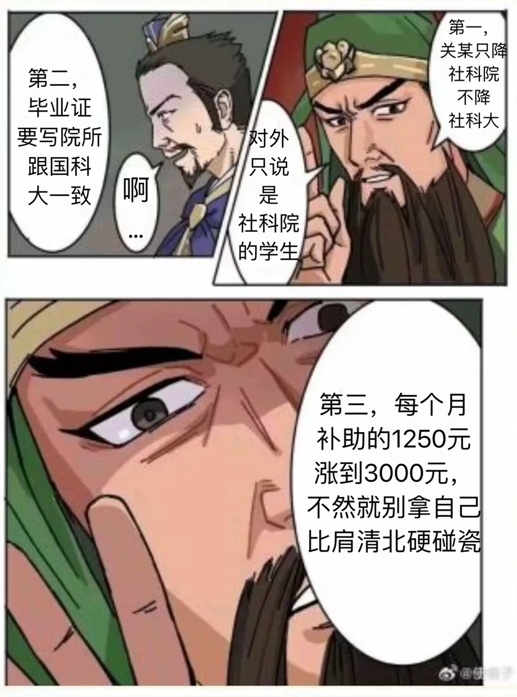
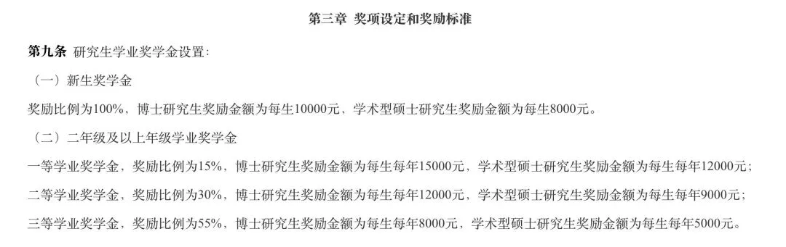
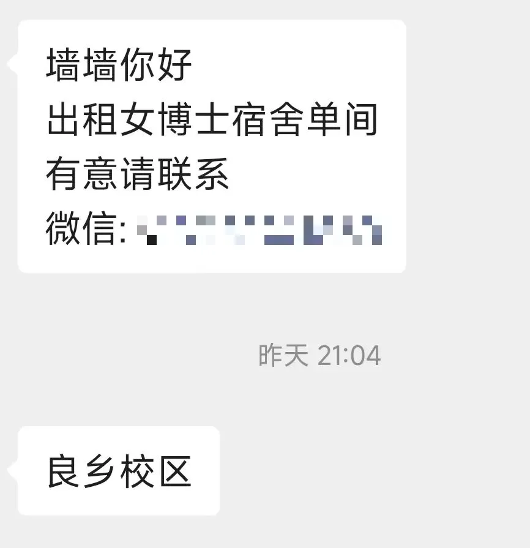

请相关部门及时关注并跟进问题。

## 1 教务问题

“今年不知道为何要全面推广所谓的雨课堂，从第一周的实践来看，这个软件相当不便，最大的好处或许是考勤。但一个大学等到需要天天抓考勤的时候，那离完蛋也不远了。

何苦这样折腾老师和同学，这个软件搞的天怒人怨，本质上毫无道理，为了所谓的数字化、信息化而随意出台政策。也不知道用这个软件是便利了谁？还是只让领导从中获得了好处？我们不得而知。

我们坚决反对以数字化为名行层层加码之实，更反对借助所谓的信息化工具来监管课堂的这种监狱作风。学校之所以区别于监狱、大学之所以区别于中学，核心就是减少层级，增加学习的自由。否则动辄扫码，随意监管，那又和“健康码”有何区别？健康码是特殊时期的特殊产物，难道雨课堂也是吗？一个增加麻烦、全无用处的东西到底方便了谁？谁又从中获得了好处，值得深思。”

## 2 证书&奖补问题

## “希望学校尽快商议，

给学位证毕业证上加上培养院所。

那是所有社科人的泪，

是给我们往返穿梭的时光最好的证明。

希望学校提高补助，

我们无愧于学校的培养，

但我们有愧于家庭的资助，

我们不想被物质束缚。

配图：

“我校是不是对专硕太不友好了，很多学院每年都在扩招专硕，专硕生数量多于学硕，学费更是十分高昂，但是却没有学业奖学金？未免太让人心寒了，很没有归属感。”

## 3 宿舍

> “后勤处能发一下公告说一下各个宿舍楼的洗衣机男女情况吗？现在 3 号楼西侧的男生洗衣房很多女生在洗衣服，去洗衣服真的好尴尬。而且有些人在洗衣机里面洗袜子内裤，真的是不卫生。请严格区分男女洗衣房，以避免不需要的麻烦。谢谢。”

“后勤一直推诿说没宿舍了，只能住三人间。去年学期来来回回查寝那么多次，就没查出那么多一个人住的是不是。那来来回回查寝查的什么呢？一直说不允许单人间，我请问啊，现在还有单人间出租了呢～ 来来来，后勤老师来说说怎么来的。

1、到底能不能单人间，能的话怎么一个手续。2、如果不能单人间，现有单人间宿舍到底怎么来的，只有一张床怎么来的，谁允许的？谁开的后门？3、一直说排查，排到现在怎么还有，怎么排查的，每间都住多少人，什么人后勤没有登记记录吗？寝室不是来来回回进那么多次了？”

## 4 图书馆

“望京校区图书馆大动干戈建三个静音仓不如多建几个厕所。牺牲了一个研讨室、两台电视，搞出来三个功能和研讨室无异甚至更少的静音仓。现在的图书馆三楼仅一半的面积就塞了5个研讨室、3个静音仓，阴暗逼仄，走进去就头晕眼花（可能甲醛还没散光）。四楼原来的研讨室被拆后现在塞满了阅览四人桌和窗边高脚桌，能容纳的学生密度堪比运奴船。

在原有设施已经能完全满足全校学生需求（如厕需求除外）甚至还有盈余的情况下，两台电视（充好会员版）、一个研讨室换成了三个没有增加任何新功能的静音仓。怎么，是觉得学生不该看电视还是在为学校扩招2000名学生做准备？？？？建议下次再干这种脱裤子放屁的事情先了解一下学生的真实需求，公布装修方案，不是把四楼的研讨室拆了原封不动装到三楼就叫图书馆“全新升级”。”
