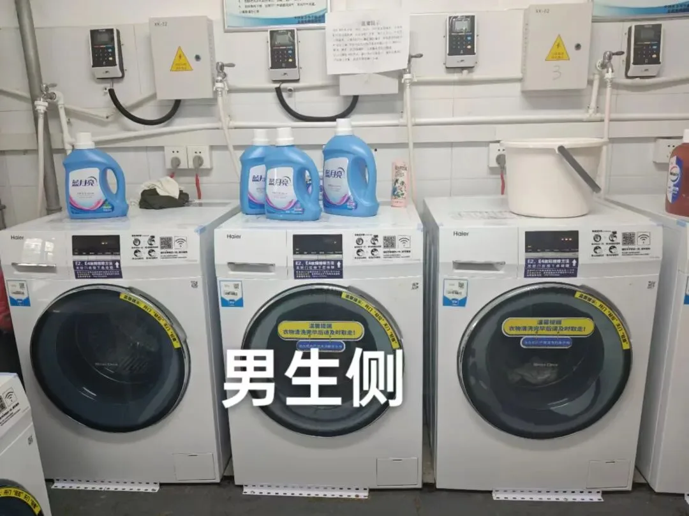
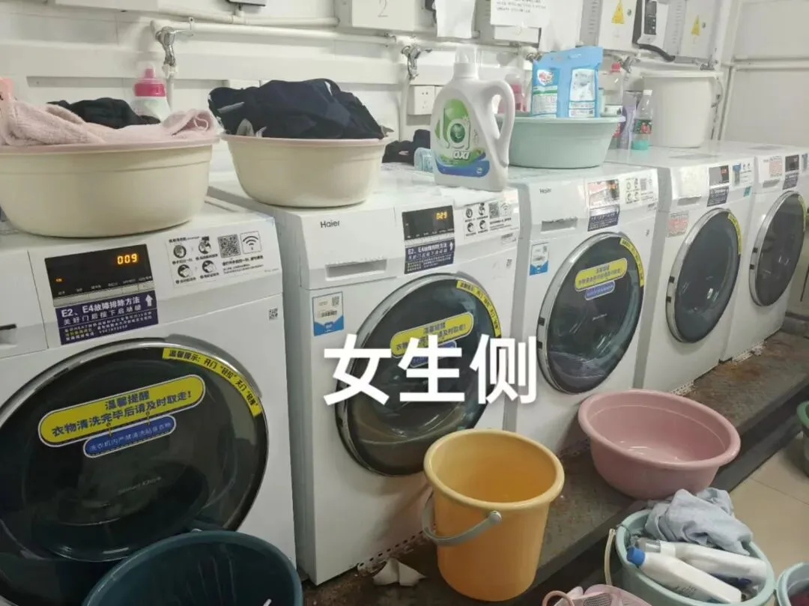

请相关部门及时关注并跟进问题。

## 1 军训

“9月7号早上雨天通知进体育馆训练，暂且不论下雨天让我们去军训，400来号人排队进体育馆你是认真的吗？

正在排队，坐等后续”

## 2 补助问题

“投稿：食堂的菜已经默默涨价了！每天的消费支出又多了，而每个月的补助还是1250吗？？？

普通院校的补助都是四千！！！

社科大还是只发1250元？？？”

## 3 洗衣机

## “投稿 关于三号楼洗衣机：

3号楼有几个男生又有几个女生啊……咱们按人数比例划分一下洗衣机比例不好吗？女生人太多根本排不上，西侧给男生用那几天去看了，总有空闲，另一侧两间洗衣房爆满有人排队也有盆子排队，这样是觉得女生的衣服排不上队去洗的话可以自己变干净吗？

既然三号楼绝大多数都是女生，并且洗衣机严重不够用，应该按人数比例来划分而不是一刀切按东西侧来划分，如果西侧全住男生我们当然毫无怨言，但是事实就是西侧绝大多数都是女生，我们的时间也很有限不可能说学校这么盲目划分我们就永远傻傻排队吧？我们也要上课也要吃饭睡觉的。

希望可以按比例划分给男生2or3台洗衣机，后勤大可以把3号楼男女生人数公示一下来看怎么样比较科学。而不是天天一刀切制造学生内部矛盾”

（见《

【读者投稿】被注视的与被忽略的

》第3.1）
