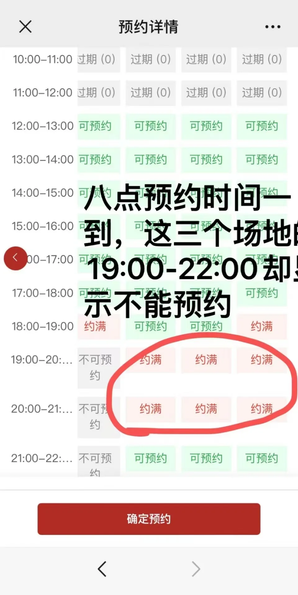

请相关部门及时关注并跟进问题。

## 1 系统设计

> “研究生培养管理信息系统，开题申请的设计简直反人类！字数上限太低了，每个部分都完全不够用，需要删减！英文文献只够放20多个！我很多部分都删了80%才能满足字符要求。”

## 2 历史学院

“历史学院行政疑似有点太幽默了，隔壁某学院给了5天选导师，我们伟大的历史学院只给1天选导师，且不发可选导师名单，且发的文档还是22级的，连改都不带改的。你们有这样的行政吗，真的是行行又政政啊！学生们只需要在一天之内遴选好导师、准备信息和自我介绍、与导师联系就可以了，我们伟大的学院行政那些拍脑门决策、复制粘贴往年文档的领导们要考虑的就多了。

我们的诉求如下：1.放宽个人信息提交时间，至少留5天选导师； 2.立即更新相关文件，给予我们起码的尊重 ；3.保证以往此类事件不再出现。”

## 3 食堂

> “良乡校区食堂：首先食堂的餐饮是价格实惠又美味的，特别好！美中不足有两个小小建议：一是豆腐脑能不能出半份的，一份太大了，实在吃不完，我和我身边的同学都吃不完，而且食堂阿姨说没有半份的，半份也要收整份钱。二是食堂青菜都偏油，能不能少点油，本来就是青菜，油多了太油腻了，感觉比肉菜还油多，也不健康。 非常感谢！”

## 4 体育场馆预约

> “这学期羽毛球场的场地预约状况一直很迷惑，一会堆满行李的场地却开放了预约，一会没有特殊安排的场地却不让预约，以至于成片空着。今天甚至出现了晚上7-10所有场地不能预约的场景，能理解周二周三晚上有羽毛球课，但不至于所有场地都不让预约吧？让想约7-10场地的同学扑了个空。结果到11点左右又突然开放三个场地允许预约了，这种没有来头的变来变去的场地预约简直就像在玩弄我们一般，你要么八点之前就设置好哪些场地不能预约、哪些允许预约，不要过了半天才想起自己不合理的预约设定然后临时找补，我们的时间也很宝贵，这样真的非常不尊重预约的同学！！！”

## 5 感冒防护

“想提一个小小的建议：在图书馆感冒的同学，可不可以自己戴一下口罩，方便一下大家伙~周围的同学们可能不是每个都抵抗力那么强；加上坐得近，图书馆空气不是那么流通，有一个感冒的太容易把周围人传染了

一来感冒实在太难受，二来学习任务重，感冒实在会影响进度。”

## 6 教务问题

> “教务：学校想尽办法把学生绑在课堂有什么用？真正优质的课堂会担心没人上吗？不都是抢着上的吗？与其把脑筋用在怎么提高技术、监控学生，不如你们自己轮流听课，看看有些课到底上得怎么样，看看有的老师在上面讲得到底多枯燥、生硬。还是我们高估了你校的工作能力，你们只是一帮坐在办公室绞尽脑汁转移矛盾的人罢了。”

（见《[【读者投稿】被注视的与被忽略的](https://mp.weixin.qq.com/s?__biz=Mzg2MjcwNzQ1Mw==&mid=2247489276&idx=1&sn=d919edb37366a3c3df866f83c5ee4737&chksm=ce029d6ef9751478c397e359d37c34dc13bc3751f57d1af9c56354bc22d41b04c98003f73867&scene=21#wechat_redirect)》第1条）
