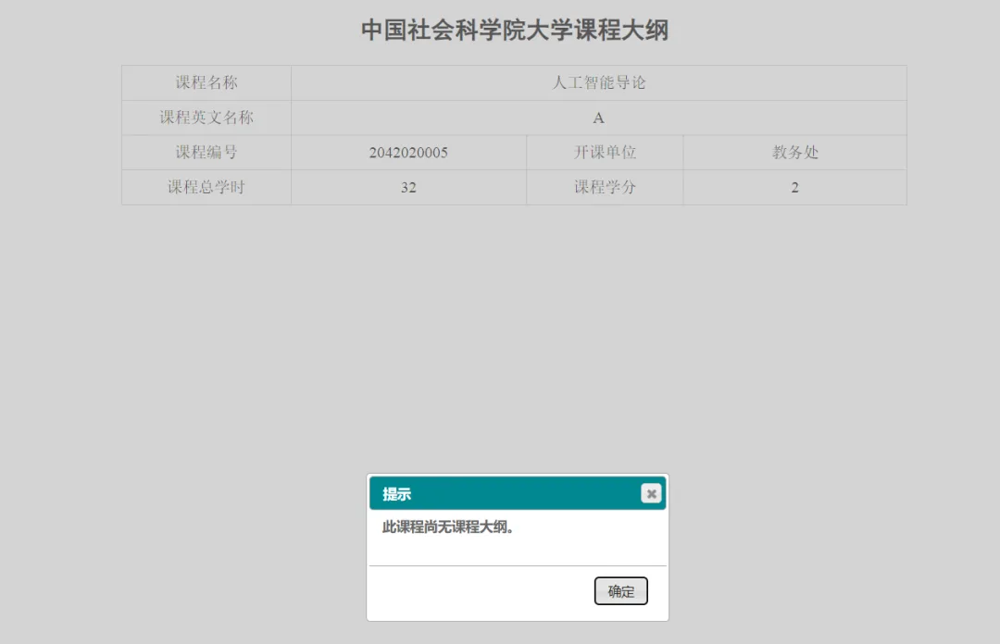

请相关部门及时关注并跟进问题。

## 1 网络系统

> “不好意思，很难忍住不骂。为什么学校三番五次要更新网络系统，然后让学生一次又一次登录系统搞这搞那呢（什么个人信息填写，系统本身就不流畅，各种bug，填个表花半小时，怎么，学生的时间不是时间？）？？？如果系统不行，就请学校大方点花点钱找专业的人一次性办好了，能不能不要这么穷折腾？学校的槽点已经够多了，网络中心是想要为此尽一份力是吧，要证明学校是方方面面的垮，从硬件到软件、从现实到虚拟都垮？”

> “严重吐槽学校刚出的学工系统里的基本信息设置！明明是“基本信息”，怎么连身高体重特长还有家庭成员的单位地址及收入情况也要设为必填？感到隐私被侵犯。希望学校可以参照国内正常大学的信息登记设置，审慎的收集学生信息！”

## 2 教务问题

“希望学校可以优化课表，选完课自动出一个每天的课表，旁边标上时间。现在这样一点一点地找太浪费时间，而且毫无意义。”

## “我们社科大的教务工作做得太完美辣！！！

24级新生突然冒出一个人工智能导论就算是临时安排也能接受，但是直接按行政班来开课就不会考虑到学生实际时间是否冲突吗？所以好多同学课表里竟然能同时出现两门时间冲突的课。这让我们同学们怎么办，请问一下我们的充满智慧的伟大的教务处？

为什么不能像人文社科研究方法那样让学生根据自己的时间选课呢？”

> “社论君好，投一个稿。吐槽一下新开设的所谓“人工智能导论”课程。现在人工智能大热，为学生补充一点这方面的知识没有什么问题，但现在这课程设置的也太仓促了吧。首先，突然在大家的课表里塞进这样一门课，与大家选好的课对撞，有点无语。此外，这门课具体什么内容？不知道，课程大纲尚无，很好奇教务处三令五申的要求课纲要求到哪里去了呢？这样给大家塞一个不清不楚的课挺奇怪的，让人摸不着头脑。最后再提个建议，学校旁边就是北理，和国科亦有合作关系，如果真要给大家搞好这门导论的话，可能从实打实研究人工智能的优秀高校来请一些老师补充效果更好。”

## 3 空调

“外面23°，有些同学非要开26°，屋子里跟开了暖气一样，这样合理？ 建议学校再过几天可以直接把制冷和制热都关了，只留通风。”

## 4 体育馆

“体育馆也是挺有意思的，理论上来说场地没有人就可以随便打，那你预定场地有什么用呢？”

（见《[【读者投稿】基建后勤有问题 教学相关诉求多](https://mp.weixin.qq.com/s?__biz=Mzg2MjcwNzQ1Mw==&mid=2247489297&idx=1&sn=78980e8571c73a1e76b4ba2fd0415f52&chksm=ce029c83f9751595cf3802238282b111eb921c36a98f8702caec06a4e78faae8d762ab4aa1a2&scene=21#wechat_redirect)》第4条）
