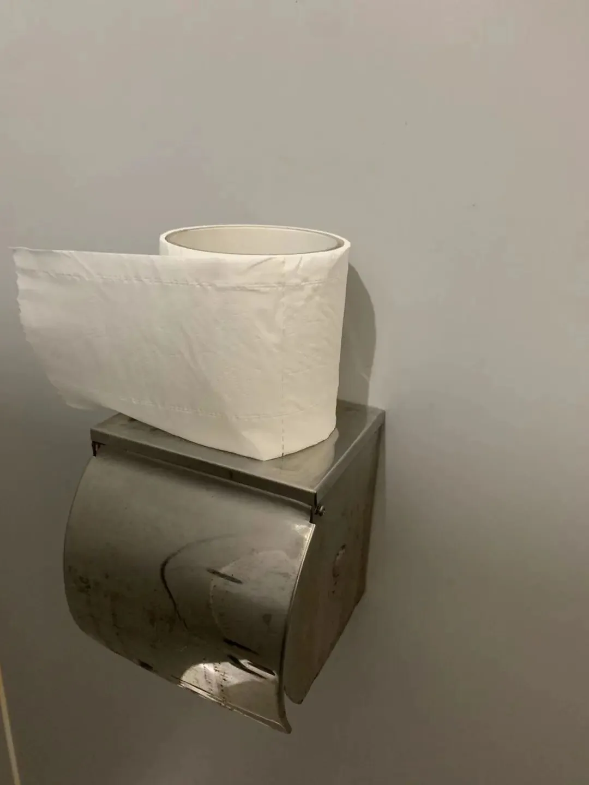
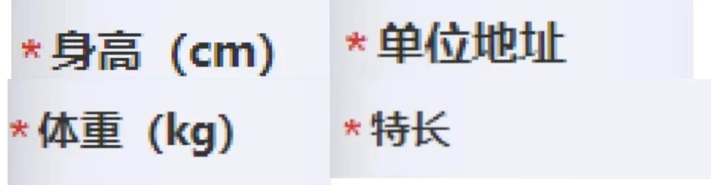

请相关部门及时关注并跟进问题。

## 1 就业

> “投稿，咱们学校的双选会就业相关的资源太少了！别的学校双选会都是200多家企业来，咱们就30家，还有几个企业是招大专的。双一流建设也遥遥无期，真的感觉咱们社科大就业指导中心所做的工作，与别的学校所做的工作的这种资源和质量方面的差距，我们的社科大什么时候能变好？变好不就是让毕业生有更多更好的就业选择，有更好的去处吗？就业指导中心能不能给点力？”

## 2 校园基建

## “投稿：

体育馆的女卫生间，只有侧壁的挂钩，运动完身体大量出汗，因为运动服装普遍口袋较小或者没有口袋，存在如厕时手机无处放置或者手机从口袋滑落的情况。请问后勤处，是否可以安排给女卫生间的加装手机放置台？”

## 3 教务问题

“感觉社科大信息十分庞杂混乱，作业有在雨课堂布置的，有微信群布置的，有口头布置的，请问能不能统一一个系统，按时提醒大家作业呢？”

## 4 学工系统

> “投稿。有人说与校方沟通过后，那些大家反映不合理的学工系统必填项目做出了修改，问题已经解决了。可是截至目前我一介本科生，看系统里没有任何变化啊。“身高体重特长还有家庭成员的单位地址”这些都没有变，原本是必填项的还是必填项。想问一下校方从善如流从到哪里去了呢，难道说差人做个样子就当解决问题了吗。这的确没法理解，挺失望的。”

（见《[【读者投稿】用之无法坐和放宽](https://mp.weixin.qq.com/s?__biz=Mzg2MjcwNzQ1Mw==&mid=2247489302&idx=1&sn=4e4e0f5b0363df95f75a730b48b840f9&chksm=ce029c84f975159235a79e7c8ea2a0642b587308f91f7a6f6f171bda2208a47cdd3b585b5040&scene=21#wechat_redirect)》第1条）
