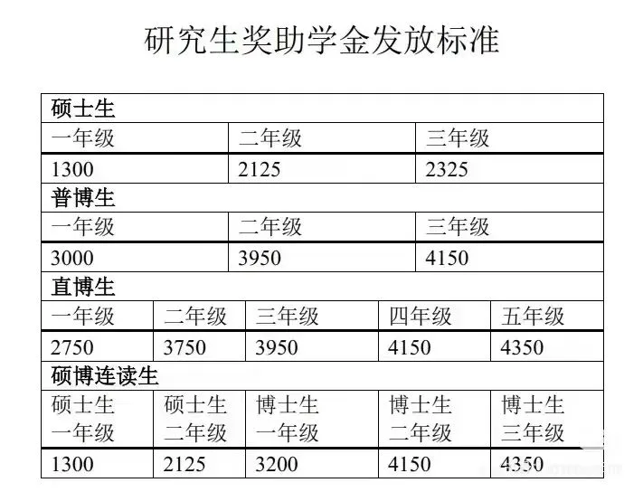

请相关部门及时关注并跟进问题。

## 1 宿舍

“投稿一则，7号楼很多宿舍冷水水流特别小，洗澡的时候特别烫，而且正常生活洗脸刷牙洗衣服也要接很久的水，很多宿舍上报都说要等领导，左等右等等不来，做打油诗一首：

今日水烫，洗澡如淋岩浆。

多次上报，均称要等领导。

左等一日，右等一日。

花好月圆，中秋秋露霜寒。

阀门依旧，领导不见影踪。”

## “7号楼宿舍楼的凉水水压，晚上洗个澡全是热水烫的跟要脱层皮，我真快要受不了了！”

## 2 奖助补费

## “投稿

社科大这个涉及全校的补助问题大家反映日久、呼声不断，校方却一直装作没看见一样。从去年反映到现在，新学期中秋假期都结束了，也没见到任何说明，既不和大家开诚布公协商这个问题怎么处理，也不去针对补助做出任何调整。怎么，是恬不知耻认为学生现在拿着全北京倒数有名的补助非常满意吗，还是自以为吃准了大家面对这个问题会畏畏缩缩不敢发声、过一阵子就遗忘这个问题？你们这样搞下去，大家又会怎么看待你们？恐怕只会搞得寒心而离心。”

## “这是国科大最新补助标准”

## 3 校园网

> “我快要受不了了，这校园网到底能不能用？今天一上午了我拿着电脑想找找文献，上个知网一直显示无法访问，要么就是访问一会儿再搜别的直接又没有反应，我真的快要崩溃了。”

## 4 食堂

“良乡校区一食堂，建议可以专门开一个档口用做打包服务，这样节省大家时间，不用师傅来回的拿取餐盒。”

“今天我要做一次不完全归纳推理，即从风味食堂麻辣烫窗口变质发臭的鹌鹑蛋这一件事来“诬陷”整个风味食堂的卫生状况。今天吃罢他家的腥臭鹌鹑蛋后，回到寝室，喉管苦干，好似有油煎肺腑、火燎肝肠。请允许我运用这样夸张的词句来形容我的感受，以替我和许许多多吃到臭鹌鹑蛋的兄弟姐妹们鸣不平。

伸冤的内容到此为止，毕竟我不是怨妇，而是斗士。希望学校相关部门可以重视这件事情，敦促食材质检工作的每日推行，把卫生这一问题的监管、督促、整改落到实处，否则学校自诩“人文之光”，却又的的确确地生出了一个逆子：‘人文之脏’。”
