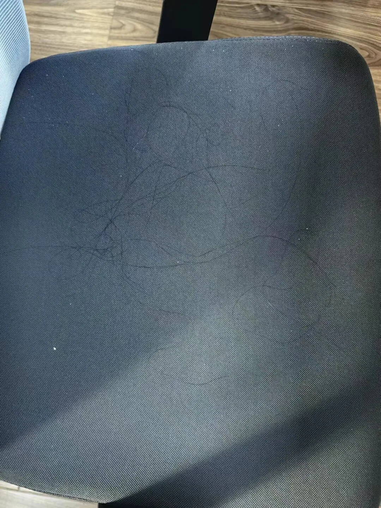

请相关部门及时关注并跟进问题。

## 1 食堂

“一食堂每天二楼排长队，一楼没什么人。为什么一楼不可以卖小份菜呀？如果有大份菜需求可以直接说要两个小份呀。既缓解排队压力，也能让同学们有更多选择。”

## 2 图书馆

## “望京校区图书馆研讨室，辛苦阿姨打扫卫生时也清理下凳子吧。”

## 3 保卫处

“我是新传学院的一名研究生，想特别感谢一下学校保卫处处长（不好意思网上没搜到咱学校保卫处处长姓名）、保卫处黄老师、今天（9.22）一食堂门口保安亭的值班保安大哥，还有安信捷超市。

事情是这样的：

我昨天在食堂和二号楼那边的摊位上买了一箱安慕希酸奶，本来要晚上六点前回来拿的，但是我忘了（非常对不起，因为我的疏忽给大家造成了许多麻烦）。

今天午饭后，我咨询了一位保安大哥，他建议我去保卫处办公室问问看。

谢天谢地，虽然今天是周日，但保卫处处长在办公室值班，他听我说明来意后，通过发消息、打电话询问等方式，确定了昨天摆摊的情况，并且和超市负责人联络说会让黄老师带我过去取酸奶。然后，黄老师顶着大太阳一路把我带去安信捷顺利拿到了酸奶。

非常感谢保卫处处长休息日坚守岗位，面对一箱酸奶这样的小事，积极伸出援手，联系相关部门和负责人帮我询问情况、拿到酸奶等。

非常感谢保卫处黄老师专程带我到超市拿酸奶，一直安慰我这是他们应该做的，提醒我上下楼梯小心等。

也感谢安信捷超市诚实守信，确认情况后返还商品。

再次为因我的疏忽大意而给大家带来的不便表示歉意。”
