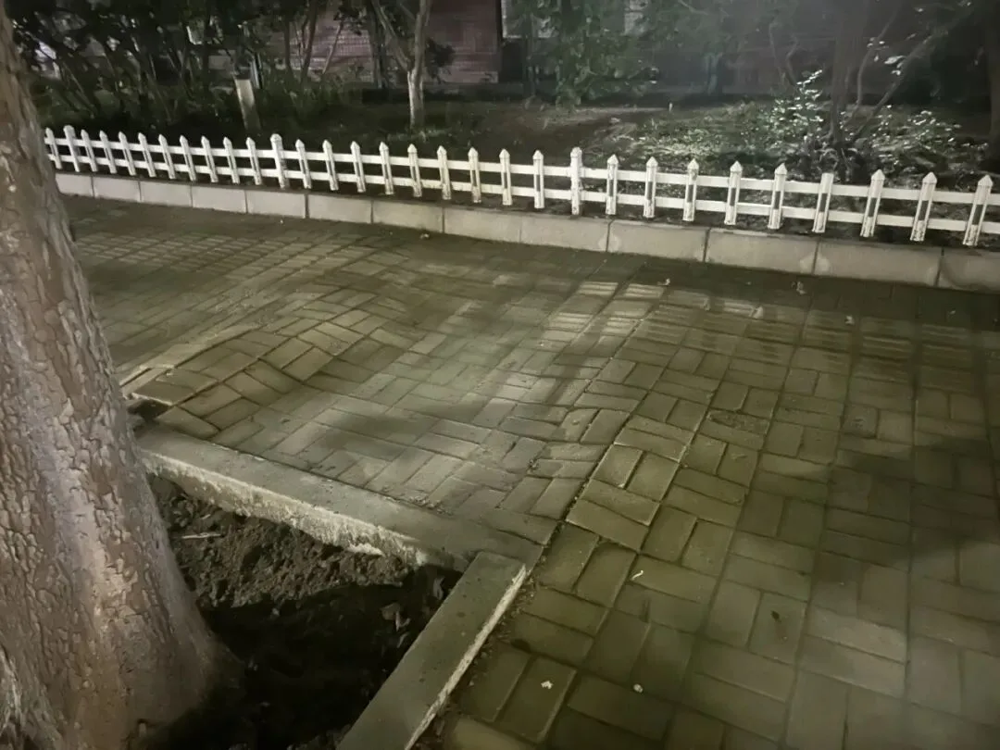

请相关部门及时关注并跟进问题。

## 1 基础设施

## “良乡校区希望能修一下明辨楼靠北门往南走一点的路，那块灯照不太到，有人摔了”

“体育馆能拉个网把篮球等场地与羽毛球场地隔开吗？有时候篮球总是飞到正在打的羽毛球场地，非常不安全。”

## 2 宿舍

> “懒得喷这个宿舍安排，当时填个人信息的时候就是有什么作息“早起早睡”“晚起晚睡”，我还夸了社科大一嘴说人性。现在了才知道原来收集了只是个心理安慰啊，今天周末有人早起有人赖床，问了才知道我们宿舍四个人选的四种作息。先不说这样很容易有矛盾，就算现在能改也无力回天。原来真的只是心理安慰啊。”

## 3 图书馆

“怎么有人在图书馆阅览室（良乡校区，报刊阅览室，9月23日下午）吃东西（桃子苹果之类）啊！就算没有味道也有奇怪的声音啊！”

## 4 食堂

> “关于食堂打饭人员效率问题，我已经向后勤部门反映过，后勤部门说会提高效率。但是自从作出回复之后，我并未察觉到打饭效率的提高。社科大良乡校区的食堂打饭工作人员似乎带编，饭点时候打饭动作不麻利，我觉得食堂的工作人员也得行动起来，打饭动作要快，实在不行搞一个每周业务单统计，每周业务成交量不达标或者太低的食堂工作人员要罚款。 另外，食堂的菜品是否可以有所调整呢？建议每天做一个菜品评价，就像社科院食堂那样，评价最低的菜咱们以后也就别做了。浪费粮食，浪费时间，吃饭的人心情也会变差。既然社科大的学生吃饭洗澡吹头发都要被推着定时定点，食堂也别偷懒，一周翻来覆去都是同样不好吃的菜，别以为进了社科大的食堂，就躺平摆烂，不开发新菜式了。 结论就是学校别双标，逼着学生定时定点吃饭，食堂等各个部门也提高效率吧。”

