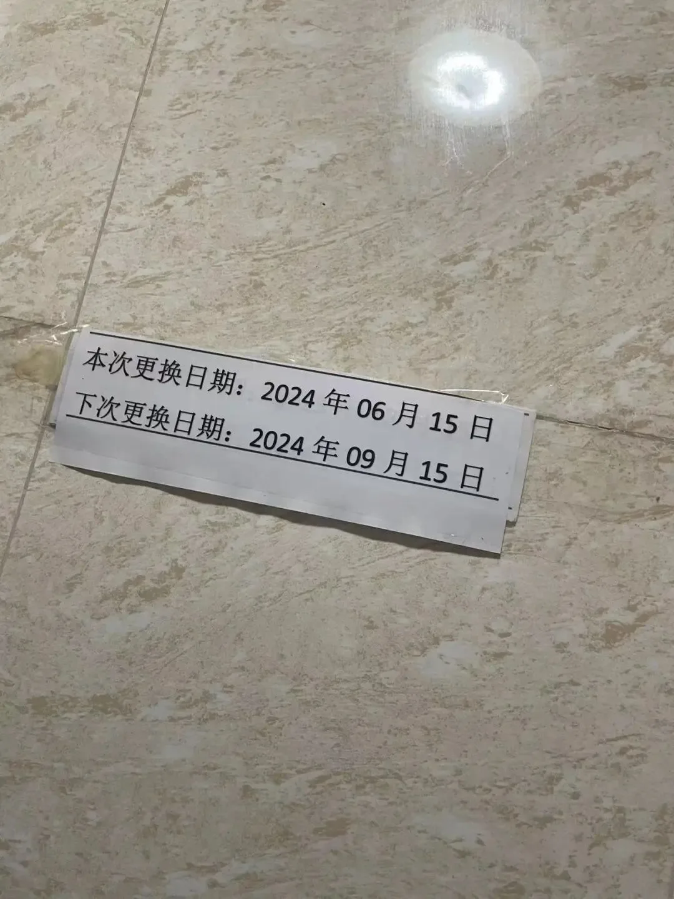
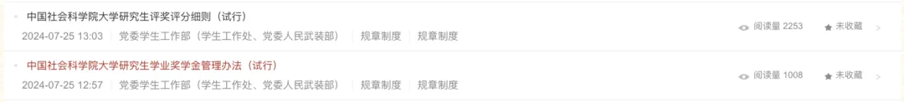
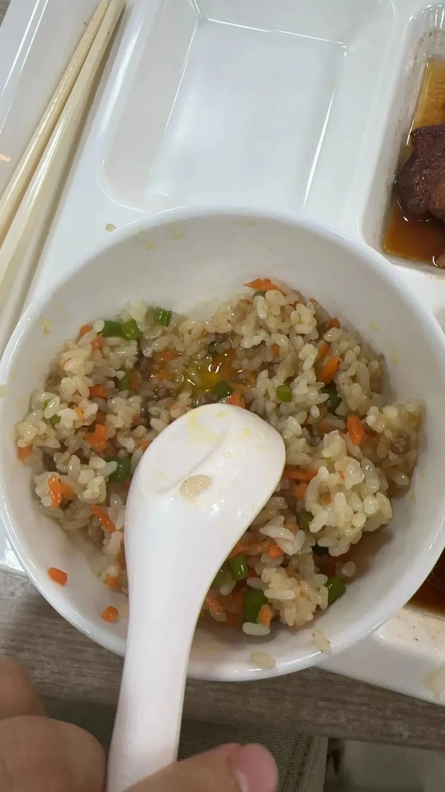
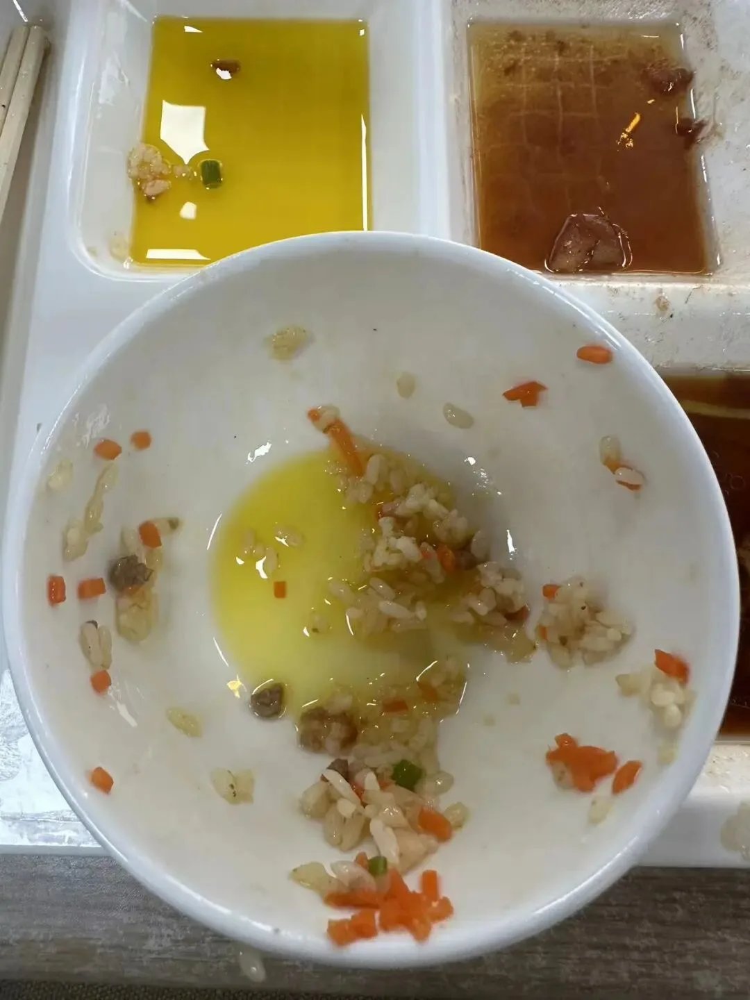

请相关部门及时关注并跟进问题。

## 1 基础设施

> “你好，我想反映一下望京校区快递柜这边的修建改造工程，晚上12点到了大家都睡觉的时候还在施工，声音巨大，严重影响了我们的睡眠，希望可以在合理的时间安排施工。晚上被吵的睡不着真的很痛苦！”

“良乡校区教学楼饮水机的滤芯是不是该换了，标注的更新日期是9月15号，现在已经9月24号了，是要十一之后再更换吗？”

## 2 奖助补费

## “关于今年奖学金评选可能发生的一些事

9月23日晚上，同学告诉我新的奖学金评选方案出来了。我很吃惊，因为我之前并没有见到这份文件。我们学院以及其他学院的部分同学均未收到这份文件发出的通知，但是通过校园门户，却可以查到这份文件。我想请问一下学校某些领导，某宿舍楼维修、自习室清空这些小事可以发全校通告，奖学金这么大的事很多人居然没有收到，而且是在暑假期间发出的，不知道某些领导的用心何在。

细看这份文件，当时同学提的一些意见可以说是大部分没有被采纳。

先指出一些问题，论文成果要以科研系统审核通过的成果作为依据，我想知道我们发论文，还要通过系统审核？为什么之前没有听说过这个事情？

参与教师科研项目，最多两项，不论等级，老师评职称尚且要看项目等级与数量，学生评奖学金就不看？不同等级的项目，学生所做的努力在学校看来是一致的吗？而且科研项目尚未结项的不予记分，我想知道学校领导真的有参与到科研项目中吗？从申报到中期到结项，申报书批准到结项书发到单位，一年的项目往往走流程大概有一年半左右，学校领导真的知道吗？况且上一年以及今年在科研系统里填报导师科研项目时，并未提到这会与奖学金挂钩，学校让没有填报的人怎么办？学生科研项目以学校颁发的结项证书或奖励证书作为依据，老师的课题，学校咋颁发证书？

先说这么多，大家可以仔细看一下这份文件。我想说的是，对于在社科大上了两三年的学生来说，奖学金评选的适用办法在中途更换这么大的事，很多人居然没有收到消息。社科大真的有在好好剥离研究生院！”

## 3 图书馆

“硕士新生，请问各位大佬咱们学校图书馆里的wind数据库该怎么使用，我只看到了让下载APP，可是没有账户该怎么登录呢？学校是否购买了这个数据库？”

## 4 食堂

## “一言以蔽之：食堂这么涨价博士生要吃不起饭了，要不降价要不多发钱谢谢。”

## “投稿：学校食堂正在危害我们的健康。

本人中午在良乡一食堂一楼点了二两炒饭，刚开始没有什么问题，可是稍微吃了两口就感觉油糊糊的，等我将上层的饭吃完，发现碗底都是油，这个炒饭的油量过大了，完全不是一份正常炒饭该有的油的量，这对于我们的健康有着极大的危害。

图一是我发现饭底下有油，图二是把饭中的油控出来了，图三为吃完饭后的碗底”

