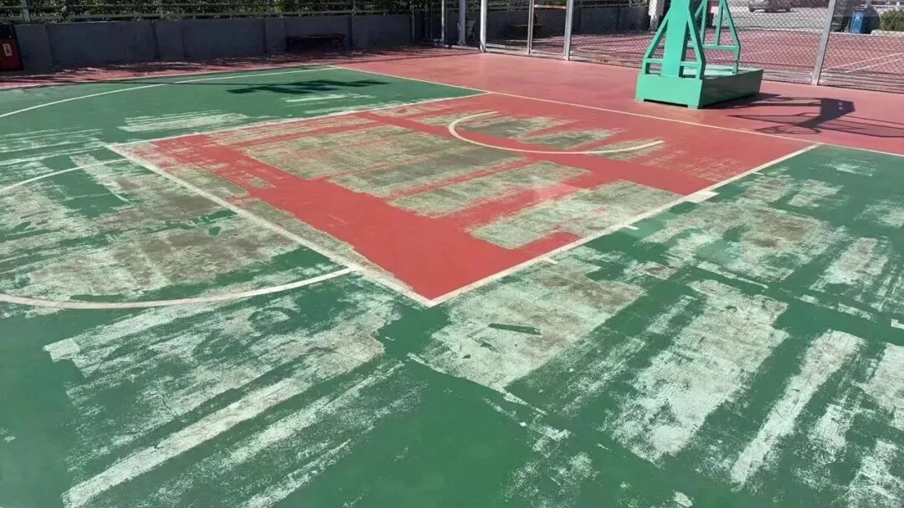

请相关部门及时关注并跟进问题。

## 1 校园安全

## “投稿望京校区：能不能翻修一下篮球场呢，场地条件越来越恶劣了，求求了。”

## 2 饮水卫生

“投稿：研教楼一楼的饮水机管线是不是该清洗了？接的水一股腥味，图书馆的没有闻出来。”

## 3 食堂

## “投稿

表扬10月3日晚上的二食堂自选，菜品很棒，继续加油！”

## “投稿

吐槽一下最近一食堂二楼的菜品供应情况。才晚上五点半左右，去到食堂就是问一个菜没有，再问一个还是没有，让人无语。先不说菜品质量如何，现在连基本供应也没法好好保障了吗。这还不到六点，平时六点下课的同学会面临什么“惨况”，真是让人难以想象。”

## 4 奖金问题

> “投稿：6.4让人笑掉大牙，还“规范得很好”？这个思维岂不是和“我管你发了多少论文，参加多少项目，我只要求你参加我组织的闭卷中期”一样荒诞？敝帚自珍，还好意思说呢。”

“不懂科研项目为什么不算科研能力，老师评职称都会看课题申请情况。不会有人觉得老师的科研项目学生不用干活就能挂名吧。

新的评奖细则中加大了研创计划的加分，我想也是认可科研项目的。之前的评奖细则也不是“老师有项目，学生就加分”的，而是“学生参与教师科研项目”加分。请不要将二者混淆。

总之，虽然之前的评奖细则有诸多不合理之处，但我更不能接受在学年末发布的新的评奖细则”

“学校真的很有意思。去年六月份和我们开会，说奖学金政策要变一变，但是今年时间太晚了，担心变化之后影响同学的准备，所以打算评完奖就发布新的规则。结果呢？今年还不是等到了快评奖才发布。我想请问这公平吗？合理吗？很多同学之前的努力都白费了，为什么呢？一天天的朝令夕改到底是在做什么呢？按你们之前的说法，是否可以要求这一次的评奖规则按照老办法执行呢？

至于奖学金评定的不合理之处，我就不多说了，大家自己都能看到。什么导师贡献不占比重，什么项目结项才能算成果之类的。还有成绩的换算方法。也不知道是不是为了给某些人方便开后门才临时改的规则，说真的我是看不懂。不知道大家怎么想。”

（见《[【读者投稿】差距与不足](https://mp.weixin.qq.com/s?__biz=Mzg2MjcwNzQ1Mw==&mid=2247489378&idx=1&sn=d4998240e43aa5747f8eff1a4935181b&chksm=ce029cf0f97515e6c98b7f7ec81a4712ec3431a0316246a312a4fac81434aa7ceba84b05a2b3&scene=21#wechat_redirect)》第6条）
