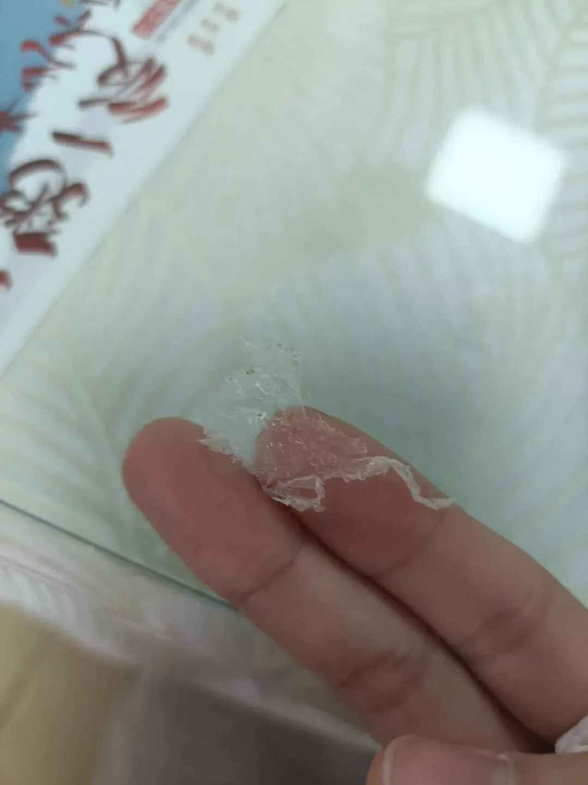
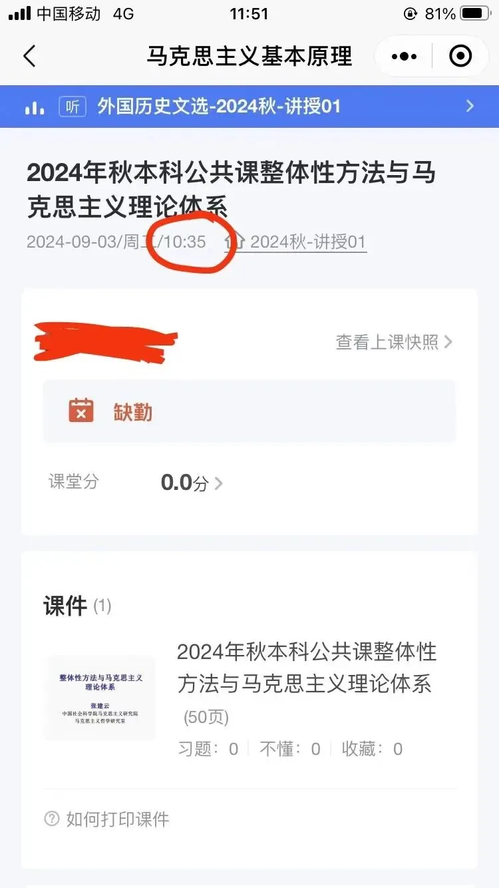
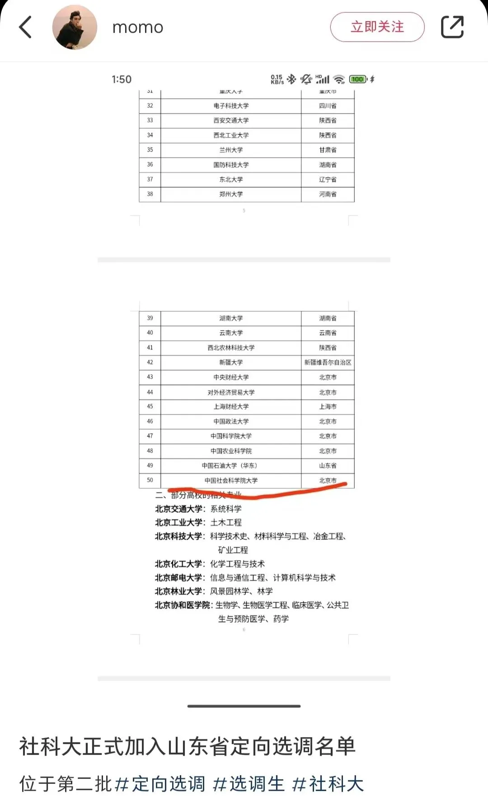
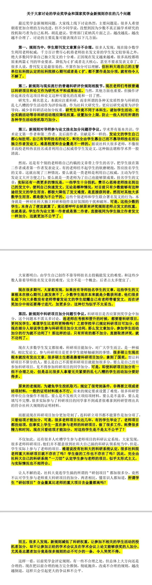

请相关部门及时关注并跟进问题。

## 1 食品安全

“在良乡校区二食堂馄饨馅中竟然吃到了塑料！！！！食品安全什么时候可以得到保障？！”

## 2 教务问题

“我们伟大的教务处使用的雨课堂这种先进的签到软件为什么总是出现一些令人啼笑皆非的错误捏？

明明是下午的课却弄成上午，导致全员缺勤，那我缺的考勤分这一块谁给我补啊？！”

## 3 校园卫生

> “社论君你好，投稿望京校区厕纸问题。抽卷纸的时候发现卷纸侧面有相当厚一部分是那种卷纸散开之后又重新被人为卷好的样子。不清楚这一部分纸是从哪里来的，这部分纸又是否干净呢？卷的过程中又是否保证了手部的干净卫生呢？后勤可否注重一下这方面的卫生问题呢？谢谢！”

## 4 就业

“投稿：山东定向选调社科大入围第二批院校名单，感谢学校相关领导对学生就业考公的大力支持！！山河四省考公碎片凑齐了”

## 5 科教融合&奖助补费

> “投稿：听说某些负责老师以“学生的主业是学习，不能让学生参与过多导师的科研项目”为由，将科研项目比重缩减。这话不跟导师说，从学生下手？多少有点欺软怕硬吧。现在好了，学生不仅要参加繁重的课题任务，还得不到应有的反馈。离谱。”

## “投稿：

（见《[【读者投稿】生活相关反映不断 奖金疑问持续延烧](https://mp.weixin.qq.com/s?__biz=Mzg2MjcwNzQ1Mw==&mid=2247489385&idx=1&sn=2aa4dae03645357b43f7679c143e2d55&chksm=ce029cfbf97515ed2622be249662f96f87bda235cfea101a3f4676a86228509dba52be54e062&scene=21#wechat_redirect)》第4条）
