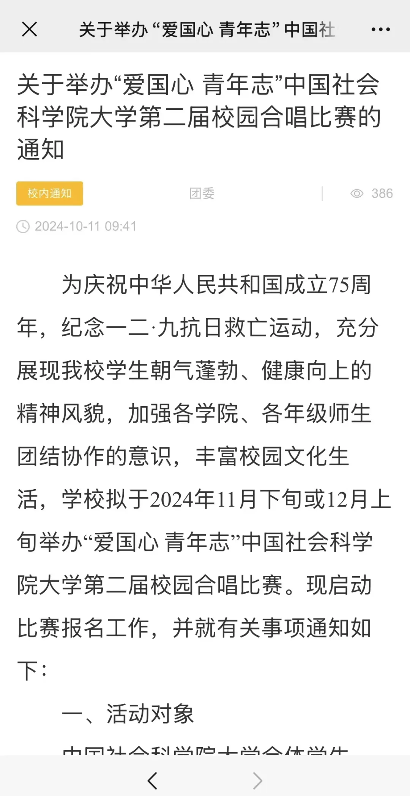

请相关部门及时关注并跟进问题。

## 1 体育馆

“气膜体育馆能不能把晚上熄灯时间往后调个2~3分钟？出场的时候很容易因为灯光太暗而摔倒”

## 2 建筑危险

> “早晨8点50左右路过良乡图书馆侧面，突然身后不到1m处传来巨响，一块巨大的墙灰或砖俯冲到地面，砸的粉碎。一时间大脑很懵，不知道该庆幸自己的幸运，还是感叹学校基础设施质量之好。”

## 3 合唱

## “终于有纪念一二九大合唱了，表扬”

