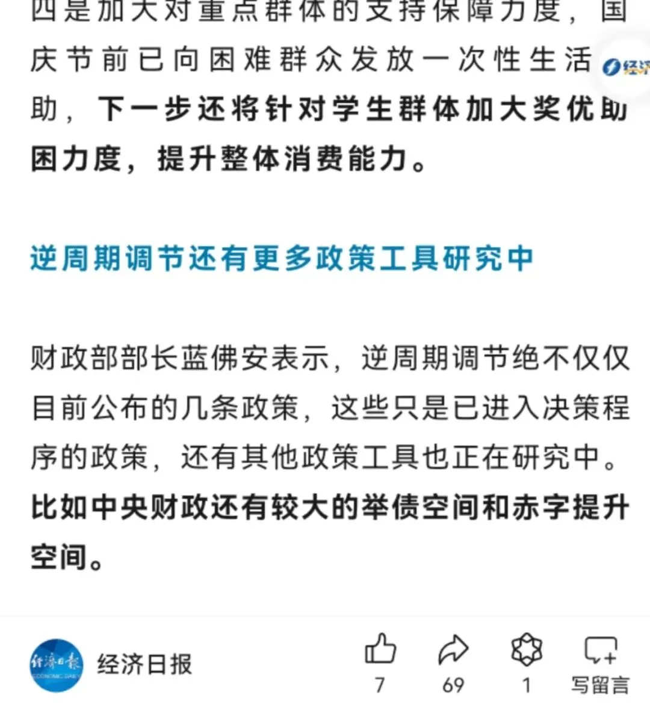
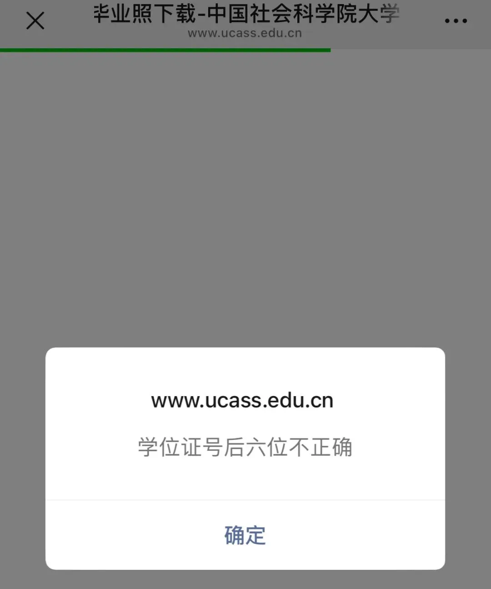

请相关部门及时关注并跟进问题。

## 1 补助政策

## “请学校响应奖优助补贴政策

周末一揽子增量政策重磅发布，其中四是加大对重点群体的支持保障力度，国庆节前已向困难群众发放一次性生活补助，下一步还将针对学生群体加大奖优助困力度，提升整体消费能力。

希望学校能积极响应国家政策，提高学生早就提出已久的奖优助学补贴，对比一下其他学校，别再垫底了，别再无作为。”

## 2 活在阴影中

## ““我感觉我一直活在他的阴影里”

近日，中国科学院副院长、党组成员常进院士任中科大校长、党委副书记。自2014年国科大成立、招收本科生以来，国科大的校长和党委书记一直由中科院副院长、党组成员兼任，2014-2018年，中科院副院长丁仲礼院士兼任，2018-2023年，中科院副院长李树深院士兼任，2023年至今，中科院副院长周琪院士兼任。

至此，中科院下属的两所高校均由副院长坐镇一把手，足见中科院党组对高校建设、科教融合、人才培养的重视。而自2023年7月，高培勇学部委员卸任社科院副院长以来，社科大的一把手就江河日下。又或者说，社科大在上级的发展规划中已经失去了重要地位，无人愿接手这块烫手山芋。如此比较，不是强调那些虚头巴脑的官职，而是有这个级别的院领导坐镇一把手，在科教融合过程中对于院部各个单位的人事和资源的统筹协调才会有保障。

看看隔壁的国科大吧，据国科大毕业生就业指导中心公众号推文，“第五轮全国学科评估结果，国科大36个学科被评为A类学科，其中A+学科19个，位居全国第三。”每每听到国科大的喜讯，我们总是不禁将目光投向那被我们寄予厚望的社科大，他又交出了一份怎样的答卷呢？不妨先假设比肩人大。”

## 3 毕业照

## “请问2024届毕业生为什么没法下载毕业照啊？？！”

## 4 就业

## “想投稿：求求打下东三省的定向选调，助力东北孩子回家的梦，谢谢啦”
