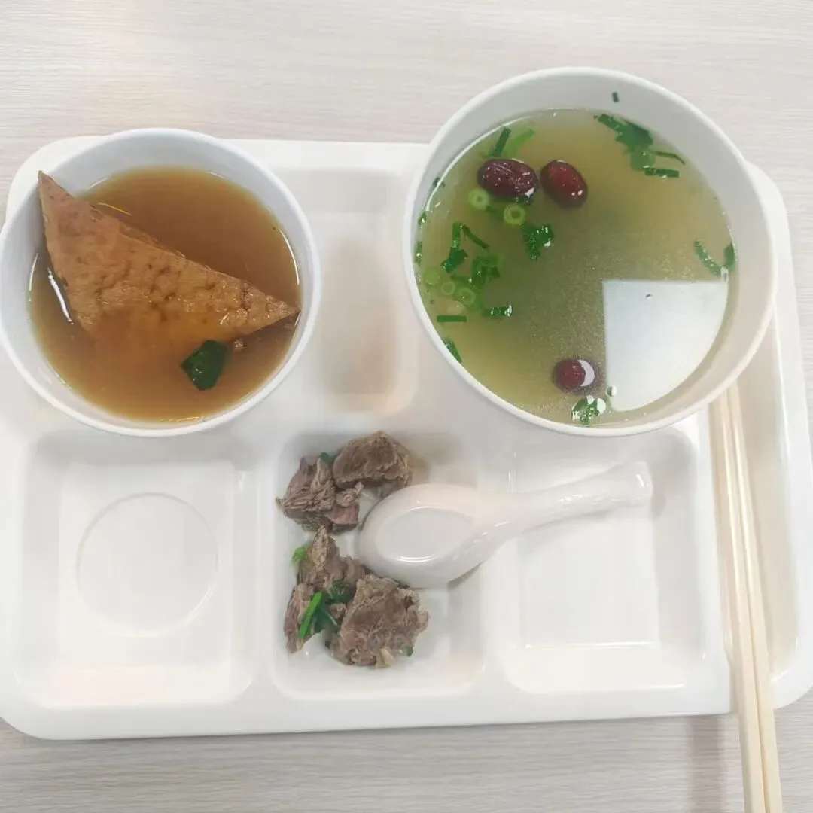

请相关部门及时关注并跟进问题。

## 1 食堂

## “【投稿】望京食堂清蒸鱼

望京食堂的清蒸鱼，不知道之前什么状况，至少在2024年10月17日这一天点的这道菜，我闻到了刺鼻的味道，吃了一会也感受到了难受。这种味道就像药水浸泡过那样，感觉像是巴沙鱼吧。感觉学校真的应该对食材进行把控，这是直接关系生命健康的东西！”

> “今天中午（10月18日）在一食堂一楼清淡窗口买了牛肉汤里只有四块牛肉，还不如二楼3块钱的清炖牛肉里的肉多呢。去找了叔叔说只有四块肉，以前也不这样啊。叔叔说牛肉汤主要是卖汤。如果只是汤的话，8块钱也太贵了吧？”

## 2 图书馆

“希望良乡校区图书馆增加储物柜。每天晚上都没有柜子用，每层楼都没有！倒是锻炼身体了”
