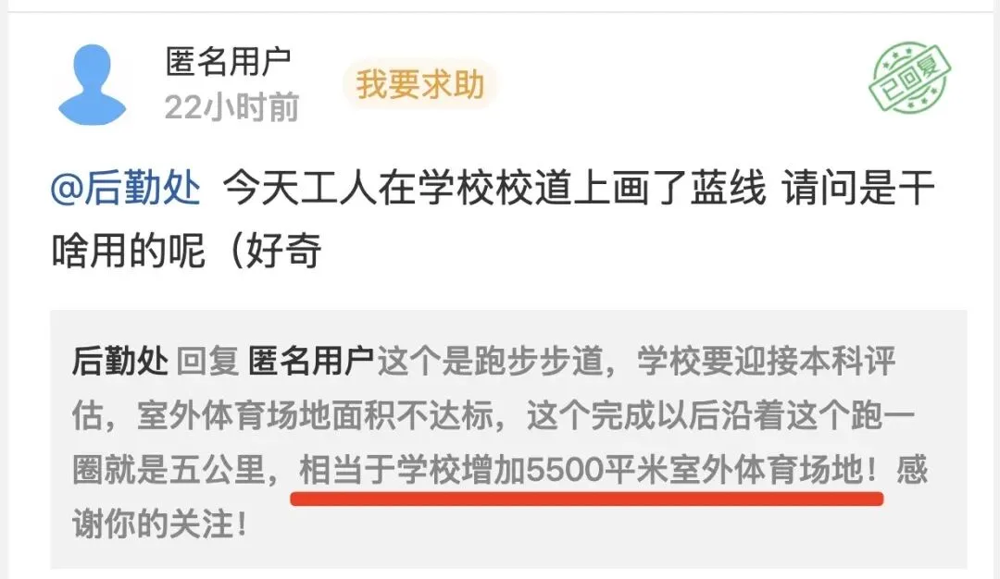
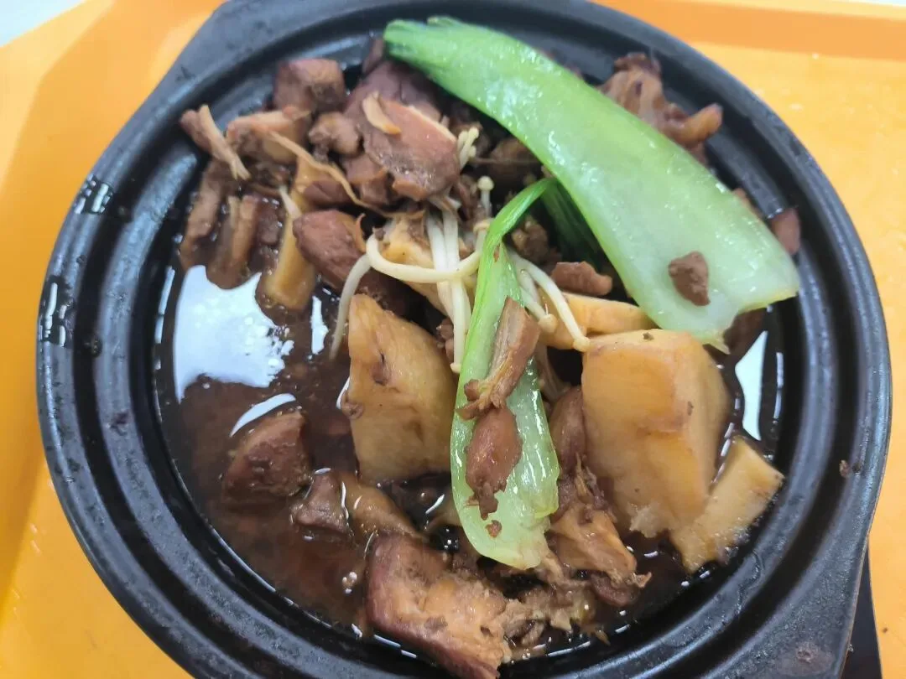

请相关部门及时关注并跟进问题。

## 1 运动会

“周六在校运动会做志愿者，想分享一些感想和思考，希望行政方面可以思考如何将运动会办的更好。

当天早上七点去签到的时候，看到了很多学院大费周章地走方队和喊口号，据我身边人所讲，很大一部分人是不情愿的或被拉去的，甚至还看到有人在某群付费找人代走方队，估计是因为某些原因不得不走。对于一个运动会来说，开幕式展示运动员风采风貌的用意无可厚非，但即使是奥运会也不会让各个国家代表团列队喊口号，这种规训意味很强的行为给大家带来很多不必要的麻烦，比如要六点就起床，要排练很多次，要换特定服装等等，而且也没有太多好处，很难说和运动会最重要的运动之间有什么关系。

第二点是，在志愿者工作中，发令枪在头一开始的几组一百米比赛一直都不响，导致参赛运动员准备了很多次都不能起跑，后面的长跑比赛，发令枪的声音也不是很大，让精神紧张的运动员很难听清楚。

所以我认为社科大投入的金钱在使用时可以改善，对于运动会来说，最重要的是运动本身，一块大屏幕并没有租用或者购买一套更好的电子发令计时设备更能提升赛事水平。不过总得来说运动会举办的比较成功，希望社科大之后能更好。”

## 2 校园基建

> “不太能理解学校为啥要在校园里用油漆铺环形跑道，搞得校园到处都是刺鼻的油漆味，况且跑道经过的位置都是车来人往的，适合跑步吗？如果有跑步需求，去运动场不就好了嘛。油漆不是非常污染环境吗？好像还要在小花园里铺，放过花花草草吧！ps.之前也没有征求过学生的意见，请问是哪家油漆生产厂家来学校解决生产过剩吗？”

“投稿：学校在路上刷一大圈油漆干什么啊，钱多了没地方花吗，今天又在宿舍楼旁边刷，好大的刺激味道，要被熏死了”

## “投稿：社，你自己说你丢不丢人。”

## 3 奖助补费

## “投稿，不知道研究生学业奖学金什么时候发。”

## 4 食堂

“吐槽风味食堂的黄焖鸡，原来那个窗口的黄焖鸡挺好吃的。现在面面俱到这个窗口黄焖鸡的鸡肉是卤出来的，根本不是黄焖的，请避雷，真的很难吃。”

